# 결재 흐름

구매 요청은 팀장 검토를 거쳐 금액에 따라 결재선이 갈린다. 반려되면 요청자가 보완해 다시 올린다. DIA_A01

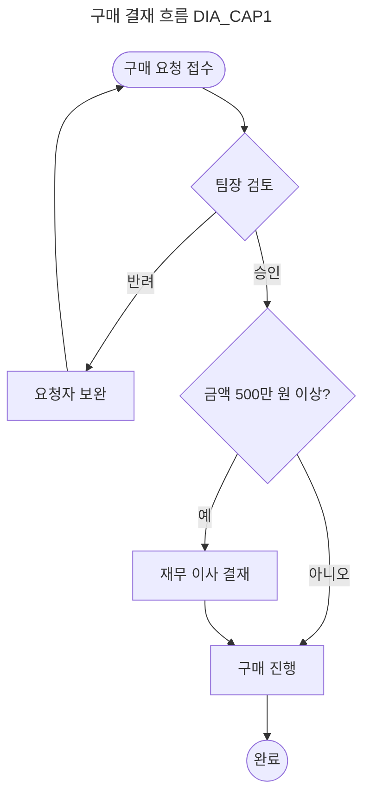

DIA_A02 위의 그림은 순환(반려 → 보완 → 접수)과 합류(두 결재선이 구매 진행으로)를 담는다.

## 시스템 구성

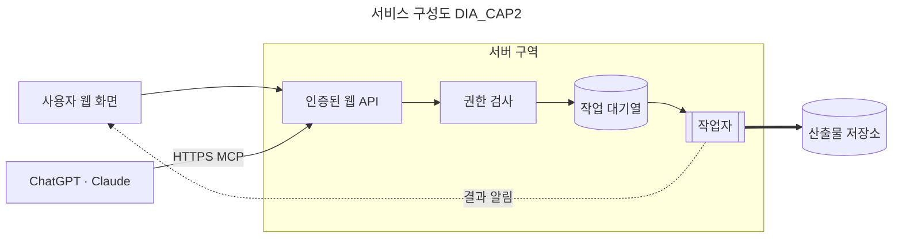

DIA_B01 묶음은 점선 없이 옅은 상자로, 상자 밖으로 나가는 화살표는 상자 테두리를 지난다.

## 분기 일정

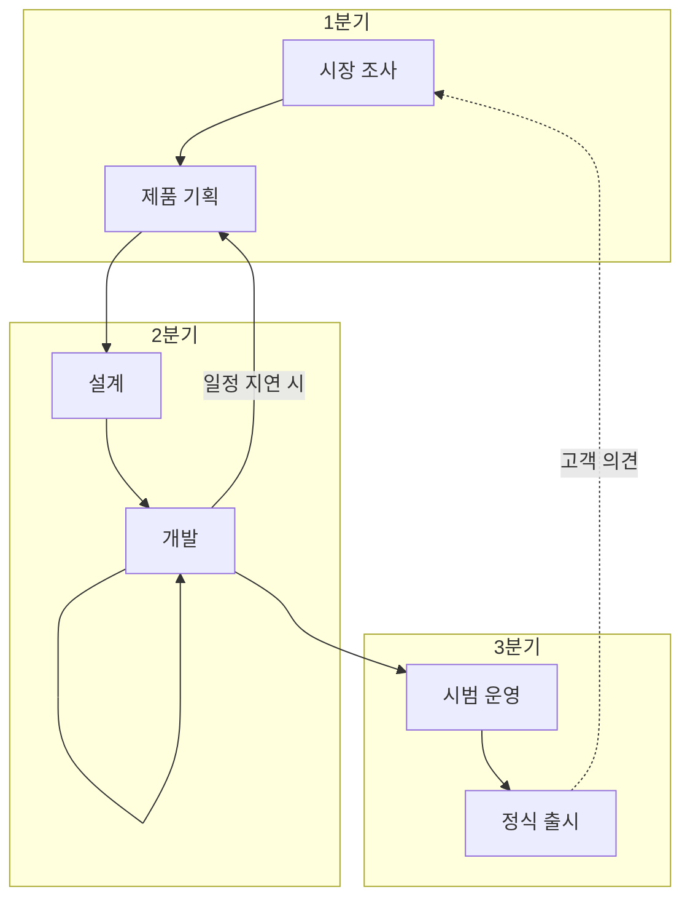

DIA_C01 자기 간선(개발 → 개발)은 노드 옆의 고리다.

# 모양과 화살표

| 표기 | 모양 | 표기 | 화살표 |
|---|---|---|---|
| `A[글]` | 사각형 | `-->` | 화살표 |
| `A(글)` | 둥근 사각형 | `---` | 선 |
| `A{글}` | 마름모(판단) | `-.->` | 점선 화살표 |
| `A[(글)]` | 원통(DB) | `==>` | 굵은 화살표 |

Table: 자주 쓰는 표기 DIA_T01

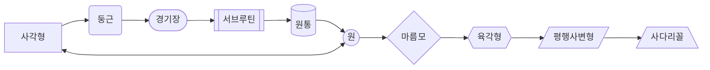

DIA_D01 위는 지원하는 모양 열 가지다.

## 아래에서 위로·오른쪽에서 왼쪽으로

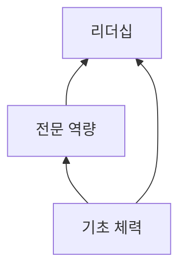

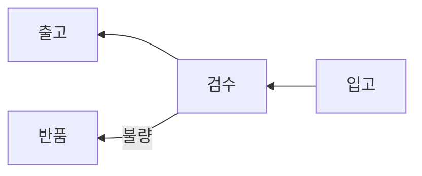

DIA_E01 방향 네 가지(TD·LR·BT·RL)를 모두 그린다.

# 그리지 않는 것

다른 그림 종류는 원문 코드 그대로 둔다(경고 하나). DIA_F01

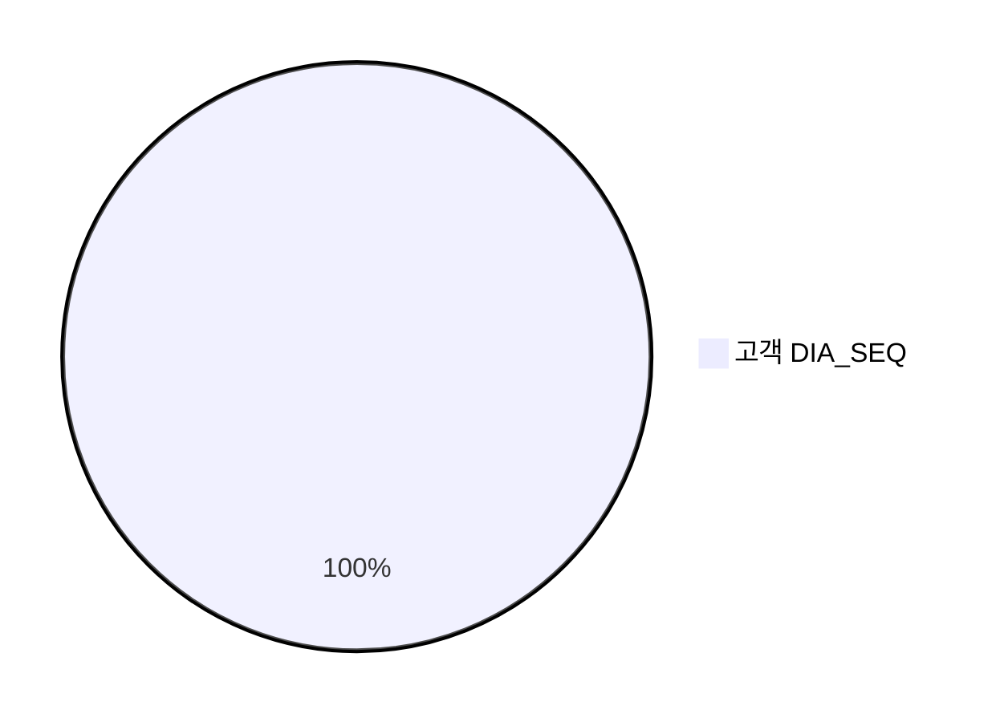

모양을 적는 줄은 쓰지 않고 그림은 그린다(경고). DIA_F02

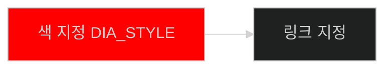

# 긴 흐름

쪽 끝에 걸치는 긴 그림은 나뉘지 않고 다음 쪽으로 넘어간다. DIA_G01

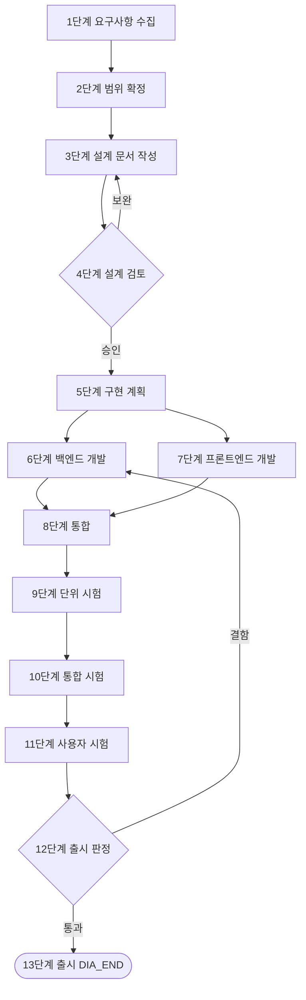

DIA_H01 문서 끝.

# 간트 차트

mermaid 간트 블록도 그림이 된다(#409 ①). 정상 견본 DIA_I01

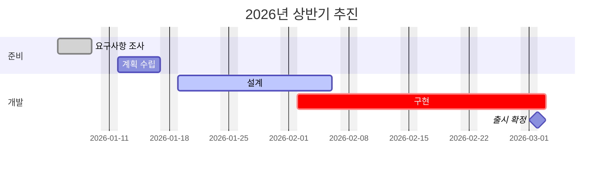

DIA_I02 모양을 적는 줄(todayMarker·topAxis)은 쓰지 않고 그림은 그린다(경고).

```mermaid
gantt
  dateFormat YYYY-MM-DD
  todayMarker stroke:red
  topAxis
  작업 하나 :2026-04-01, 10d
```

DIA_I03 vert 태그는 이 판이 그리지 않는다 — 원문 코드 블록 + 경고.

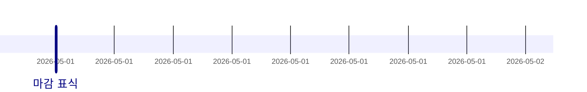

DIA_I04 월 단위 로드맵도 그린다.

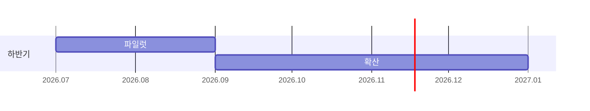

DIA_I05 문서 끝.

# 타임라인

mermaid 타임라인 블록도 그림이 된다(#409 ②). DIA_J01

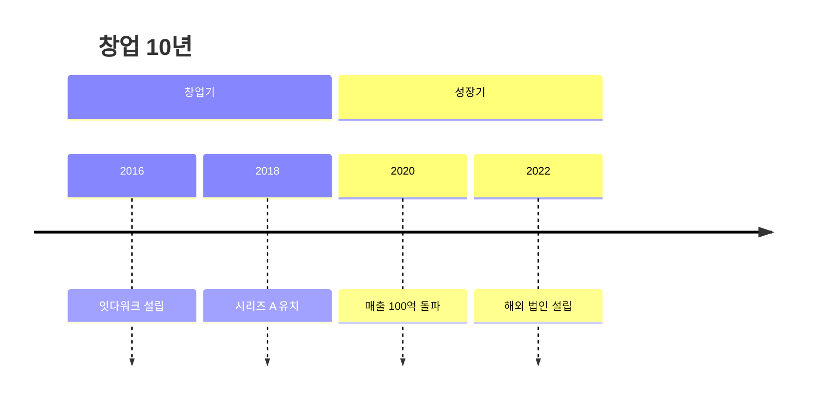

DIA_J02 구역(창업기·성장기)과 한 줄에 사건 하나, 캡션을 담는다.

## 사건 여럿과 이어 쓰기

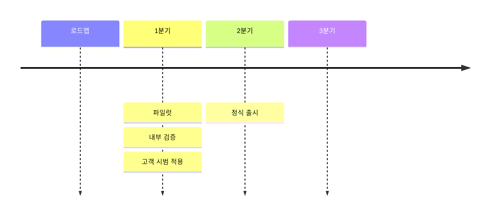

DIA_J03 한 줄에 사건 여럿(콜론 구분), 다음 줄 이어 쓰기, 사건 없는 시기(3분기)를 담는다.

# 순서도

mermaid 순서도(sequenceDiagram) 블록도 그림이 된다(#409 ③). DIA_K01

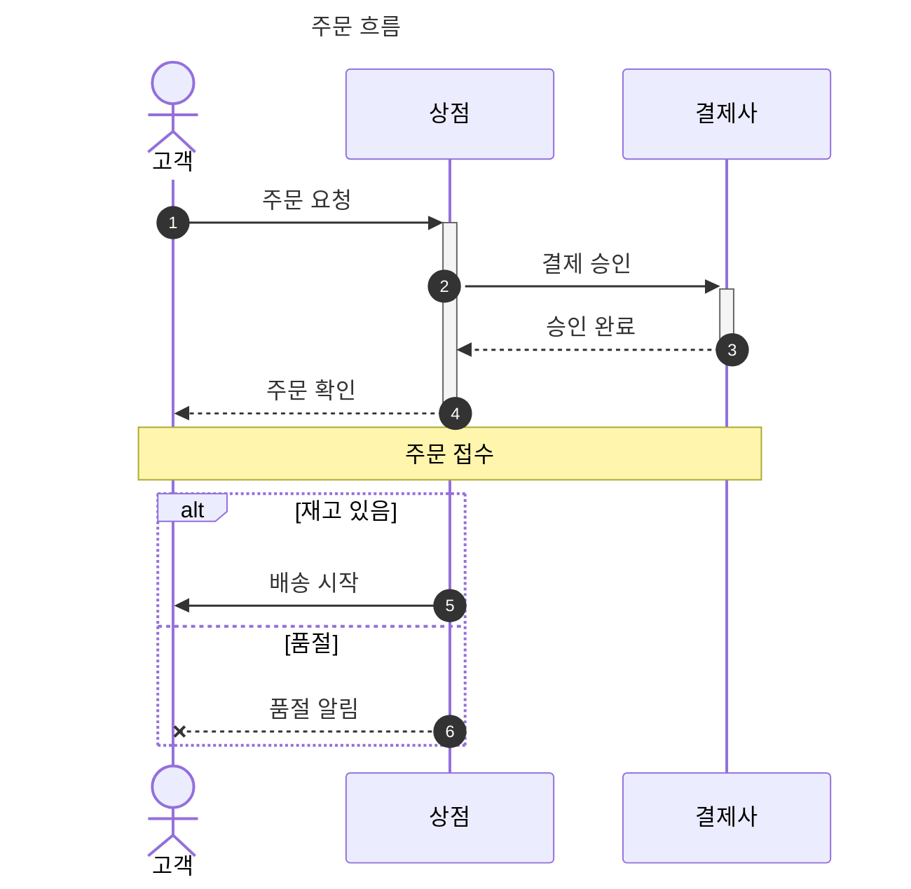

DIA_K02 사람 모양 참여자(actor)·활성 막대(+·-)·메모·alt/else 구획·자동 번호·캡션을 담는다.

## 묶음과 무리

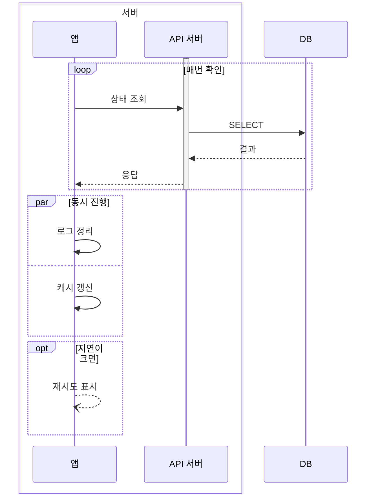

DIA_K03 무리(box) 띠·loop·par/and·opt·가는 화살촉(-))·activate/deactivate 문장을 담는다.

## 그리지 않는 것

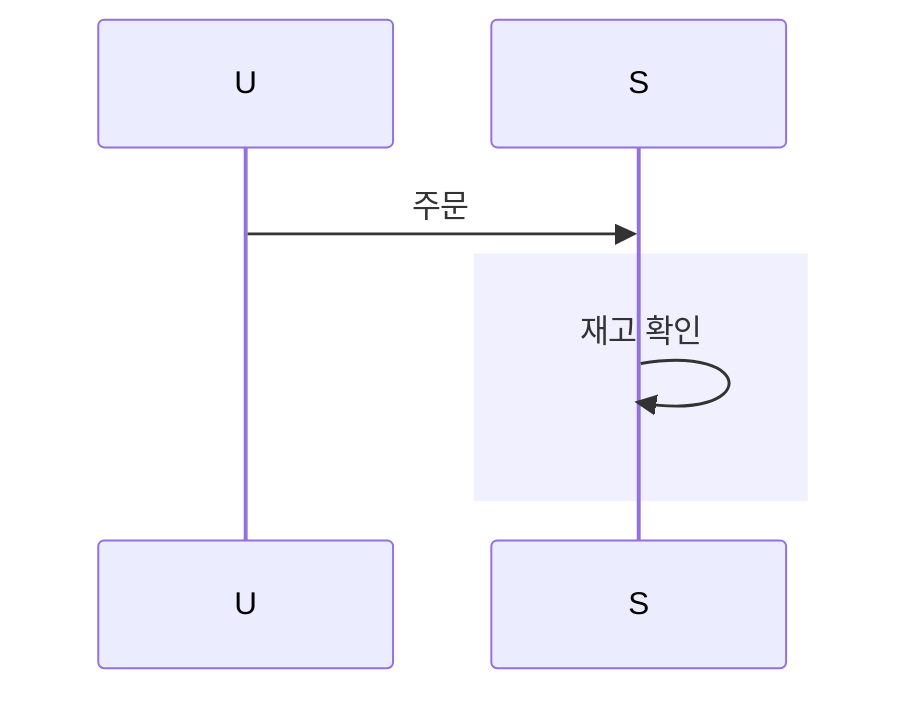

DIA_K04 링크 메뉴(link)와 rect 의 색은 쓰지 않고 그림은 그린다(경고 각 한 번).

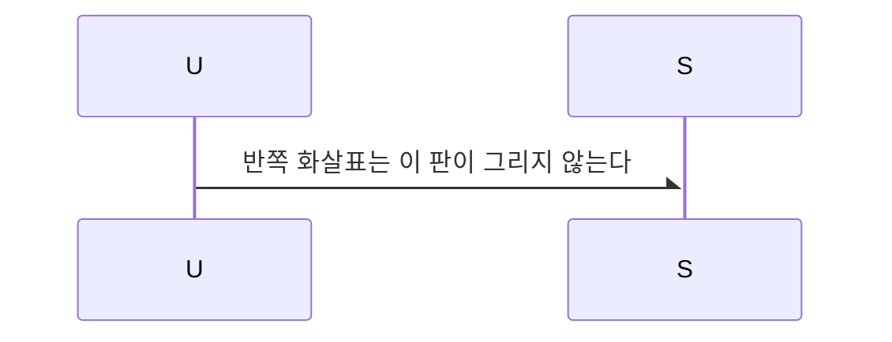

DIA_K05 반쪽 화살표는 원문 코드 블록 + 경고.

## ER 다이어그램

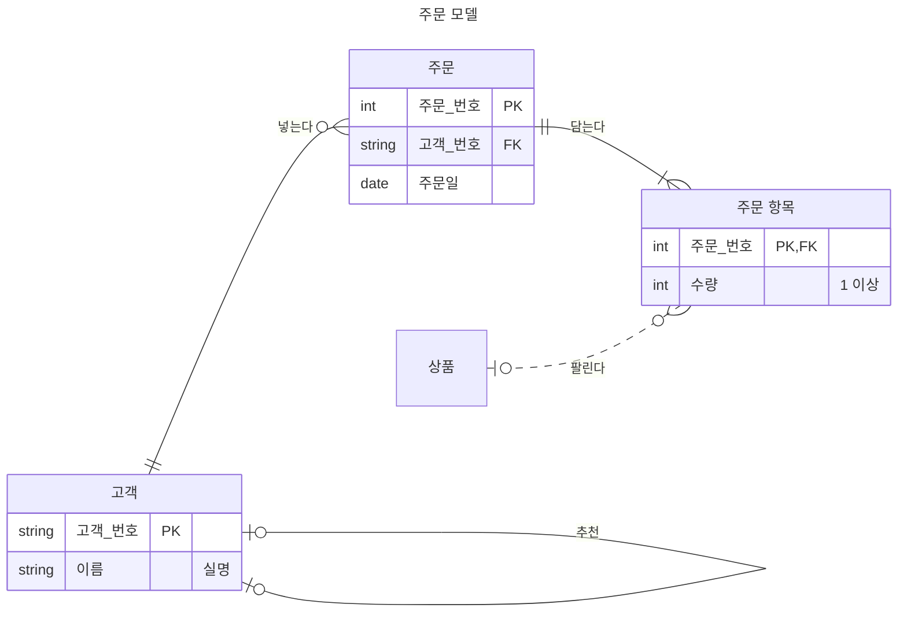

DIA_L01 엔티티 상자(머리 + 속성 표 — 타입·이름·키·설명)·까마귀발 기수 네 종·점선 비식별 관계·자기 관계·별칭을 담는다.

```mermaid
erDiagram
    A ||--o{ B : x
    classDef 강조 fill:#f9f
    A one or more B : y
```

DIA_L02 낱말 기수 줄 하나 때문에 그림 전체가 원문 코드 블록 + 경고 하나(그리지 않으니 classDef 경고는 따로 내지 않는다).

## 상태도

```mermaid
---
title: 주문 처리
---
stateDiagram-v2
    state 확인 <<choice>>
    [*] --> 접수
    접수 --> 확인 : 결제 요청
    확인 --> 취소 : 실패
    확인 --> 포장 : 성공
    state "배송 중" as 배송 {
        state 갈래 <<fork>>
        state 합류 <<join>>
        [*] --> 포장
        포장 --> 갈래
        갈래 --> 출고
        갈래 --> 안내
        출고 --> 합류
        안내 --> 합류
        합류 --> [*]
    }
    포장 : 상자에 담기
    포장 : 송장 붙이기
    합류 --> 완료
    완료 --> [*]
    취소 --> [*]
    classDef done fill:#eee
```

DIA_M01 시작·끝 원·선택 마름모·갈래·합류 막대·복합 상태(제목 칸)·전이 라벨·설명 둘(머리 + 구분선 + 설명)을 담는다. classDef 줄은 쓰지 않은 줄 경고 하나.

```mermaid
stateDiagram-v2
    A --> B
    note right of A : 메모
```

DIA_M02 메모 줄 하나 때문에 그림 전체가 원문 코드 블록 + 경고 하나.

## 클래스도

```mermaid
---
title: 주문 클래스
---
classDiagram-v2
    direction LR
    accTitle: 주문 모델
    class 고객 {
        +이름 String
        -전화$
        +주문하기(상품) 주문
    }
    class 결제수단 {
        <<interface>>
        +결제(금액) bool*
    }
    class 빈칸
    고객 "1" --> "*" 주문 : 주문한다
    주문 *-- 주문항목
    주문항목 o-- 상품
    결제수단 <|.. 카드결제
    주문 ..> 결제수단 : 사용
    주문 -- 주문 : 묶음
    주문 : +합계() decimal
    class 저장소~T~ {
        +찾기(키 List~K~) Map~K, T~
    }
    저장소~주문~ <-- 주문 : 보관
    classDef hot fill:#f9f
```

DIA_N01 이름 칸(주석 «interface» + 굵은 이름)·속성 칸·메서드 칸·빈 칸·가시성·정적 밑줄·추상 기울임·상속·실현·합성·집합·의존·자기 관계·양끝 수량 글·관계 라벨·제네릭(이름 `저장소<T>`·멤버 `List<K>`·`Map<K, T>`)을 담는다. classDef 줄은 쓰지 않은 줄 경고 하나.

```mermaid
classDiagram
    class 목록~T~
    목록 : +쌍 a~T~ b~U~
```

DIA_N02 받지 않는 제네릭(원본이 바깥 짝으로 묶는 형제 제네릭) 줄 하나 때문에 그림 전체가 원문 코드 블록 + 경고 하나. 문서 끝.
