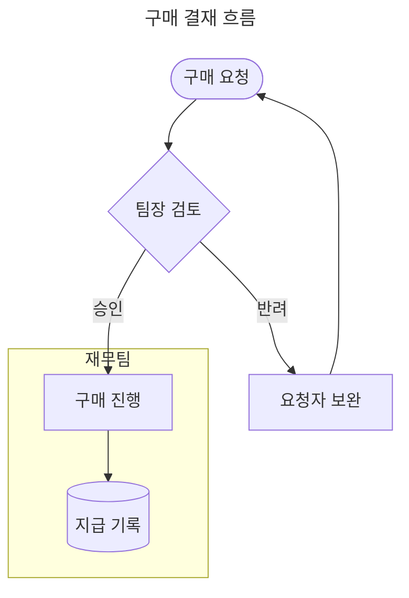
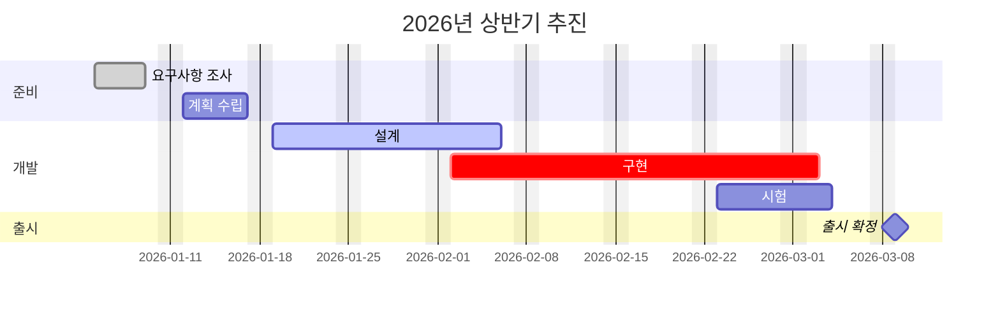
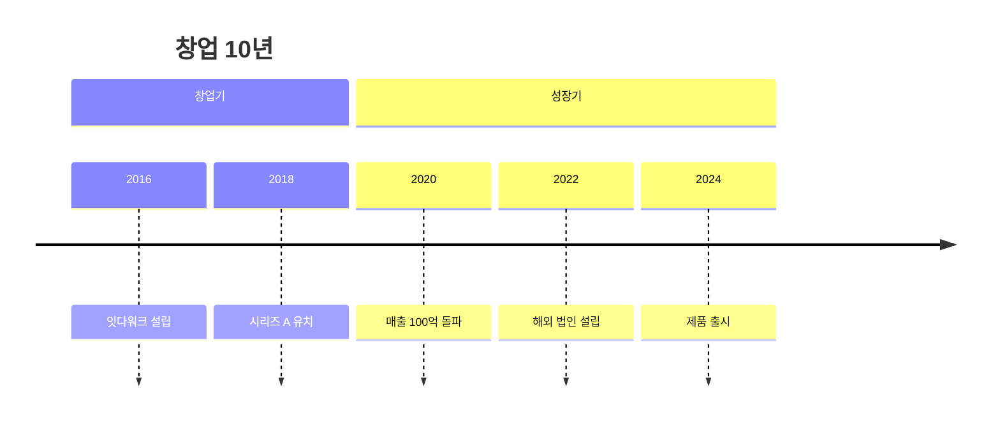
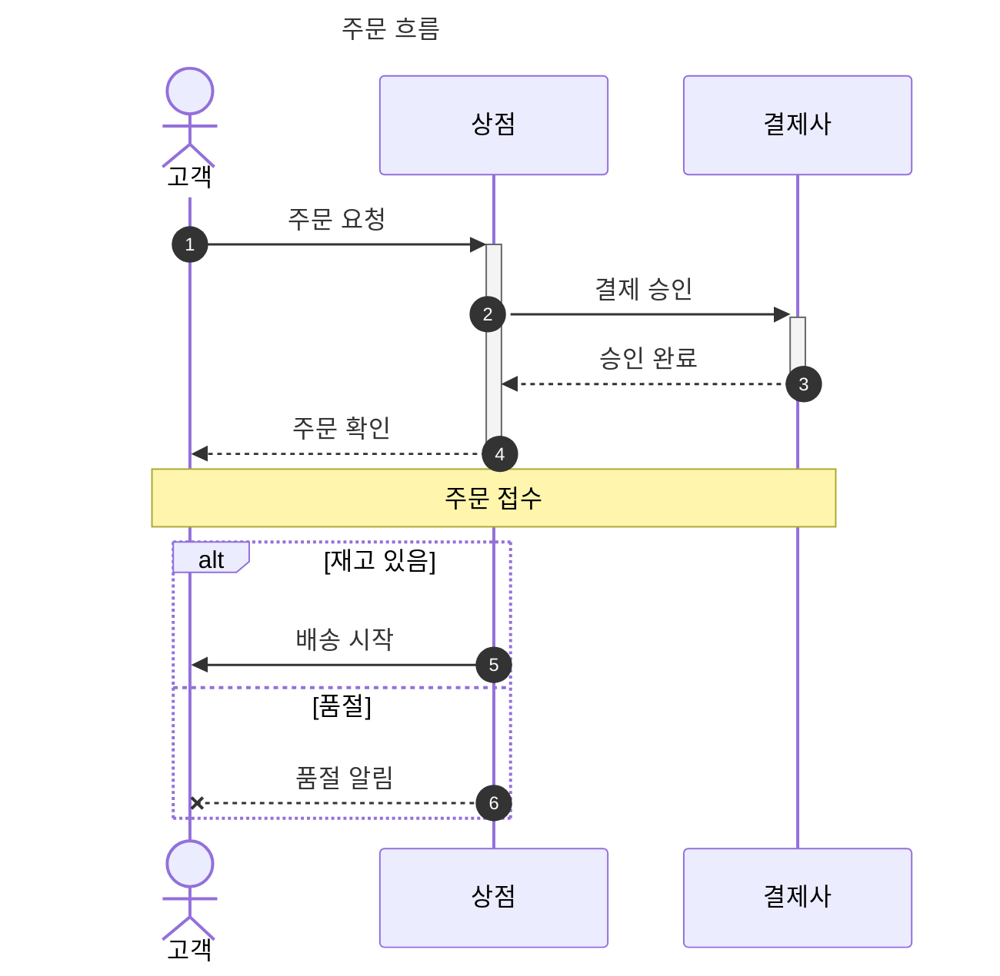
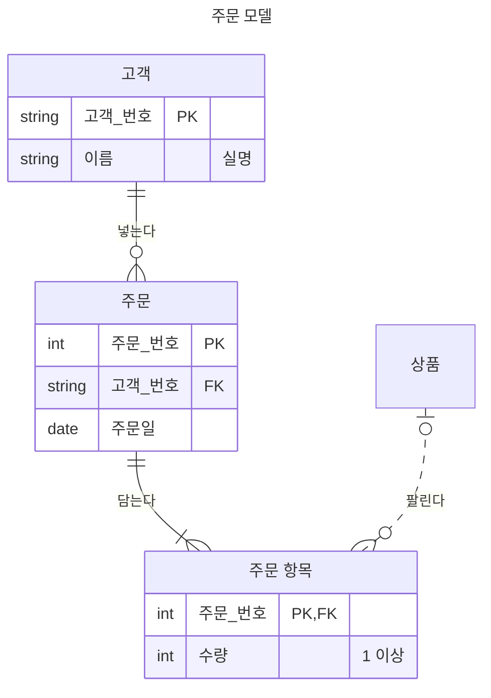
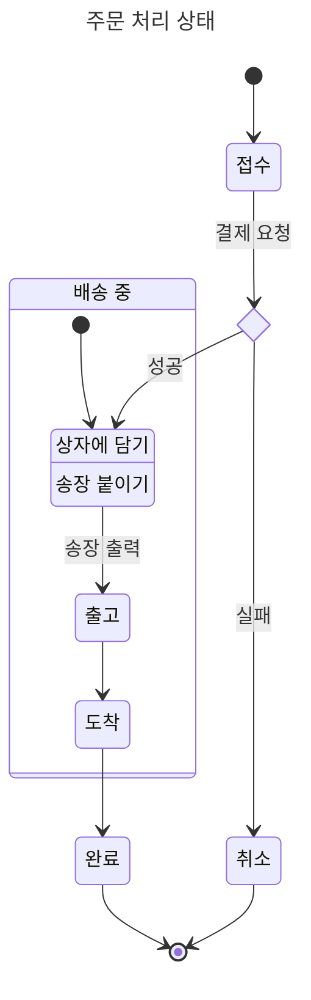
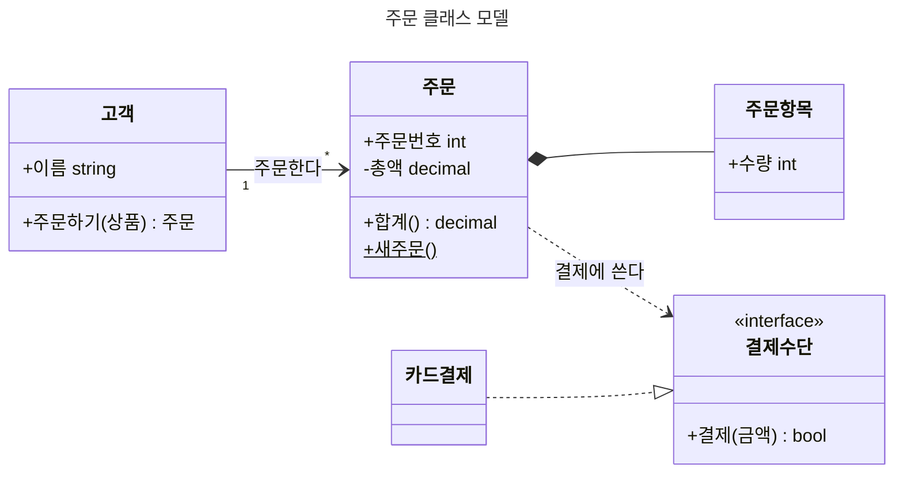

<!-- itda-hyve 마크다운 문법 · 주제 diagrams · 자동 생성(spec/diagrams.md) — 손으로 고치지 않는다. 장 번호("3장")는 이 주제 안의 번호다 -->

그림은 **[Mermaid](https://mermaid.js.org) 표기 그대로** 쓴다 — 이 판이 그리는 종류는 흐름도(flowchart, 1~7장)와 간트 차트(gantt, 8장), 타임라인(timeline, 9장), 순서도(sequenceDiagram, 10장), ER 다이어그램(erDiagram, 11장), 상태도(stateDiagram, 12장), 클래스도(classDiagram, 13장)이다.
문서 창이 앱 안에서(인터넷 없이, 스크립트 없이) SVG 로 그리고, 노드·화살표·작업 이름의 글자는 PDF 에서도 글자로 남아 선택·검색된다.
GitHub·VS Code·Obsidian 도 같은 코드 블록을 그림으로 그린다 — 다른 뷰어에서도 그림이 보인다. 이 판이 그리는 것은
**흐름도와 간트·타임라인·순서도·ER 다이어그램·상태도·클래스도**의 부분집합이다(2·3장·8\~13장). 그리지 못하는 그림은 원문 코드 블록 그대로 두고 줄 번호와 함께 경고한다 — 새 문법을 만들지 않는다.

## 1. 한눈에

````markdown

````

- 첫 줄은 `flowchart` 또는 `graph` 와 방향(`TD`·`TB` 위→아래, `BT` 아래→위, `LR` 왼쪽→오른쪽, `RL` 오른쪽→왼쪽). 방향을 빼면 위→아래다.
- 노드는 `이름[글]` 처럼 이름과 모양·글을 적는다. 이름만 적으면 이름이 글이다. 이름에는 한글을 써도 된다.
- 맨 앞의 `---` 사이에 `title:` 을 적으면 그림 캡션("그림 n. …")이 된다. 이 부분은 YAML 이다(Mermaid 와 같다) — 여러 줄은 `title: |`, `#` 이 든 제목은 따옴표로(`title: "결재 #3"` — 따옴표 없이 공백 뒤 `#` 은 주석). 읽을 수 없는 YAML·글이 아닌 `title` 은 그림을 그리지 않고 원문으로 둔다.
- 색·선·글꼴은 문서 테마가 정한다(4장). 문서에 색을 적는 줄은 쓰지 않는다.

`title` 표기와 캡션(YAML 규칙):

| `---` 안에 쓴 것 | 캡션 |
|---|---|
| `title: 구매 결재 흐름` | 구매 결재 흐름 |
| `title: '구매 결재'` | 구매 결재 |
| `title: "결재 #3"` | 결재 #3 |
| `title: 결재 # 메모` | 결재 |
| `title: \|` ↵ `  구매 결재 흐름` | 구매 결재 흐름 |
| `title: >` ↵ `  첫 줄` ↵ `  둘째 줄` | 첫 줄 둘째 줄 |
| `title: "비율 #35;"` | 비율 #35; |

캡션의 `#…;` 는 엔티티로 풀지 않고 글자 그대로다 — 원본 Mermaid 가 `---` 부분을 엔티티 전처리 전에 떼어 내기 때문이다(`#` 은 `#`
그대로 쓴다). 캡션은 `---` 부분을 YAML 로 읽은 값을 기준으로 처리한다 — YAML 의 여러 줄·이스케이프 규칙을 적용한 뒤 캡션의
공백·길이 규칙과 출력 검사를 거친다. 그 값의 안쪽 연속 빈칸·탭, 줄바꿈 밖의 제어 문자(U+0000~U+001F·U+007F), 특수 공백(NBSP 따위)은
그림을 그리지 않고 원문 + `title` 줄 번호 경고다(줄바꿈은 빈칸 하나가 된다). 이 규칙은 일곱 그림 종류(클래스도 포함)가 같다.
C1 제어 문자(U+0080~U+009F)가 든 입력의 수락 여부와 표시 형태는 호환성 보장 대상이 아니다 — 캡션·라벨·접근성 값 어디서든 일반 글자로
바꿔 쓴다.

## 2. 지원 문법

| 분류 | 표기 | 뜻 |
|---|---|---|
| 머리 줄 | `flowchart TD` `graph LR` `flowchart BT` `graph RL` | 그림 종류와 방향 |
| 모양 | `A[사각형]` `A(둥근 사각형)` `A([경기장])` `A[[서브루틴]]` `A[(원통)]` | |
| 모양 | `A((원))` `A{마름모}` `A{{육각형}}` `A[/평행사변형/]` `A[\평행사변형\]` | |
| 모양 | `A[/사다리꼴\]` `A[\거꾸로 사다리꼴/]` | |
| 글 | `A["괄호 [ ] ( ) 가 든 글"]` `A[첫 줄<br>둘째 줄]` `A["#quot;인용#quot; #35;"]` | 따옴표 글·줄바꿈·Mermaid 엔티티 |
| 화살표 | `A --> B` `A --- B` `A -.-> B` `A -.- B` `A ==> B` `A === B` | 화살표·선·점선·굵은 선 |
| 화살표 | `A <--> B` `A <-.-> B` `A <==> B` | 양쪽 화살촉 |
| 화살표 | `A ---> B` `A ----> B` | 길게(계층을 더 건넌다) |
| 화살표 | `A ~~~ B` | 보이지 않는 선(배치만) |
| 화살표 글 | `A -->\|예\| B` `A -- 예 --> B` `A -. 예 .-> B` `A == 예 ==> B` | |
| 잇기 | `A --> B --> C` `A & B --> C & D` | 이어 쓰기·여럿을 한 번에 |
| 묶음 | `subgraph id [제목]` … `end`, `subgraph 제목` … `end` | 노드는 처음 언급된 묶음에 든다 |
| 문장 | 줄바꿈 또는 `;` | |
| 주석 | `%% 메모` | 줄 전체(`accDescr { … }` 블록 안에서도 지운다 — 설명에 들어가지 않는다) |
| 캡션 | `---` `title: 제목` `---` | 맨 앞 |
| 접근성 | `accTitle: 이름` `accDescr: 설명` `accDescr { … }` | 화면 읽기 이름·설명 |

같은 이름의 노드를 다시 적으면 나중에 적은 모양·글이 이긴다(Mermaid 와 같다). 긴 글은 낱말 사이에서 줄을 바꾼다(약 12자).
화살표는 순환(되돌아가는 화살표)·자기 자신으로 가는 화살표(`A --> A`, 노드 옆 고리)도 그린다.

## 3. 그리지 않는 것

**모양을 문서에 적는 줄은 쓰지 않고 그림은 그린다**(종류마다 처음 나온 줄에 경고 하나 — `style` 이 열 줄이어도 하나, frontmatter 설정은 키마다):

| 표기 | 까닭 |
|---|---|
| `style A fill:#f00` `classDef` `class A x` `A:::x` `linkStyle` | 색·선은 테마가 정한다 |
| `%%{init: …}%%`, `---` 안의 `config:` 등 `title` 밖의 키 | 테마·글꼴 설정은 테마가 정한다(줄 전체가 닫힌 지시 하나일 때만 — 여러 줄 지시·같은 줄의 다른 글은 원문) |
| `click A "…"` `click A call f()` | 링크·스크립트를 내지 않는다(남이 보낸 문서일 수 있다) |
| `direction LR`(subgraph 안) | 그림 전체의 방향으로 그린다 |

**그리지 못하면 원문 코드 블록 그대로 둔다**(경고에 줄 번호와 까닭):

| 표기 | 비고 |
|---|---|
| `pie` `mindmap` … | 이 판이 그리지 않는 그림 종류(8\~13장의 종류는 그 장) |
| `subgraph` 안의 `subgraph` | 묶음 중첩 |
| `A --> 묶음id` | 묶음으로 잇는 화살표 |
| `A(((겹원)))` `A>깃발]` `A@{ shape: … }` | 다른 모양 문법 |
| ``A["`**마크다운**`"]`` | 마크다운 글 |
| `A --o B` `A --x B` | 끝이 원·가위표인 화살표 |
| `%%{init: {` | 여러 줄 설정 지시 |
| `%%{init: {}}%% A --> B %%{init: {}}%%` · `accTitle: 앞 %%{init: {}}%% 뒤` · `A[글 %%{init: {}}%%]` · `%% 메모 %%{init: {}}%%` | 설정 지시는 한 줄에 하나만 따로 — 지시 앞뒤·사이의 글, 접근성 값·노드 글·화살표 글·주석 안, `accDescr { … }` 안의 지시는 원문(원본은 지시만 지우고 남은 글을 읽는다 — 앞의 둘은 **원본은 그리지만 이 판은 원문**) |
| `%%`(글 없는 주석) | 원본 전처리가 주석으로 지우지 않는 줄 — 이 판은 그리지 않는다(`%% 메모` 처럼 뒤에 글을 둔다) |
| `A[#copy;]` · `A[x#160;y]` · `A[두  칸]` · `accTitle: a&b` | 12장 엔티티 표 밖의 엔티티·공백 엔티티, 라벨 안의 연속 빈칸·탭, 접근성 값의 맨 `&`·`<`·`>` — 아래 엔티티·공백 |
| `accTitle:` · `accDescr:` · `accDescr { 설명 } 뒤` | 빈 접근성 값, `accDescr { … }` 의 닫는 `}` 뒤의 글 — 접근성 값은 비우지 않고, `}` 는 줄 끝에 둔다 |
| `A["style x:#35;"];` · `A["classDef x:#35;"];` · `A --> B; classDef c fill:#f00;` | `style…:…#…;`·`classDef…:…#…;` 꼴이 든 줄 — 원본은 엔티티를 지키기 전에 줄의 마지막 `;` 를 지워 라벨 값이 이 판과 갈린다(**원본은 그리지만 이 판은 원문**). `style`·`classDef` 는 그 줄 하나로 따로 쓴다 |

**엔티티·공백**(12장과 같은 정책 — 원본과 다르게 정한 점): 라벨의 `#…;` 는 12장 엔티티 표의 것만 글자로 한 번 풀리고, 표 밖의
엔티티(`#copy;`·`#nbsp;`·`#160;`)나 라벨 안의 연속 빈칸·탭이 든 줄은 원문이다(원본은 `#copy;` 를 ©로 그리지만 이 판은 받지 않는다 —
©는 그대로 쓴다). 실제 특수 공백(NBSP·EM SPACE·폭 없는 빈칸 따위)이 든 줄도 원문이다 — 일반 빈칸으로 쓴다. 접근성 값(`accTitle`·`accDescr`)은 앞뒤 빈칸만 지우고 안쪽 빈칸·탭을 두며, 맨 `&`·`<`·`>` 는 원문이다
(`#amp;`·`#lt;`·`#gt;` 로 쓴다). `accDescr { … }` 는 줄바꿈을 지키고 닫는 `}` 는 줄 끝에 둔다. 흐름도 라벨의 맨 `#`·`;` 는 글자다(원본 라벨 글과 같다).

## 4. 테마 — 색과 글꼴

그림은 문서 글꼴로 그리고 색은 테마 토큰을 따른다. 기본값은 테마의 강조색에서 온다 — 테마를 바꾸면 그림도 바뀐다.
회사 테마는 아래 토큰을 바꿀 수 있다([테마 안내서](themes.md)의 토큰 표).

| 토큰 | 쓰는 곳 | 기본 |
|---|---|---|
| `--diagram-node-bg` | 노드 바탕 | `var(--accent-soft)` |
| `--diagram-node-border` | 노드 테두리 | `var(--accent)` |
| `--diagram-edge` | 화살표 선·화살촉 | `var(--muted)` |
| `--diagram-text` | 노드·화살표 글 | `var(--ink)` |
| `--diagram-muted` | 묶음 제목 | `var(--muted)` |
| `--diagram-label-bg` | 화살표 글 바탕 | `var(--paper)` |
| `--diagram-cluster-bg` | 묶음 바탕 | `var(--code-bg)` |
| `--diagram-cluster-border` | 묶음 테두리 | `var(--rule)` |
| `--diagram-grid` | 간트 눈금 격자선 | `var(--rule)` |
| `--diagram-exclude-bg` | 간트 제외 날짜 띠 | `var(--rule)` |
| `--diagram-bar-done` | 간트 `done` 막대 | `var(--muted)` |
| `--diagram-bar-active` | 간트 `active` 막대·마일스톤 | `var(--accent)` |
| `--diagram-bar-crit` | 간트 `crit` 막대·마일스톤 | `var(--alert-caution)` |
| `--diagram-bar-crit-border` | 간트 `crit` 테두리 | `var(--rule-strong)` |

간트 막대 안 작업 이름은 기본 막대 위에서 `--diagram-text`, `done`·`active`·`crit` 막대 위에서 `--chart-on`(기본 흰색)이다
(`web/base.css` 의 `.gt-tname.gt-in` 규칙). 진한 막대 토큰(`--diagram-bar-*`)을 밝게 바꾸는 테마는 `--chart-on` 도 함께 맞춘다.

타임라인(9장)의 색은 차트와 같은 팔레트(`--chart-1`…`--chart-8`)를 구역마다 순환해 쓴다(구역 없는 앞 시기는 모두 첫 색, 구역이
전혀 없는 그림은 시기마다 순환) — 진한 상자(구역
머리·시기) 위 글자는 `--chart-on` 이고 차트의 색 면 위 값 라벨과 같은 어두운 테두리 규칙을 공유해 옅은 팔레트 색 위에서도 읽힌다
(`base.css` 의 `.val.in`·`.tl-sec-t`·`.tl-per-t` 규칙). 사건 상자는 종이색 바탕 위에 같은 색을 옅게 깐다(`.tl-evn-bg`·`.tl-evn`) —
세로 점선은 상자 사이 빈 곳에서만 보인다. 테마가 팔레트를 바꾸면 타임라인도 따라간다.

순서도(10장)는 새 토큰 없이 위의 토큰만 쓴다 — 참여자 상자·활성 막대는 노드 토큰(`--diagram-node-bg`·`--diagram-node-border`),
묶음(loop·alt·…) 테두리와 rect 띠·box 띠·메모 상자는 묶음 토큰(`--diagram-cluster-bg`·`--diagram-cluster-border`), 화살표·생명선은
`--diagram-edge`·`--diagram-grid`, 메시지 글 바탕은 `--diagram-label-bg`(생명선이 글자를 가로지르지 않게)이다.

ER 다이어그램(11장)도 새 토큰 없이 위의 토큰만 쓴다 — 엔티티 상자 머리 칸 바탕·테두리는 노드 토큰(`--diagram-node-bg`·
`--diagram-node-border`), 속성 줄 번갈이 바탕은 `--diagram-label-bg`·`--diagram-cluster-bg`, 나눔 선은 `--diagram-node-border`(옅게),
관계 선·끝 기호는 `--diagram-edge`(동그라미 속은 `--diagram-label-bg`), 이름·속성 글자는 `--diagram-text`, 키·설명 글자는 `--diagram-muted`, 역할 글 바탕은 `--diagram-label-bg` 다(`base.css` 의 `.er-*` 규칙).

## 5. 상한

넘으면 그 그림을 그리지 않고 원문 그대로 둔다(경고). 그림 계산 시간은 이 상한 안에서 묶인다.

| 상한 | 값 |
|---|---|
| 그림 하나의 원문(바이트) | 16384 |
| 노드 수 | 150 |
| 화살표 수 | 300 |
| 묶음(subgraph) 수 | 30 |
| 라벨 하나의 글자 수 | 200 |
| 화살표 길이 | 4 |
| 문서 하나의 그림 수 | 50 |

화살표 길이(`----->` 처럼 더 긴 것)는 4 로 그린다. 노드·긴 화살표가 많아 배치가 너무 커지면("그림이 너무 큼") 그리지 않는다 —
그림을 둘로 나눈다. 문서 하나의 그림 글자 합이 4MB 를 넘어도 뒤의 그림은 원문으로 둔다.

간트 차트의 상한은 8장 표와 같다(원문 16KB·라벨 200자는 이 표와 공통).

## 6. 배치

배치는 자동이다(계층 배치): 화살표가 대체로 한 방향(위→아래 등)으로 흐르도록 노드를 계층에 놓고, 화살표가 덜 엇갈리게 순서를 고르며,
되돌아가는 화살표는 옆으로 돌아간다. 화살표 글은 화살표 가운데에 바탕과 함께 놓여 노드와 겹치지 않는다. 묶음 상자는 서로 겹치지 않는다.
Mermaid 의 배치(dagre)와 같은 방식이지만 좌표는 다르다 — 같은 원문이 GitHub 에서는 조금 다른 자리에 그려질 수 있다.

넓은 그림은 쪽 너비에 맞춰 줄어든다(글자도 작아진다). 노드가 한 줄에 많이 늘어서는 `LR` 그림은 `TD` 로 바꾸면 읽기 쉽다.

### 그림 자리 — 펜스 줄 `ratio`·`width`·`height`

여는 펜스 줄에 그림이 차지할 자리(상자)를 적는다(#475). 그림은 상자 안에 비율을 지켜 최대한 크게·가운데
그린다(글자도 그만큼 커지고, 상자보다 작은 그림도 상자에 맞춰 커진다) — 그림 안 배치가 다시 짜이는 것은
아니다. 다른 뷰어(GitHub 등)는 이 속성을 무시하고 그림을 그대로 그리므로 원문 호환은 지켜진다.

````markdown

````

값 규칙(크기 속성은 **따옴표 없는 꼴만** 받는다 — 공백으로 나뉜 낱말 전체가 아래 꼴이어야 한다. 따옴표가 든 크기 낱말(`ratio="16:9"`·`width=50%"junk"`)은 경고 후 무시한다. `title=` 파일명 표기와 함께 쓸 수 있고, 다른 속성의 따옴표 값 안(`title="보고서 width=50%.md"`)의 `width=…` 는 크기가 아니다. 따옴표가 닫히지 않으면 그 따옴표부터 줄 끝까지가 그 속성의 값이라, 뒤에 적은 크기 속성도 읽지 않는다):

- `ratio=W:H` — 상자의 가로:세로 비율. 정수 1\~99, 비율은 1/10\~10.
- `width=N%` — 그림이 **놓인 자리** 너비에 대한 백분율. 최상위 문단이면 본문 너비이고, 목록 항목·인용·다단 칸 안이면 그 칸 너비다. 정수 10\~100, `%` 필수.
- `height=N%` — **본문** 높이에 대한 백분율(제목 띠가 있는 슬라이드는 제목 아래 본문). 정수 10\~100, `%` 필수. 너비는 놓인 자리·높이는 본문으로 두 축의 기준이 다르다.
- 틀린 값은 그 펜스 줄 번호 경고를 남기고 그 값만 쓰지 않는다. 그림을 그리지 못해 코드 블록으로 남으면 속성도 쓰지 않는다.

| 쓴 것 | 상자 |
|---|---|
| (없음) | 문서: 그림 제 크기(본문 너비를 넘으면 줄어든다) / 슬라이드: 너비를 채운다 — 지금과 같다 |
| `ratio=16:9` | 너비 100%, 높이 = 너비 ÷ 비율 |
| `width=50%` | 너비 50%, 높이는 그림 제 비율 |
| `height=60%` | 높이 60%, 너비 100% |
| `ratio=4:3 width=50%` | 너비 50%, 높이 = 너비 ÷ 비율 |
| `ratio=16:9 height=60%` | 높이 60%, 너비 = 높이 × 비율. 놓인 자리 너비를 넘으면 너비를 채우고 높이를 비율대로 줄인다 |
| `width=50% height=60%` | 너비 50%·높이 60% 그대로 |
| `ratio=16:9 width=50% height=60%` (셋 다) | `ratio` 를 쓰지 않는다(경고 한 번) — `width`·`height` 상자 그대로 |

- 상자는 가운데 정렬이고 문서(쪽)·슬라이드·발표·PDF·공유 보기가 같은 규칙이다. 캡션(`title:`)은 상자 아래에 온다.
- 높이가 정해지는 조합(위 표에서 `ratio` 또는 `height` 가 들어간 모든 줄)은 본문 높이에서 캡션 자리(60px)를 뺀 상한을 넘지 못한다 — `height=100%` 도 실제로는 그 상한까지다. `width` 만 쓴 그림은 이 상한 대신 원래 그림 높이 상한을 그대로 쓴다. 캡션이 그 60px 자리보다 길어 상자와 캡션을 합친 그림이 한 쪽에 못 들어가면, 상자를 더 줄여 캡션과 함께 한 쪽에 통째로 넣는다(`web/pager.js` `forceFit`) — 캡션 자체가 한 쪽보다 길면 줄여도 못 맞춰 캡션이 다음 쪽으로 넘어간다.
- 상자 높이가 정해진 그림도 쪽에서 나뉘지 않고 한 쪽 안에 통째로 들어간다.
- 이어보기(쪽 없는 보기)에서는 본문 높이가 없어 높이 백분율을 200mm 기본값 기준으로 잡는다(`web/pager.js` `sizeDiagrams`). 발표자 노트 칸의 그림에도 속성은 렌더되지만 노트 칸 표시에는 적용하지 않는다(기본 모양으로 그려진다).

## 7. 인쇄·PDF·발표

- 그림은 쪽에 걸쳐 나뉘지 않는다 — 남은 자리에 들어가지 않으면 다음 쪽으로 넘어간다. 한 쪽보다 큰 그림은 한 쪽에 맞게 줄인다.
- PDF 에서 노드·화살표·묶음 제목 글자를 선택·복사·검색할 수 있다(문서 글꼴이 임베드된다).
- 발표(슬라이드)에서는 그림이 자리를 채우도록 커진다(높이는 슬라이드 본문까지). 펜스 줄 속성으로 자리를 정했으면 그 상자를 채운다(6장).

## 8. 간트 차트(gantt)

첫 줄이 `gantt` 인 블록은 간트 차트가 된다 — 추진 일정·로드맵을 시간 축과 작업 행으로 그린다(#409 ①).

````markdown

````

- `title` 줄은 그림 안 위쪽 제목이고, 맨 앞 `---` 사이의 `title:` 은 그림 캡션("그림 n. …")이다(1장 과 같은 YAML 규칙).
- 설정 줄(`dateFormat` `axisFormat` `tickInterval` `excludes` `inclusiveEndDates`)은 그림 어디에 있어도 그림 전체에 적용된다(Mermaid 와 같다) — 작업 뒤에 와도 앞 작업의 날짜 계산에 쓴다.
- 작업은 `이름 : 값, 값, 값` 이다. 쉼표로 나눈 값에서 태그(`done`·`active`·`crit`·`milestone`)를 앞에서부터 뗀 나머지 개수로 읽는다(Mermaid 와 같게):
  **1개 = 끝**(시작은 바로 앞 작업의 끝 — 첫 작업이면 원문 + 줄 번호 경고), **2개 = 시작·끝**, **3개 = 작업 id·시작·끝**(id 는 `after`·`until` 로 참조한다).
- 제외 날짜(`excludes`)는 기간에서 빼고 그만큼 끝을 오른쪽으로 민다(막대에 구멍이 생기지 않는다) — Mermaid 와 같다. 제외 날짜는 옅은 세로 띠로 표시된다.
- 오늘 선(`todayMarker`)은 그리지 않는다 — 기록 문서의 그림이 오늘 날짜에 달라지지 않게(값이 `off` 이면 경고도 없다).
- 날짜 꼴(`YYYY-MM-DD`)만 적고 기간이 시간 단위(`3h`·`30m`)면 눈금이 거의 없다(시 눈금 칸은 꼴에 시가 있을 때만 쓴다) — `axisFormat %H` 를 쓴다.

지원 문법:

| 분류 | 표기 | 뜻 |
|---|---|---|
| 머리 줄 | `gantt` | |
| 제목 | `title 간트 제목` | 그림 안 위쪽 제목(Mermaid 와 같게). frontmatter `title` 은 캡션(1장 과 같은 YAML 규칙 — 깨진 YAML·글 아닌 title 은 원문) |
| 날짜 꼴 | `dateFormat YYYY-MM-DD`(기본) `dateFormat YYYY-MM-DD HH:mm` `dateFormat YYYY/MM/DD` `dateFormat YYYY.MM.DD` `dateFormat YYYY-MM` `dateFormat YYYY` | 작업 날짜를 읽는 꼴 — 토큰 `YYYY` `MM` `DD` `HH` `mm` 과 구분자 `-` `/` `.` 공백 `:` |
| 축 라벨 꼴 | `axisFormat %Y-%m-%d`(기본) — 지시자 `%Y` `%y` `%m` `%d` `%e` `%H` `%M` 과 글자(`%m월` `%d일` 같은 한글 포함) | 다른 `%` 지시자는 이 판이 그리지 않는다 |
| 눈금 | `tickInterval 1day` `tickInterval 2week` `tickInterval 1month` | 수는 1\~1000. 없으면 d3(Mermaid 가 쓰는 눈금) 기반 간격 사다리에 2주 칸을 더한 것 — 1·5·15·30분(`dateFormat`·`axisFormat` 에 분이 있을 때)·1·3·6·12시간(시나 분이 있을 때)·1·2일·1·2주·1·3개월·1·2·5·10·20·50·100년 — 에서 목표 눈금 수(축 폭 ÷ 라벨 폭)에 가장 가까운 간격을 고르고, 라벨이 겹치면 다음 칸으로 간다. 눈금은 모든 작업 가운데 가장 이른 시작을 간격의 달력 경계로 올린 시각부터 가장 늦은 끝까지(행 차례와 무관), 격자선마다 라벨이 있다. 주는 일요일에 선다. `tickInterval` 의 눈금이 400개를 넘거나 라벨이 겹치면 경고하고 자동 눈금으로 그린다. 사다리의 마지막 칸(100년)까지 라벨이 겹치면 그리지 않는다(미지원 표) |
| 구역 | `section 구역 이름` | 띠. 구역 앞의 작업은 구역 없는 띠 |
| 작업 | `준비 :a1, 2026-01-01, 5d` `준비 :2026-01-01, 5d` `준비 :5d` | 값(태그를 뺀)의 개수로 읽는다 — 3개 = id·시작·끝, 2개 = 시작·끝, 1개 = 끝(시작은 바로 앞 작업의 끝) |
| 태그 | `done` `active` `crit` `milestone` | 색·꼴은 토큰(4장). `milestone` 은 마름모 — 시작과 끝의 가운데 |
| 시작 | `2026-01-05` `after a1` `after a1 a2` | 날짜(dateFormat 꼴), 앞에 정의한 작업 id 의 가장 늦은 끝 |
| 끝 | `2026-01-10` `5d` `1w` `1M` `1y` `2h` `30m` `10s` `500ms` `until a1` | 날짜, 기간(정수 + 단위), 앞에 정의한 작업 id 의 가장 이른 시작 |
| 제외 | `excludes weekends` `excludes 2026-01-06, 2026-01-07` `excludes monday, friday` | 기간 계산에서 빼고(Mermaid 와 같게) 옅은 세로 띠로 그린다. 여러 `excludes` 줄은 합쳐진다 |
| 끝 포함 | `inclusiveEndDates` | 끝 날짜를 dateFormat 의 최소 단위만큼 포함(일 꼴이면 하루, 월 꼴이면 한 달) |
| 주석·접근성 | `%% 메모` `accTitle: 그림 이름` `accDescr: 설명` `accDescr { … }` | 흐름도와 같다. 다만 블록 밖의 글 없는 맨 `%%` 도 주석이다(원본 lexer 가 건너뛴다) |

모양을 문서에 적는 줄은 쓰지 않고 그림은 그린다(종류마다 처음 나온 줄에 경고 하나):

| 표기 | 까닭 |
|---|---|
| `todayMarker off` | 오늘 선을 그리지 않는다(경고 없음) |
| `todayMarker stroke:red` `topAxis` `weekday monday` `click a1 "https://…"` `%%{init: …}%%` | 눈금은 아래에, 주는 일요일에, 링크·스크립트·테마 설정은 내지 않는다(설정 지시는 줄 전체가 닫힌 지시 하나일 때만 — 여러 줄 지시·같은 줄의 다른 글은 원문) |
| `---` 안의 `config:` 등 `title` 밖의 키 | 테마·글꼴 설정은 테마가 정한다 |

그리지 못하면 원문 코드 블록 그대로 둔다(경고에 줄 번호와 까닭):

| 표기 | 비고 |
|---|---|
| `vert` 태그(`준비 :vert, 2026-01-01, 1d`) | 세로 표식 |
| `includes weekends` | 제외 되돌리기 |
| `weekend friday` | 주말 시작 요일 바꾸기 — 주말은 토·일로 그린다 |
| `2026/01/01` · `2026-+1-01` | dateFormat 과 맞지 않는 날짜(Mermaid 는 물러서지만 이 판은 그리지 않는다) — 자릿수는 숫자만, 달 1\~12·일 1\~31·시 0\~23·분 0\~59, 같은 토큰 두 번인 꼴도 |
| `dateFormat YYYY-MM-DD HH:mm` 에서 `excludes 2026-01-06` | 시각이 있는 꼴의 날짜 제외(Mermaid 는 그 시각 문자열만 맞춘다) — `weekends`·요일 이름 제외는 그린다 |
| `excludes 공휴일` `excludes ,` | weekends·요일 이름·dateFormat 꼴 날짜가 아닌 낱말·쉼표만 있는 값 — 모르는 값을 조용히 넘기지 않는다(Mermaid 는 날짜 문자열로 넣어 아무 효과가 없다) |
| `axisFormat %a` | `%a` `%b` `%B` `%j` `%U` … 영문 요일·월 이름 지시자 |
| `axisFormat %m#%d` · `axisFormat %m;%d` · `axisFormat %m#35;%d` | `axisFormat` 값의 `#`·`;` — 원본은 그 글자에서 값을 끊거나 엔티티로 푼다 |
| `after x9` `until x9` | 모르는 작업 id(뒤에 정의된 id 도 안 된다) |
| `dateFormat YYYY-MM-DD` 줄이 둘 | 같은 설정 줄이 둘 이상(`axisFormat` `tickInterval` 도) — 설정 줄은 그림 전체에 한 번 |
| 같은 id 두 번 · 끝이 시작보다 앞 · 기간이 정수가 아님(`1.5d`) · 기간이 100년을 넘음(`5124096h`) · `tickInterval 1001day` | 기간·눈금 수는 계산 전에 상한을 본다 |
| `준비 :5d` | 첫 작업의 값이 끝 하나뿐(시작을 알 수 없음) |
| 날짜 범위 100년 초과 · 상한 초과 | 8장 상한 표 |
| 축 라벨이 겹침 | 사다리의 마지막 칸(100년)까지 눈금 라벨이 겹친다(`axisFormat` 의 글자가 길다) — `axisFormat` 을 줄인다. 경고 줄은 `axisFormat` 줄(없으면 `gantt` 줄) |
| `%%{init: {` | 여러 줄 설정 지시 |
| `%%{init: {}}%% 작업 :2026-01-01, 1d %%{init: {}}%%` · `accTitle: 앞 %%{init: {}}%% 뒤` · `작업 %%{init: {}}%% :2026-01-01, 1d` · `%% 메모 %%{init: {}}%%` | 설정 지시는 한 줄에 하나만 따로 — 지시 앞뒤·사이의 글, 접근성 값·작업 이름·제목·주석 안, `accDescr { … }` 안의 지시는 원문(원본은 지시만 지우고 남은 글을 읽는다 — 앞의 둘은 **원본은 그리지만 이 판은 원문**) |
| `accDescr {` ↵ `%%` ↵ `}`(블록 안의 글 없는 주석) | 원본은 설명 글로 넣는 줄 — 이 판은 그리지 않는다(`%% 메모` 처럼 뒤에 글을 둔다. 블록 밖의 맨 `%%` 는 주석) |
| 알 수 없는 문장 | |
| `준비 #copy; :2026-01-01, 1d` · `두  칸 :2026-01-01, 1d` · `accTitle: a&b` | 12장 엔티티 표 밖의 엔티티, 라벨 안의 연속 빈칸·탭, 접근성 값의 맨 `&`·`<`·`>` — 아래 엔티티·공백 |
| `accTitle:` · `accDescr:` · `accDescr { 설명 } 뒤` | 빈 접근성 값, `accDescr { … }` 의 닫는 `}` 뒤의 글 — 접근성 값은 비우지 않고, `}` 는 줄 끝에 둔다 |

**엔티티·공백**(12장과 같은 정책 — 원본과 다르게 정한 점): 라벨의 `#…;` 는 12장 엔티티 표의 것만 글자로 한 번 풀리고, 표 밖의
엔티티(`#copy;`·`#nbsp;`·`#160;`)나 라벨 안의 연속 빈칸·탭이 든 줄은 원문이다(원본은 `#copy;` 를 ©로 그리지만 이 판은 받지 않는다 —
©는 그대로 쓴다). 실제 특수 공백(NBSP·EM SPACE·폭 없는 빈칸 따위)이 든 줄도 원문이다 — 일반 빈칸으로 쓴다. 접근성 값(`accTitle`·`accDescr`)은 앞뒤 빈칸만 지우고 안쪽 빈칸·탭을 두며, 맨 `&`·`<`·`>` 는 원문이다
(`#amp;`·`#lt;`·`#gt;` 로 쓴다). `accDescr { … }` 는 줄바꿈을 지키고 닫는 `}` 는 줄 끝에 둔다. 간트 라벨(작업·`section`·`title`)은 한 줄이라 `<br>` 은 빈칸 하나다. 작업 줄의 엔티티는 작업 이름 안에만 쓴다 — 콜론 뒤의 `#…;` 와 `style…:…#…;` 꼴이 든 작업 줄은 원문이다(원본은 줄 전체를 전처리해 뜻이 갈린다). `axisFormat` 값에 `#`·`;` 가 있으면(엔티티 꼴 `#35;` 도)
원문 + 그 줄 경고다 — 원본은 그 글자에서 값을 끊거나 엔티티로 풀어 이 판과 뜻이 갈린다.

배치·모양: 구역 이름은 왼쪽 열(가로 글자), 시간 영역은 아래 축(눈금·라벨·옅은 세로 격자선)과 구역마다 번갈이 띠다.
작업 이름은 막대 폭에 들어가면 막대 안, 아니면 막대 오른쪽(Mermaid 와 같게). 마일스톤은 마름모다.
긴 이름은 낱말 사이에서(낱말이 길면 글자에서) 줄을 바꾸고, 행·구역 높이가 줄 수만큼 늘어난다. 제외 날짜 띠는 그날 0시부터 다음 날 0시까지다.
색은 4장 토큰 표(`--diagram-bar-*`)다.

상한:

| 상한 | 값 |
|---|---|
| 작업 수 | 150 |
| 구역 수 | 30 |
| 날짜 범위(년) | 100 |
| 눈금 수 | 400 |

원문 16KB·라벨 200자·문서 하나의 그림 수는 5장 상한 표와 같다.

## 9. 타임라인(timeline)

첫 줄이 `timeline` 인 블록은 타임라인이 된다 — 연혁·로드맵을 가로 시기 열과 사건 상자로 그린다(#409 ②).

````markdown

````

- `title` 줄은 그림 안 위쪽 제목이고, 맨 앞 `---` 사이의 `title:` 은 그림 캡션("그림 n. …")이다(1장 과 같은 YAML 규칙). 제목이 시기보다 길면 그 폭까지 그림이 넓어진다(간트와 같다).
- 지시자(`title`·`section`·`accTitle`·`accDescr`)와 머리 `timeline` 은 대소문자를 가리지 않는다(원본과 같다).
- 시기와 사건은 `시기 : 사건` 이다 — 한 줄에 사건 여럿은 `시기 : 사건1 : 사건2`, 다음 줄의 `: 사건` 은 바로 앞 시기에 사건을 더한다.
  **콜론 뒤에는 공백**을 하나 둔다(`시기:사건` 처럼 붙이면 읽지 못 한다 — 원본 Mermaid 도 같다). 사건 안의 `10:30 회의` 처럼 공백 없는 콜론은 글자다.
- **시기 이름의 맨 `#` 은 쓰지 못 한다** — 원본 Mermaid 는 파싱 전에 엔티티(`#35;` 꼴)를 먼저 지켜 주고, 시기 토큰에서 만난 남은 `#` 부터 줄 끝까지를 주석으로 버린다. 이 판도 같은 순서다: 시기 이름의 엔티티는 쓸 수 있고(예 `단계 #35;1` → 「단계 #1」), 엔티티가 아닌 `#` 이 있으면 그림을 그리지 않고 원문 + 줄 번호 경고를 낸다. 사건 안의 `#` 은 원본이 허용하므로 글자로 쓸 수 있다.
- 콜론이 없는 줄은 시기 이름이다(원본과 같다) — `timeline` 블록에 다른 종류의 지시자(`dateFormat` 등)를 써도 시기로 읽힌다. timeline 문법에는 `click`·`style`·`classDef` 문장이 없어(원본도 마찬가지) 이런 줄도 원본처럼 시기 이름으로 읽는다 — #409 공통 규칙의 「무시하고 그림」은 그 문장이 문법에 있는 종류에 적용된다.
- `<br>` 은 상자 안 줄바꿈이다. 긴 글은 상자 폭에서 줄을 바꿔 상자 높이가 는다(시기 행의 상자끼리는 높이를 맞춘다).
- 구역(`section`)이 있으면 시기들 위에 구역 머리 상자가 그 구역 시기들의 폭만큼 걸친다. 구역 없는 앞 시기도 그린다(구역 머리 없이).

지원 문법:

| 분류 | 표기 | 뜻 |
|---|---|---|
| 머리 줄 | `timeline` `timeline LR` | 가로 방향(기본). 머리·지시자는 모두 대소문자를 가리지 않는다(원본과 같다) |
| 제목 | `title 타임라인 제목` | 그림 안 위쪽 제목(Mermaid 와 같게 — 한 줄). frontmatter `title` 은 캡션(1장 과 같은 YAML 규칙) |
| 구역 | `section 구역 이름` | 뒤따르는 시기를 묶는 머리 상자. 구역 앞의 시기는 구역 없는 시기 |
| 시기 | `2026 : 사건` `2026 : 사건1 : 사건2` `2026` | 시기 하나와 사건 0개 이상 — 사건 없는 줄(시기만)도 시기다 |
| 사건 이어 쓰기 | `: 사건`(다음 줄) | 바로 앞 시기에 사건을 더한다(구역이 바뀌었어도 마지막 시기 — Mermaid 와 같다) |
| 라벨 안의 `#` | `단계 #35;1`(시기) `메모 #1` `비율 #35;`(사건) | 엔티티 `#…;` 는 시기·사건 어디서나 글자로 풀린다(원본 전처리가 지켜 준다). 맨 `#` 은 사건에서만 글자(시기는 미지원 표) |
| 줄바꿈 | `첫째 줄<br>둘째 줄` | 상자 안 줄바꿈(`<br/>`·`<br />` 도 같다). 다른 HTML 은 글자 그대로(실행하지 않는다) |
| 주석·접근성 | `%% 메모` `accTitle: 그림 이름` `accDescr: 설명` `accDescr { … }` | 흐름도와 같다. 다만 블록 밖의 글 없는 맨 `%%` 도 주석이다(원본 lexer 가 건너뛴다). 선언이 여럿이면 마지막이 이긴다 |

모양을 문서에 적는 줄은 쓰지 않고 그림은 그린다(종류마다 처음 나온 줄에 경고 하나):

| 표기 | 까닭 |
|---|---|
| `%%{init: …}%%` | 색·글꼴은 테마가 정한다(줄 전체가 닫힌 지시 하나일 때만 — 여러 줄 지시·같은 줄의 다른 글은 원문) |
| `---` 안의 `config:` 등 `title` 밖의 키 | 테마·글꼴 설정(`disableMulticolor` 등 포함)은 테마가 정한다 |

그리지 못하면 원문 코드 블록 그대로 둔다(경고에 줄 번호와 까닭):

| 표기 | 비고 |
|---|---|
| `timeline TD` | 세로 방향 — 이 판은 가로만 그린다 |
| `timeline RL` | 그 밖의 방향 낱말(`LR` 만) |
| `2026 :사건` | 콜론 뒤 공백 없음(원본 Mermaid 도 읽지 못 한다) |
| `2026 :` `2026 :  : 사건` | 빈 사건 |
| `: 사건`(첫 시기 앞) | 시기 없는 사건 — `시기 : 사건` 순서로 쓴다 |
| `section` | 구역 이름이 없음 |
| `section a:b` | 구역 이름의 콜론 — 원본도 사건 토큰을 만들지 못 한다(콜론 뒤 공백이 필요). `section a: b` 는 원본이 구역 `a` 와 이어 쓰기 사건 `b` 로 쪼갠다 — 이 판은 둘 다 그리지 않는다 |
| `title` | 제목이 없음 |
| `accTitle:` | 접근성 글이 비었음 |
| `# 메모` `2026 # 메모` | `#` 주석 — 원본은 파싱 전에 엔티티(`#35;` 꼴)를 지켜 준 뒤 시기 안의 남은 `#` 부터 줄 끝까지를 주석으로 버린다. 이 판은 `%%` 만 지원한다(엔티티·사건의 `#` 은 지원 표) |
| `fl°`·`¶ß` 문자 | Mermaid 내부 표식 문자(엔티티 전처리가 쓰는 글자)가 원문에 이미 있으면 이 판은 그 줄을 그리지 않는다(원본은 그린다) — 엔티티 표기 `#…;` 는 그대로 쓸 수 있다 |
| `%%{init: {` | 여러 줄 설정 지시 |
| `%%{init: {}}%% 2026 : 사건 %%{init: {}}%%` · `accTitle: 앞 %%{init: {}}%% 뒤` · `2026 : 사건 %%{init: {}}%%` · `%% 메모 %%{init: {}}%%` | 설정 지시는 한 줄에 하나만 따로 — 지시 앞뒤·사이의 글, 접근성 값·시기·사건 글·제목·구역 이름·주석 안, `accDescr { … }` 안의 지시는 원문(원본은 지시만 지우고 남은 글을 읽는다 — 앞의 둘은 **원본은 그리지만 이 판은 원문**) |
| `accDescr {` ↵ `%%` ↵ `}`(블록 안의 글 없는 주석) | 원본은 설명 글로 넣는 줄 — 이 판은 그리지 않는다(`%% 메모` 처럼 뒤에 글을 둔다. 블록 밖의 맨 `%%` 는 주석) |
| 상한 초과 | 아래 상한 표 |
| `2026 : #copy;` · `2026 : 두  칸` · `accTitle: a&b` | 12장 엔티티 표 밖의 엔티티, 라벨 안의 연속 빈칸·탭, 접근성 값의 맨 `&`·`<`·`>` — 아래 엔티티·공백 |
| `accDescr:` · `accDescr { 설명 } 뒤` | 빈 `accDescr` 값, `accDescr { … }` 의 닫는 `}` 뒤의 글 — 값은 비우지 않고, `}` 는 줄 끝에 둔다(빈 `accTitle:` 은 위 행) |

**엔티티·공백**(12장과 같은 정책 — 원본과 다르게 정한 점): 라벨의 `#…;` 는 12장 엔티티 표의 것만 글자로 한 번 풀리고, 표 밖의
엔티티(`#copy;`·`#nbsp;`·`#160;`)나 라벨 안의 연속 빈칸·탭이 든 줄은 원문이다(원본은 `#copy;` 를 ©로 그리지만 이 판은 받지 않는다 —
©는 그대로 쓴다). 실제 특수 공백(NBSP·EM SPACE·폭 없는 빈칸 따위)이 든 줄도 원문이다 — 일반 빈칸으로 쓴다. 접근성 값(`accTitle`·`accDescr`)은 앞뒤 빈칸만 지우고 안쪽 빈칸·탭을 두며, 맨 `&`·`<`·`>` 는 원문이다
(`#amp;`·`#lt;`·`#gt;` 로 쓴다). `accDescr { … }` 는 줄바꿈을 지키고 닫는 `}` 는 줄 끝에 둔다.

배치·모양: 시기 상자가 한 줄로 늘어서고, 그 아래 가로 시간축 선(오른쪽 화살촉)이 지나가며, 시기마다 세로 점선에 매달린
사건 상자가 세로로 쌓인다. 구역 머리 상자는 시기 위에 그 시기 폭만큼 걸친다. 색은 4장(차트 팔레트 순환)이다 — 구역마다
순환하고(구역 없는 앞 시기는 모두 첫 색), 구역이 전혀 없는 그림은 시기마다 순환한다. 사건 상자는 종이색 바탕 위에 같은
색을 옅게 깔아 세로 점선이 상자 안에서는 가려진다.

상한:

| 상한 | 값 |
|---|---|
| 시기 수 | 60 |
| 사건 합계 | 300 |
| 시기 하나의 사건 수 | 20 |
| 구역 수 | 20 |

## 10. 순서도(sequenceDiagram)

첫 줄이 `sequenceDiagram` 인 블록은 순서도가 된다 — 업무 매뉴얼·시스템 설계의 호출 순서를 생명선과 순서 메시지로 그린다(#409 ③).
**줄마다 아래 지원 표의 꼴 하나에 통째로 맞는 줄만 그린다** — 맞으면 원본 mermaid@12.2.0 과 같은 뜻이고, 어느 꼴에도 맞지 않으면
그 그림을 원문 + 줄 번호 경고로 둔다(2026-10-30 #208 결정 「허용 목록 문법」). 원본이 그리는 구석 꼴(공백·기호 든 참여자 이름,
`;` 로 이은 여러 문장, 예약어 이름 …)도 원문으로 간다 — 미지원 표의 「원본은 그리지만 이 판은 원문」 줄들이다(의도된 축소).

````markdown

````

- `title` 줄은 그림 안 위쪽 제목이고, 맨 앞 `---` 사이의 `title:` 은 그림 캡션("그림 n. …")이다(1장 과 같은 YAML 규칙).
- 머리 `sequenceDiagram` 과 지시자(`participant`·`actor`·`autonumber`·`Note`·`loop`·`else` …)는 모두 대소문자를 가리지 않는다(원본 lexer 와 같다).
  영문자(ASCII)만 접는다 — `ſ`(U+017F)·`K`(U+212A 켈빈 기호)처럼 s·k 를 닮은 글자로 쓴 지시자는 지시자가 아니라 원문이다(원본도 그렇게 읽어 오류).
  머리 줄에는 그 낱말 하나만 둔다.
- **한 줄에 문장 하나**다. `;` 로 문장을 잇지 않는다(원본은 `;` 에서 다음 문장으로 넘어간다 — 그래서 글 안의 `;` 도 원문이 된다. 엔티티 `#59;` 는 쓸 수 있다).
- **참여자 이름**(메시지·메모·`activate` 에 쓰는 이름)은 글자(한글 포함)·숫자·`_` 만 쓰고 글자나 `_` 로 시작한다 — `A`·`고객`·`P_2`.
  공백·`-`·`.`·엔티티 같은 기호나 숫자로 시작하는 이름은 원문이 된다. **보이는 이름은 `as` 별명**으로 적는다: `participant Api as API 서버`.
- 지시자 낱말 그 자체(`end`·`loop`·`note`·`title`·`as` …)와, 지시자 뒤에 한글처럼 영문·숫자·`_` 가 아닌 글자가 붙은 이름(`end가`)은
  참여자 이름으로 쓰지 못 한다 — 원본 lexer 가 지시자로 먼저 읽는다(`endpoint`·`end_1` 처럼 영문·숫자·`_` 가 이어지면 된다). 원본에서
  선언 `participant end` 는 되지만 이 판은 선언·참조 모두 막는다(단순화).
- **라벨**(별명·메시지 글·메모 글·묶음 조건·구획 글·box 이름·제목)에는 `#`·`;`·`%%` 를 쓰지 않고 `wrap:`·`nowrap:` 으로 시작하지 않는다.
  `:`·`,`·`<br>`·엔티티 `#…;` 는 쓸 수 있다. **글 안의 맨 `#` 은 쓰지 못 한다** — 원본 Mermaid 는 파싱 전에 엔티티(`#35;` 꼴)를 먼저
  지켜 주고, 남은 `#` 부터 줄 끝까지를 주석으로 버린다(timeline 9장 과 같은 결정 — 주석은 줄 머리 `%%`).
- 메시지는 `보낸이 화살표 받은이: 글` 이다 — **콜론 뒤에 오는 글**이 화살표 위에 적힌다(빈 글도 된다: `A->>B:`). 화살표 앞뒤 빈칸은 된다.
- 활성(`activate`·`+`·`-`)은 짝이 맞아야 한다 — **활성되지 않은 참여자를 `deactivate`(·`-`) 하면 원문 + 줄 번호 경고**다(원본 DB 도 오류다).
  닫히지 않은 `activate` 는 막대를 그리지 않는다(원본과 같다).
- `accTitle:`·`accDescr:` 의 값은 줄 끝까지다(`;`·`#` 도 글자 — 원본 lexer 상태 그대로). `accDescr { … }` 의 닫는 `}` 는 그 줄 끝에 둔다.
- box 안에는 참여자 선언(`participant`·`actor`)만 올 수 있다(원본 문법도 같다).
- **원본과 다르게 정한 점 — box 색 판정**: 원본은 box 첫 낱말이 색인지 브라우저(`CSS.supports`)에 묻지만, 이 판은 CSS 색 키워드의
  **닫힌 목록**으로 가른다 — CSS Color 4 의 색 이름 148개·`transparent`·`currentcolor`·시스템 색(`Canvas`·`ButtonText`·`Highlight` …
  폐기 예정인 `ThreeDFace`·`Window` 등 포함)·전체 키워드(`inherit`·`initial`·`unset`·`revert`·`revert-layer`), 대소문자(영문자) 무시.
  목록에 없는 첫 낱말은 색이 아니라 이름의 일부다 — 이 판정은 목록이 닫혀 있다는 데 기댄다. 브라우저마다 다른 비표준 색 키워드는 미검증.

지원 문법(이 꼴들이 곧 허용 목록이다):

| 분류 | 표기 | 뜻 |
|---|---|---|
| 머리 줄 | `sequenceDiagram` | 대소문자 무시(원본 lexer 와 같다). 낱말 하나만 |
| 참여자 | `participant A` · `participant A as 앨리스` · `actor B` · `actor B as 밥` | `participant 이름 [as 별명]`. `actor` 는 사람 모양. 다시 적으면 별명 있는 것만 이름을 바꾼다(원본과 같다) |
| 메시지 | `A->>B: 글` `A-->>B: 글` | `이름 화살표 [+ 또는 -] 이름: 글`. 실선·점선 + 채운 화살촉 |
| 메시지 | `A->B: 글` `A-->B: 글` | 끝이 빈 선(화살촉 없음) |
| 메시지 | `A-xB: 글` `A--xB: 글` | 가위표(`-X` 도 같다) |
| 메시지 | `A-)B: 글` `A--)B: 글` | 가는(열린) 화살촉 |
| 메시지 | `A<<->>B: 글` `A<<-->>B: 글` | 양쪽 화살촉 |
| 자기 메시지 | `A->>A: 글` | 되돌아오는 꺾인 선 |
| 활성 | `activate A` `deactivate A` | 생명선 위 활성 막대. 겹친 활성은 옆으로 비껴 쌓인다 |
| 활성 | `A->>+B: 글` `B-->>-A: 글` | 메시지 끝 `+` 는 받은이를 활성, `-` 는 보낸이를 종료(원본과 같다) |
| 메모 | `Note left of A: 글` `Note right of A: 글` `Note over A: 글` `Note over A,B: 글` | 생명선 옆·위의 상자. 둘째 이름(`,`)은 `over` 에만 |
| 묶음 | `loop 매번` `opt 조건` `break 중단` | … `end`. 걸친 참여자 범위의 테두리 + 왼쪽 위 머리 칸. 조건은 비어도 된다. 중첩 가능(안쪽으로 여백) |
| 묶음 | `alt 첫째` `else 둘째` | … `end`. 구획 점선으로 나뉜다 |
| 묶음 | `par 동시` `and 또한` | … `end` |
| 묶음 | `critical 위험` `option 대안` | … `end` |
| 띠 | `rect rgb(1,2,3)` | … `end`. 옅은 바탕 띠. 색은 색 키워드(`red`·`Canvas` … — 아래 「box 색 판정」의 목록)·`rgb/rgba(…)`·`hsl/hsla(…)` 꼴만 받고 쓰지 않는다(무시 표) |
| 번호 | `autonumber` `autonumber 10` `autonumber 10 5` `autonumber off` | 메시지 앞 동그라미 번호(수는 6 자리 이하 정수, 수 사이는 빈칸). 모든 메시지가 번호를 세고(숨김 구간·`autonumber` 앞도 — 원본과 같다), `off` 뒤 다시 `autonumber` 는 세던 수에 이어 켠다. 0 은 「적지 않음」으로 세던 값(원본과 같다). 메모·활성은 세지 않는다 |
| 무리 | `box 이름` | … `end`. 참여자 묶음 띠 + 이름. 색을 앞에 두면(`box grey 이름`·`box Canvas 이름`) 색 값으로 읽는다(무시 표). 색인지는 위 「box 색 판정」의 닫힌 목록으로 가르고, 목록에 없는 첫 낱말은 이름의 일부다(`box Team A` → 이름 Team A) |
| 제목 | `title 제목` `title: 제목` | 그림 안 위쪽 제목(Mermaid 와 같게 — 옛 꼴은 콜론 뒤에 빈칸). frontmatter `title` 은 캡션(1장 과 같은 YAML 규칙) |
| 엔티티 | `비율 #35;` | 엔티티 `#…;` 는 라벨 어디서나 글자로 풀린다(원본 전처리가 지켜 준다) |
| 줄바꿈 | `첫째 줄<br>둘째 줄` | 상자 안 줄바꿈(`<br/>`·`<br />` 도 같다). 다른 HTML 은 글자 그대로(실행하지 않는다) |
| 주석·접근성 | `%% 메모` `accTitle: 그림 이름` `accDescr: 설명` `accDescr { … }` | 줄 머리 `%%` 는 주석(블록 안에서도 — 블록 밖에서는 글 없는 맨 `%%` 도). 접근성 값은 줄 끝까지. 선언이 여럿이면 마지막이 이긴다 — 다만 빈 블록(`accDescr {}`·공백·빈 줄뿐)은 선언으로 치지 않아 앞 설명이 그대로 남는다(원본과 같다) |

모양을 문서에 적는 줄은 쓰지 않고 그림은 그린다(종류마다 처음 나온 줄에 경고 하나):

| 표기 | 까닭 |
|---|---|
| `%%{init: …}%%` | 색·글꼴은 테마가 정한다(줄 전체가 닫힌 지시 하나일 때만 — 여러 줄 지시·같은 줄의 다른 글은 원문) |
| `---` 안의 `config:` 등 `title` 밖의 키 | 테마·글꼴 설정은 테마가 정한다 |
| `rect rgb(1,2,3)` 의 색 값 · `box grey 이름`의 색 낱말 | 띠 색은 테마가 정한다(색이 앞에 있으면 이름에서 뺀다 — Mermaid 와 같다) |
| `link A: 문서 @ https://…` `links` `properties` `details` | 링크 메뉴는 내지 않는다 — 그림에서 링크를 걸지 않는다. 꼴은 `link 이름: …`(콜론 필수), 참여자는 원본처럼 그 자리에서 생긴다 |

그리지 못하면 원문 코드 블록 그대로 둔다(경고에 줄 번호와 까닭):

| 표기 | 비고 |
|---|---|
| `participant API Server` · `A-B->>C: 글` · `participant A:B` · `participant A,B` · `A#35;->>B: 글` | **원본은 그리지만 이 판은 원문** — 공백·기호·엔티티 든 참여자 이름. 보이는 이름은 `participant Api as API Server` 처럼 별명으로 |
| `5->>B: 글` | **원본은 그리지만 이 판은 원문**(빈칸 없는 꼴) — 숫자로 시작하는 이름(`5 ->>B` 는 원본도 수 토큰으로 읽어 오류) |
| `A->>B: 첫째; B->>A: 둘째` · `participant A as;` | **원본은 그리지만 이 판은 원문** — `;` 로 이은 여러 문장(한 줄에 문장 하나) |
| `autonumber 10;` | 수 바로 뒤의 `;` — 원본은 수 뒤에 빈칸·줄바꿈이 와야 수로 읽어(NUM 의 `(?=[ \n]+)`) `10` 을 참여자 이름으로 읽고 오류다. 이 판도 원문 |
| `participant end` · `A->>end: 글` · `Note over loop: 글` · `end가->>B: 글` | 예약어 이름 — 원본 lexer 가 지시자로 먼저 읽는다(선언 `participant end` 는 **원본은 그리지만 이 판은 원문**). 낱말: end·box·loop·opt·alt·else·par·par_over·and·critical·option·break·rect·participant·actor·create·destroy·note·over·activate·deactivate·sequenceDiagram·autonumber·off·title·accTitle·accDescr·link·links·properties·details·as |
| `accDescr { 설명 } A->>B: 글` · `end x` | 줄 끝 뒤의 글 — `}`·`end` 뒤에 다른 글을 두지 않는다(앞의 것은 **원본은 그리지만 이 판은 원문**) |
| `A%%->>B: 글` · `A->>B: 글 %% 메모` | 줄 중간의 `%%` — 주석은 줄 머리에 |
| `A->>-xB: 글` | 끝 표시 `-` 바로 뒤의 `x` 로 시작하는 이름 — 원본이 `-x`(가위표)로 먼저 읽는다 |
| `A-\B: 글`(반쪽 화살표 16종 — `-\|\` `-\|/` `/\|-` `\\|-` `-//` …) | 이 판은 고전 10종만 그린다 |
| `A->>()B: 글` `A()->>B: 글`(가운데 연결 `()`) | |
| `create participant B` `destroy participant B` | 참여자 만들기·없애기 |
| `par_over 조건` | 겹치는 병렬 묶음 |
| `participant A@{shape: database}` | 참여자 설정(모양 database·queue 등) |
| `box rgb(bad) 이름` · `rect 무지개` | 색 꼴을 판단할 수 없음 — 색 이름 또는 `rgb/rgba(정수 셋 또는 퍼센트 셋[, 알파])`·`hsl/hsla(정수, 퍼센트, 퍼센트[, 알파])` 꼴만 |
| `box red-team` · `box rgb(1) Team` · `box foo(x) 이름` | 색 경계를 확신할 수 없다 — 색 뒤에는 빈칸을 두고 이름을 쓴다(원본은 red-team 을 색 red·이름 -team 으로 읽는다) |
| `autonumber 9999999`(수 7 자리) · `autonumber 1.5` · 단계가 커서 번호가 7 자리가 되는 그림 | 번호는 6 자리 이하 정수로 적고 6 자리까지 그린다 |
| `wrap:`·`nowrap:` 앞말(`:wrap:` 꼴 포함) — 참여자 별명·묶음 조건·구획 글·메시지 글·메모 글·box 이름·제목 | 원본과 같은 뜻으로 읽을 수 없어 원문으로 돌린다(대소문자 무시. 줄바꿈은 이 판이 글 폭에 따라 정한다) |
| `A->>B` | 콜론(:)이 없음 — 글은 `A->>B: 글` 처럼 콜론 뒤에(빈 글은 `A->>B:`). 원본 문법도 콜론을 요구한다 |
| `Note above A: 글` · `Note left of A,B: 글` | 메모 자리는 left of·right of·over 만, 둘째 이름은 over 에만 |
| `link A {"문서": "…"}` | 링크 메뉴의 콜론 없는 꼴 — 원본은 이름을 `A {"문서"` 로 읽는다 |
| `%%{init: {` | 여러 줄 설정 지시 |
| `%%{init: {}}%% A->>B: 글 %%{init: {}}%%` · `accTitle: 앞 %%{init: {}}%% 뒤` · `A->>B: 글 %%{init: {}}%%` · `%% 메모 %%{init: {}}%%` | 설정 지시는 한 줄에 하나만 따로 — 지시 앞뒤·사이의 글, 접근성 값·라벨·주석 안, `accDescr { … }` 안의 지시는 원문(원본은 지시만 지우고 남은 글을 읽는다 — 앞의 둘은 **원본은 그리지만 이 판은 원문**) |
| `else` 가 `alt` 밖이나 다른 묶음 안(`and` 는 `par` 안, `option` 은 `critical` 안) | 원본도 읽지 못 한다 |
| 닫히지 않은 `loop`·`alt`·`box` · 짝 없는 `end` | 원본도 읽지 못 한다 |
| `deactivate B`(활성되지 않음) `activate Q`(없는 참여자) | 원본도 오류로 돌린다 |
| `box b` 안의 메시지·메모·접근성 문장 | box 안에는 participant·actor 선언만(원본과 같다) |
| `A->>B: 메모 #1` `# 메모` | 맨 `#` — 원본이 주석으로 버리는 자리다(지원 표의 엔티티는 쓸 수 있다) |
| `title`(제목 없음) `title:제목` `autonumber 10x` | 빈 값·꼴이 다름·모르는 수 |
| `fl°`·`¶ß` 문자 | Mermaid 내부 표식 문자가 원문에 있으면 이 판은 그 줄을 그리지 않는다(원본은 그린다) |
| ASCII 밖 공백·서식 문자(NBSP U+00A0·U+0085·U+FEFF·폭 없는 빈칸 U+200B 등)가 든 줄 | 원문 — 원본과 이 판의 공백 판정이 갈리는 글자라 그 줄을 그리지 않는다(주석 줄 포함). 붙여넣은 글의 NBSP 는 일반 빈칸으로 바꿔 쓴다 |
| `accDescr {` ↵ `%%` ↵ `}`(블록 안의 글 없는 주석) | 원본은 설명 글로 넣는 줄 — 이 판은 그리지 않는다(`%% 메모` 처럼 뒤에 글을 둔다. 블록 밖의 맨 `%%` 는 주석) |
| 상한 초과 | 아래 상한 표 |
| `A->>B: #copy;` · `A->>B: 두  칸` · `accTitle: a&b` | 12장 엔티티 표 밖의 엔티티, 라벨 안의 연속 빈칸·탭, 접근성 값의 맨 `&`·`<`·`>` — 아래 엔티티·공백 |
| `accTitle:` · `accDescr:` | 빈 접근성 값 — 비우지 않는다(닫는 `}` 뒤의 글은 위 「줄 끝 뒤의 글」 행) |

**엔티티·공백**(12장과 같은 정책 — 원본과 다르게 정한 점): 라벨의 `#…;` 는 12장 엔티티 표의 것만 글자로 한 번 풀리고, 표 밖의
엔티티(`#copy;`·`#nbsp;`·`#160;`)나 라벨 안의 연속 빈칸·탭이 든 줄은 원문이다(원본은 `#copy;` 를 ©로 그리지만 이 판은 받지 않는다 —
©는 그대로 쓴다). 실제 특수 공백(NBSP·EM SPACE·폭 없는 빈칸 따위)이 든 줄도 원문이다 — 일반 빈칸으로 쓴다. 접근성 값(`accTitle`·`accDescr`)은 앞뒤 빈칸만 지우고 안쪽 빈칸·탭을 두며, 맨 `&`·`<`·`>` 는 원문이다
(`#amp;`·`#lt;`·`#gt;` 로 쓴다). `accDescr { … }` 는 줄바꿈을 지키고 닫는 `}` 는 줄 끝에 둔다.

배치·모양: 맨 위 참여자 상자가 한 줄로 늘어서고(`actor` 는 사람 모양 + 이름), 아래로 생명선(점선)이 지나가며, 맨 아래 참여자 상자가
되풀이된다(원본 기본 `mirrorActors` 와 같다). 메시지는 위→아래 순서의 가로 화살표 + 위 글, 참여자 사이 간격은 그 사이를 지나는
메시지·메모 글 폭으로 넓어진다(이웃 참여자 사이의 것만 센다 — 원본 렌더러와 같은 계산). 묶음은 걸친 참여자 범위의 테두리 + 왼쪽 위
머리 칸(`loop`·`alt` …)+ 구획 점선이고 중첩되면 안쪽으로 여백이 늘어난다. 조건 글은 원본처럼 대괄호 안에(`[매번 확인]`) 머리 칸
오른쪽에 적히고, 묶음 폭은 머리 칸 + 조건 글 + 여백보다 좁아지지 않는다(긴 글은 약 17자 폭에서 줄을 바꿔 머리 줄이 늘어난다).
활성 막대는 생명선 위에, 겹치면 옆으로 비켜 쌓인다. box 이름이 띠 폭보다 길면 띠 안에서 줄을 바꿔 띠가 위로 높아진다. 조건 글·메시지 글은 종이색 바탕을 깔아 생명선·활성 막대·테두리가 글자를
가로지르지 않는다. 긴 이름은 참여자 상자(약 10자 폭)·메시지 글(약 16자 폭)에서 줄을 바꿔 상자·줄 높이가 늘어난다 — 참여자 상자 폭은
고정이다(원본은 폭이 늘어난다 — 이 판의 축소). 색은 4장 토큰 표다.

상한:

| 상한 | 값 |
|---|---|
| 참여자 수 | 50 |
| 메시지·메모 합계 | 500 |
| 묶음 수 | 100 |
| 묶음 깊이 | 10 |
| box 수 | 20 |
| autonumber 수·번호 자릿수 | 6 |

원문 16KB·라벨 200자·문서 하나의 그림 수는 5장 상한 표와 같다. 엔티티 전처리는 줄마다 적용한다(CR·U+2028·U+2029 같은
특이한 줄바꿈 글자에서 원본과 같은지는 확인하지 않는다 — 미검증).
## 11. ER 다이어그램(erDiagram)

첫 줄이 `erDiagram` 인 블록은 ER 다이어그램이 된다 — 업무 데이터의 엔티티(표)와 관계를 상자와 까마귀발 선으로 그린다(#409 ④-1).
**줄마다 아래 지원 표의 꼴 하나에 통째로 맞는 줄만 그린다** — 맞으면 원본 mermaid@12.2.0 과 같은 뜻이고, 어느 꼴에도 맞지 않으면
그 그림을 원문 + 줄 번호 경고로 둔다(10장 순서도와 같은 「허용 목록 문법」). 원본이 그리는 구석 꼴(낱말 기수 `one or more`, 따옴표
엔티티 이름, 한 줄 블록 …)도 원문으로 간다 — 미지원 표의 「원본은 그리지만 이 판은 원문」 줄들이다(의도된 축소).

````markdown

````

- 머리 `erDiagram` 은 대소문자를 가린다(원본 detector 가 `erDiagram` 만 알아본다). 지시자(`direction`·`accTitle`·`style` …)는 대소문자를
  가리지 않는다(영문자만 접는다 — 10장 과 같은 규칙).
- **한 줄에 문장 하나**다. 관계·엔티티 선언·속성 블록 여닫기·속성 하나가 각각 한 줄이다(블록 `{` 는 엔티티 줄 끝에, 닫는 `}` 는 한 줄에 따로).
- **엔티티 이름**은 글자(한글 포함)·숫자·`_`·`-` 만 쓰고 글자나 `_` 로 시작한다 — `고객`·`LINE-ITEM`·`주문_항목`. `_` 는 글자 사이에만
  (`_a`·`a_` 는 원본이 이름을 마크다운으로 그려 기울임이 될 수 있다), `-` 로 끝나거나 `--` 를 담은 이름은 받지 않는다. 공백이나 기호가 든
  **보이는 이름은 별칭**으로 적는다: `주문_항목["주문 항목"]`.
- 키워드로 **시작하는** 이름(`to`·`one`·`many`·`end`·`class`·`style`·`subgraph`·`direction`·`erDiagram`·`accTitle`·`accDescr`, 대소문자
  무시 — `Token`·`endpoint`·`Classroom` 도)과 `u-` 로 시작하는 이름, `title`·`PK`·`FK`·`UK` 는 쓰지 못 한다. 원본 lexer 는 규칙 차례의
  첫 일치를 쓰므로 이런 이름을 다른 토큰으로 갈라 읽을 수 있다 — 원본이 낱말 경계로 구해 주는 경우(`endpoint` 등)가 있는지는
  확인하지 않고 앞머리만으로 막는다(미검증, 보수적).
- **관계**는 `엔티티 왼기호선오른기호 엔티티 : 역할` 이다 — 기호와 선은 붙여 쓰고 엔티티와는 빈칸을 둔다. 왼기호 `|o`·`||`·`}o`·`}|`,
  오른기호 `o|`·`||`·`o{`·`|{`, 선 `--`(식별 — 실선)·`..`(비식별 — 점선). 왼기호는 왼쪽 엔티티 쪽 끝에, 오른기호는 오른쪽 엔티티 쪽 끝에
  그린다(원본과 같다). 기호의 `o` 는 소문자만 받는다.
- **역할**은 콜론 뒤의 이름 꼴 한 낱말 또는 따옴표 글이다 — 빈 따옴표 `""` 는 글 없는 선이다(원본과 같다). 원본 문법도 역할을 요구한다.
- **속성**은 블록 안에 `타입 이름 [키[, 키…]] ["설명"]` 꼴로 한 줄에 하나다. 타입·이름은 영문·숫자·`_`·`-`·`()`·`[]`·`.`·`,` 와
  U+00C0–U+FFFF 의 글자(한글 포함)로 쓰고 타입 끝에 `?` 를 붙일 수 있다(`int?`). 키는 대문자 `PK`·`FK`·`UK` 만이다 — 상자의 키 칸에
  쉼표로 붙어 적힌다(`PK,FK` — 원본 `keys.join()` 과 같다).
- **라벨**(별칭·역할·설명)에는 `#`·`;`·`%`·`"`·`` ` ``·`\`·`<`·`>`·`&`·`*`·`~`·`$` 를 쓰지 않고, `-`·`+`·`=` 나 `1.`·`1)` 꼴로 시작하지
  않으며 `_` 는 글자 사이에만 둔다 — 원본은 라벨을 마크다운으로 그려(목록·기울임·HTML) 글자가 달라진다. 엔티티 `#…;`(`#35;`·`#quot;`)는
  쓸 수 있고 글자로 풀린다.
- `direction` 낱말은 `direction TB`·`BT`·`LR`·`RL` 한 줄로만 쓴다 — 원본은 이 낱말이 든 줄(역할·별칭 안이라도)을 통째로 방향 문장으로 읽는다.
- `accTitle:`·`accDescr:` 의 값은 줄 끝까지다. `accDescr { … }` 의 닫는 `}` 는 그 줄 끝에 둔다.
- 엔티티는 **처음 나온 차례**로 놓이고, 같은 엔티티를 다시 선언하면 별칭은 처음 정한 것이 남고 속성은 뒤에 이어 붙는다(원본 `addEntity`·`addAttributes` 와 같다).

지원 문법(이 꼴들이 곧 허용 목록이다):

| 분류 | 표기 | 뜻 |
|---|---|---|
| 머리 줄 | `erDiagram` | 대소문자 구분(원본 detector). 낱말 하나만 |
| 엔티티 | `고객` · `고객[손님]` · `고객["보이는 이름"]` · `고객 {}` | 이름만 적어도 상자가 생긴다. 별칭은 대괄호 안(이름 꼴 또는 따옴표 글) — 상자 머리에는 별칭이 적힌다 |
| 속성 블록 | `고객 {` · `}` | 엔티티 줄 끝의 `{` 가 블록을 열고, `}` 한 줄이 닫는다. 별칭 뒤에도 연다(`주문_항목["주문 항목"] {`) |
| 속성 | `string 이름` · `int 번호 PK` · `int 번호 PK, FK` · `string 메일 UK "로그인 주소"` · `string 별명 "설명"` · `decimal(10,2) 금액` · `int? 나이` · `string[] 태그` | 타입 · 이름 · 키 · 설명 열의 표. 키·설명이 하나도 없는 엔티티는 그 열을 접는다(원본과 같다) |
| 관계 | `A \|\|--o{ B : 가진다` · `A \|o--o\| B : 짝` · `A }\|--\|{ B : 묶는다` · `A }o..o{ B : 참조` | 왼기호 `\|o` `\|\|` `}o` `}\|`, 오른기호 `o\|` `\|\|` `o{` `\|{`. 기수 0..1·1·0..N·1..N. `--` 실선(식별)·`..` 점선(비식별) |
| 역할 | `A \|\|--o{ B : "두 낱말 역할"` · `A \|\|--o{ B : ""` | 따옴표 역할. 빈 따옴표는 글 없는 선 |
| 자기 관계 | `A \|\|--o{ A : 상위` | 상자 옆으로 도는 고리 |
| 방향 | `direction LR` · `direction BT` | `TB`(기본, 위→아래)·`BT`·`LR`·`RL`. 여럿이면 마지막이 이긴다(원본과 같다) |
| 엔티티 표기 | `A["비율 #35;"]` | 엔티티 `#…;` 는 라벨 어디서나 글자로 풀린다(원본 전처리가 지켜 준다) |
| 주석·접근성 | `%% 메모` · `accTitle: 그림 이름` · `accDescr: 설명` · `accDescr { … }` | 줄 머리 `%%` 는 주석(블록 안에서도). 접근성 값은 줄 끝까지, 선언이 여럿이면 마지막이 이긴다 |

모양을 문서에 적는 줄은 쓰지 않고 그림은 그린다(종류마다 처음 나온 줄에 경고 하나):

| 표기 | 까닭 |
|---|---|
| `%%{init: {"theme":"dark"}}%%` | 색·글꼴은 테마가 정한다(줄 전체가 닫힌 지시 하나일 때만 — 여러 줄 지시·같은 줄의 다른 글은 원문) |
| `---` 안의 `config:` 등 `title` 밖의 키 | 테마·글꼴 설정은 테마가 정한다 |
| `style A fill:#f9f,stroke:#333` | 색·선은 테마가 정한다. 값은 영문·숫자·`-`·`_`·`:`·`#` 낱말만(그 밖은 원문) |
| `classDef 강조 fill:#f00` | 같다 |
| `class A 강조` · `A:::강조` | 같다(`:::` 는 엔티티·관계 줄 어디서나) |

그리지 못하면 원문 코드 블록 그대로 둔다(경고에 줄 번호와 까닭):

| 표기 | 비고 |
|---|---|
| `A one or more B : 역할` · `A 1+ to many B : 역할` · `A zero or one B : 역할` | **원본은 그리지만 이 판은 원문** — 낱말 기수·낱말 관계(`one`·`zero or many`·`only one`·`many(0)`·`1+`·`0+`·`to`·`optionally to`). 기호로 쓴다 |
| `"고객 정보" \|\|--o{ 주문 : 넣는다` · `"고객 정보"` | **원본은 그리지만 이 판은 원문** — 따옴표 엔티티 이름. `고객["고객 정보"]` 별칭으로 |
| `A { string a }` | **원본은 그리지만 이 판은 원문** — 한 줄 블록. 속성은 블록 안에 한 줄에 하나 |
| `A \|\|.-o{ B : 역할` · `A \|\|-.o{ B : 역할` | **원본은 그리지만 이 판은 원문** — `.-`·`-.` 비식별 선. `..` 로 쓴다 |
| `A \|O--o{ B : 역할` | **원본은 그리지만 이 판은 원문** — 기호의 대문자 `O` |
| `A u--o{ B : 역할` | 부모 기호 `u`(MD_PARENT) — 이 판은 그리지 않는다 |
| `Token \|\|--o{ B : 역할` · `endpoint` · `Classroom` | 키워드로 시작하는 이름 — 위 「키워드」 설명. 다른 이름 + 별칭(`Tk["Token"]`)으로 |
| `u-x` · `A-` · `A--B` · `_a` · `title` · `PK` | 이름 규칙 밖(위 설명) |
| `A1 \|\|--o{ B : x; B \|\|--o{ C : y` | `;` 로 이은 여러 문장 — 맨 `#`·`;`·`%` 는 쓰지 못 한다(원본 lexer 가 기호 토큰으로 읽어 오류) |
| `A \|\|--o{ B` | 콜론(:)과 역할이 없음 — 원본 문법도 역할을 요구한다 |
| `A \|\|--o{ B : x %% 메모` | 줄 중간의 `%%` — 주석은 줄 머리에 |
| `A["a*b"]` · `A["_기울임_"]` · `A["- 목록"]` · `A["1. 첫째"]` · `A["a<b"]` | 라벨이 마크다운·HTML 로 그려질 글 — **원본은 그리지만 모양이 달라진다**(이 판은 원문) |
| `A[""]` | 빈 별칭 — 원본도 읽지 못 한다 |
| `string a pk` · `string pk` · `list~int~ 태그` · `*int 번호` | 소문자 키·키 낱말 이름·제네릭 `~T~`·별표 — 이 판은 그리지 않는다(앞의 셋은 **원본은 그리지만 이 판은 원문**) |
| `int 번호 PK "설명` | 닫히지 않은 따옴표 |
| `A \|\|--o{ B : direction` | `direction` 낱말이 든 다른 줄 — 원본은 줄 전체를 방향 문장으로 읽는다 |
| `title 주문` · `subgraph 묶음` | 원본 ER 문법에 없는 title 문장(그림 제목은 맨 앞 `---` 의 `title`) · 묶음 |
| `ERDIAGRAM` | 머리 줄 대소문자(원본 detector 가 알아보지 못 한다) |
| `A {`(닫히지 않음) · `}`(짝 없음) · `%%`(글 없는 주석) | 이 판은 받지 않는다 — 블록은 닫고, `}` 는 짝을 맞추고, 주석에는 글을 쓴다(원본 동작은 미검증) |
| `%%{init: {` … `}}%%`(여러 줄에 걸쳐 닫힌 지시) | 이 판은 한 줄에 닫힌 지시만 받는다 — 한 줄로 쓴다. 원본 전처리(mermaid@12.2.0 `removeDirectives`)는 확인한 여러 줄 지시 예(`%%{init: {` 줄 + `"theme": "dark"` 줄 + `}}%%` 줄)를 지운다(소스 판독·전처리 함수 실측, 원본 화면은 미검증) |
| `%%{init: {}}%% A %%{init: {}}%%` · `accTitle: 앞 %%{init: {}}%% 뒤` · `A %%{init: {}}%%` · `%% 메모 %%{init: {}}%%` | 설정 지시는 한 줄에 하나만 따로 — 지시 앞뒤·사이의 글, 접근성 값·라벨·주석 안, 속성 블록·`accDescr { … }` 안의 지시는 원문(원본 전처리는 지시만 지우고 남은 글을 넘긴다 — 소스 판독, 원본 화면은 미검증) |
| `fl°`·`¶ß` 문자 | Mermaid 내부 표식 문자가 원문에 있으면 이 판은 그 줄을 그리지 않는다 |
| ASCII 밖 공백·서식 문자(NBSP U+00A0·U+FEFF·폭 없는 빈칸 U+200B 등)가 든 줄 · BMP 밖 글자(`𝔸`)가 든 이름 | 원문 — 원본과 이 판의 공백·글자 판정이 갈리는 글자라 그 줄을 그리지 않는다 |
| 상한 초과 | 아래 상한 표 |
| `A["#copy;"]` · `A["두  칸"]` · `accTitle: a&b` | 12장 엔티티 표 밖의 엔티티, 라벨 안의 연속 빈칸·탭, 접근성 값의 맨 `&`·`<`·`>` — 아래 엔티티·공백 |
| `accTitle:` · `accDescr:` · `accDescr { 설명 } 뒤` | 빈 접근성 값, `accDescr { … }` 의 닫는 `}` 뒤의 글 — 접근성 값은 비우지 않고, `}` 는 줄 끝에 둔다 |

**엔티티·공백**(12장과 같은 정책 — 원본과 다르게 정한 점): 라벨의 `#…;` 는 12장 엔티티 표의 것만 글자로 한 번 풀리고, 표 밖의
엔티티(`#copy;`·`#nbsp;`·`#160;`)나 라벨 안의 연속 빈칸·탭이 든 줄은 원문이다(원본은 `#copy;` 를 ©로 그리지만 이 판은 받지 않는다 —
©는 그대로 쓴다). 실제 특수 공백(NBSP·EM SPACE·폭 없는 빈칸 따위)이 든 줄도 원문이다 — 일반 빈칸으로 쓴다. 접근성 값(`accTitle`·`accDescr`)은 앞뒤 빈칸만 지우고 안쪽 빈칸·탭을 두며, 맨 `&`·`<`·`>` 는 원문이다
(`#amp;`·`#lt;`·`#gt;` 로 쓴다). `accDescr { … }` 는 줄바꿈을 지키고 닫는 `}` 는 줄 끝에 둔다. ER 라벨의 `<br>` 은 줄바꿈이 아니다(맨 `<` 라 원문).

원본과 다르게 정한 점(그리는 그림의 모양 — 뜻은 같다):

| 무엇 | 원본 | 이 판 |
|---|---|---|
| 배치 | dagre(또는 elk) | 흐름도와 같은 계층 배치(6장, `diagram/layered`) — 좌표는 원본과 다르다 |
| 끝 기호 | SVG marker | `path`·`circle` 로 선이 상자에 닿는 자리에 선 방향으로 돌려 그린다(크기 고정, 선 굵기와 무관) |
| 자기 관계 | dagre 의 고리 | 상자 오른쪽(가로 그림은 아래쪽)으로 도는 고리 — 끝 기호가 고리 위에 놓이게 상자 밖으로 22 만큼 더 나간다 |
| 긴 이름·글 | 상자가 늘어난다 | 머리 이름(약 15자 폭)·타입·이름 칸(약 12자 폭)·설명 칸(약 14자 폭)·역할(약 10자 폭)에서 줄을 바꿔 줄 높이가 늘어난다 |
| 역할 글 | 선 위 글 | 종이색 바탕을 깔아 선이 글자를 가로지르지 않는다 |
| 색 | `themeVariables` | 테마 토큰(4장) — 문서의 색 지정은 쓰지 않는다 |
| 이름 없는 그림의 접근성 이름 | 없음 | `aria-label` 은 `accTitle` → frontmatter `title` → 「ER 다이어그램」 차례 |

배치·모양: 엔티티 상자가 계층 배치의 노드, 관계가 간선이다(기본 위→아래). 상자는 머리 칸(이름 또는 별칭, 굵게) 아래 속성 표 — 열은 타입 ·
이름 · 키 · 설명이고, 열 너비는 그 열의 가장 넓은 글 + 여백, 머리 이름이 열 합보다 넓으면 차이를 열에 고루 나눈다(원본 erBox 와 같다).
속성 줄은 번갈아 바탕색이 다르다. 속성 없는 상자는 머리만이고 폭은 100 이상이다(원본 `minEntityWidth`). 관계 선은 곡선(basis)이고 양끝에
기수 기호를 그린다 — `||` 막대 둘, `|o` 막대 + 동그라미, `}|` 까마귀발 + 막대, `}o` 까마귀발 + 동그라미(상자 쪽이 발). 색은 4장 토큰 표다.

상한:

| 상한 | 값 |
|---|---|
| 엔티티 수 | 100 |
| 관계 수 | 300 |
| 엔티티 하나의 속성 | 50 |
| 속성 합계 | 1000 |

원문 16KB·라벨 200자·문서 하나의 그림 수는 5장 상한 표와 같다. 배치가 너무 커지면("그림이 너무 큼") 흐름도와 같이 그리지 않는다.

## 12. 상태도(stateDiagram)

첫 줄이 `stateDiagram` 또는 `stateDiagram-v2` 인 블록은 상태도가 된다 — 주문·결재·신청서처럼 「지금 어떤 상태이고 무엇이 일어나면
어디로 가는지」를 상자와 화살표로 그린다(#409 ④-2). 두 머리는 같은 그림이다(원본도 두 머리를 같은 v3 렌더로 그린다).
**줄마다 아래 지원 표의 꼴 하나에 통째로 맞는 줄만 그린다** — 맞으면 원본 mermaid@12.2.0 과 같은 뜻이고, 어느 꼴에도 맞지 않으면
그 그림을 원문 + 줄 번호 경고로 둔다(10·11장과 같은 「허용 목록 문법」). 원본이 그리는 구석 꼴(메모 `note`, 복합 상태를 끝점으로 쓰는
전이, 복합 상태 안의 복합 상태, 동시 영역 `--`, `[[fork]]` …)도 원문으로 간다 — 미지원 표의 「원본은 그리지만 이 판은 원문」 줄들이다(의도된 축소).

````markdown

````

- 머리 `stateDiagram`·`stateDiagram-v2` 는 대소문자를 가리고 그 낱말 하나만 한 줄에 둔다(원본 detector 가 이 대소문자만 알아본다).
  지시자(`state`·`as`·`direction`·`accTitle`·`style` …)는 대소문자를 가리지 않는다(영문자만 접는다 — 10·11장과 같은 규칙).
- **한 줄에 문장 하나**다. 상태 선언·전이·특수 상태·복합 상태 열기(`{` 는 그 줄 끝에)·닫기(`}` 한 줄)가 각각 한 줄이다.
- **상태 이름**은 글자(한글 포함)·숫자·`_` 만 쓰고 글자나 `_` 로 시작한다 — `접수`·`Paid`·`결제_대기`. `_` 는 글자 사이에만(원본은
  이름을 마크다운으로 그려 `_a` 가 기울임이 될 수 있다). `as`·`root` 와 `_start`·`_end` 로 끝나는 이름(원본이 `[*]` 에 붙이는 id 와
  겹친다), BMP 밖 글자(`𝔸`)가 든 이름은 쓰지 못 한다. 공백이나 기호가 든 **보이는 이름은 설명**으로 적는다: `state "결제 확인" as 결제`.
- 아래 키워드로 **시작하는** 이름(대소문자 무시 — `Clicked`·`stateful`·`Classroom`·`Hideout` 도)은 쓰지 못 한다. 원본 lexer 는 규칙
  차례의 첫 일치를 쓰고 이 규칙들이 이름 규칙보다 앞이라 이름을 다른 토큰으로 갈라 읽을 수 있다 — 원본이 낱말 경계(`\b`·`\s+`)로
  구해 주는 경우가 있지만 이 판은 앞머리만으로 막는다(보수적).

  | 앞머리 | 원본 규칙(stateDiagram.jison) |
  |---|---|
  | `click` · `href` · `default` | 69·70·73줄 — 낱말 경계 `\b` |
  | `direction` | 75–78·123–126줄 — 줄 어디서든 방향 문장 |
  | `scale` · `classDef` · `class` · `style` · `state` · `note` · `stateDiagram` | 85·97·102·106·114·140·152줄 — 뒤에 공백 |
  | `accTitle` · `accDescr` | 89·91·93줄 |
  | `hide` | 155줄 — `hide empty description` |
- **`[*]`** 는 전이의 왼끝이면 시작 원, 오른끝이면 끝 원이다. 뿌리의 `[*]` 는 그림에 시작 원·끝 원 하나씩, 복합 상태 안의 `[*]` 는 그
  묶음 안에 따로 하나씩이다(원본 docTranslator 가 범위 id + `_start`·`_end` 로 바꾼다). `[*]` 혼자 한 줄은 쓰지 못 한다.
- 상태는 **처음 나온 차례**로 놓인다. 같은 상태에 `이름 : 설명` 을 여러 번 적으면 설명이 쌓인다 — 설명이 없으면 이름, 하나면 그 설명이
  상자에 적히고, 둘 이상이면 첫 설명이 머리, 나머지가 구분선 아래 줄이다(원본 dataFetcher 와 같다).
- **복합 상태**는 `state 이름 {` 또는 `state "설명" as 이름 {` 로 열고 `}` 한 줄로 닫는다. 한 단계만이고 안에 상태가 하나 이상 있어야
  한다. 안에서 처음 나오거나, 뿌리에서 먼저 나온 뒤 안에서 다시 나온 상태가 그 묶음의 구성원이다(원본은 뿌리에서 다시 나와도 소속을
  지우지 않는다). 두 복합 상태에 나오는 상태, 복합 상태 이름을 전이 끝점·상태로 쓰는 줄(앞에 나온 상태 이름으로 묶음을 여는 것 포함)은
  원문 — 묶음으로 가는 전이는 안의 상태로 잇는다.
- **특수 상태**(`<<choice>>` 마름모·`<<fork>>`·`<<join>>` 막대)는 그 이름을 **처음 쓰기 전에** 선언한다 — 원본은 상태를 처음 만들 때만
  모양을 정해 뒤의 선언이 모양을 바꾸지 않는다. 특수 상태에는 설명을 붙이지 못 한다(원본은 보통 상자로 바뀐다).
- **라벨**(상태 설명·전이 라벨·복합 상태 설명)에는 `#`·`;`·`%`·`"`·`` ` ``·`\`·`<`·`>`·`&`·`*`·`~`·`$`·`[`·`]`·`{`·`}` 를 쓰지 않고,
  `-`·`+`·`=` 나 `1.`·`1)` 꼴로 시작하지 않으며 `_` 는 글자 사이에만 둔다 — 원본은 라벨을 마크다운으로 그린다. `:` 는 글 사이에 하나씩만
  (`a : b` 는 되고 `::`·끝 `:` 는 원문). 빈 라벨(`A :`·`A --> B :`)은 원문이다.
- 라벨의 **빈칸은 글 사이에 한 칸씩**이다. 앞뒤 빈칸은 지우고, 안쪽의 연속 빈칸(`두  칸`)이나 탭이 있으면 그 줄은 원문이다 — 원본
  화면이 연속 빈칸을 어떻게 배치하는지 확인하지 못해 받지 않는다(원본 오류라는 뜻은 아니다). 긴 라벨은 한 칸 빈칸에서 줄을 바꾸고(그
  빈칸은 줄바꿈이 된다), 상자보다 긴 낱말은 글자 사이에서 자른다 — 보이는 글자는 더하거나 빼지 않는다.
- **엔티티**(`#…;`)는 아래 표의 것만 글자로 한 번 풀린다. 원본은 전처리가 지킨 엔티티만 되돌리므로, 풀린 글자는 다시 읽지 않는다
  (`#lt;br#gt;` 는 줄바꿈이 아니라 `<br>` 글자다). 표 밖의 엔티티가 든 줄은 원문이다 — 원본에서는 그려지는 것도 있지만(`#copy;` → ©)
  이 판은 받지 않는다. `©`·`€` 같은 글자는 엔티티 대신 그대로 쓴다. 특수 공백(NBSP 등)은 엔티티로도 쓸 수 없다.
- **접근성 값**(`accTitle:`·`accDescr:`·`accDescr { … }`)은 원본처럼 앞뒤 빈칸만 지우고 안쪽 빈칸·탭은 그대로 둔다. 엔티티는 아래 표
  대로 풀리고, `#+65;`·`#65` 처럼 엔티티 꼴이 아닌 글은 글자 그대로다. `#lt;br#gt;` 는 `<br>` 글자로 풀릴 뿐 줄바꿈으로 다시 해석하지 않는다. `&`·`<`·`>` 는 그대로 쓰지
  못 한다(원본은 접근성 값을 HTML 정제에 넘겨 글이 바뀔 수 있다 — `#amp;`·`#lt;`·`#gt;` 로 쓴다). `accDescr { … }` 는 줄바꿈을
  지키고 줄 머리 빈칸과 빈 줄은 지운다(원본과 같다). `accTitle` 의 탭은 그림의 `aria-label` 속성에 `&#9;` 로 적혀, SVG 를 XML 로
  읽어도 탭 그대로다.

엔티티(라벨·복합 상태 설명·접근성 값 모두 같다):

| 받는 것 | 글자 |
|---|---|
| `#quot;` · `#amp;` · `#lt;` · `#gt;` · `#apos;` · `#num;` · `#semi;` | `"` U+0022 · `&` U+0026 · `<` U+003C · `>` U+003E · `'` U+0027 · `#` U+0023 · `;` U+003B (이름 7개, 소문자만) |
| `#35;` · `#169;` · `#8364;` · `#0000065;` | 십진 숫자 1\~7자리(앞 0 허용)의 그 코드 포인트 — `#` · `©` · `€` · `A`. U+0021\~U+10FFFF 의 글자 |

| 받지 않는 것(그 줄은 원문) | 예 |
|---|---|
| 다른 이름·대소문자가 다른 이름 | `#copy;` · `#euro;` · `#hellip;` · `#nbsp;` · `#AMP;` · `#Quot;` · `#x41;`(16진 꼴은 이름으로 읽힌다) |
| 8자리 이상·U+10FFFF 밖·서러게이트(U+D800\~U+DFFF) | `#00000065;` · `#1114112;` · `#55296;` |
| 공백(Unicode White_Space)·제어(Cc) | `#32;` · `#9;` · `#160;` · `#8195;` · `#12288;` · `#127;` · `#133;` |
| 서식(Cf) | `#173;`(SHY) · `#8203;`(폭 없는 빈칸) · `#8206;` · `#8238;` · `#65279;` · `#917505;` |
| 비문자 | `#64976;`\~`#65007;`(U+FDD0\~U+FDEF) · `#65534;` · `#65535;` · 면마다 끝 둘(`#1114111;` = U+10FFFF 포함) |

글자 분류는 Unicode 17.0.0(이 판을 빌드한 Go 의 표) 기준이다. 이 엔티티·공백 규칙은 일곱 그림 종류(흐름도·간트·타임라인·순서도·ER·
상태도·클래스도)가 같다. 캡션은 엔티티를 풀지 않고 글자 그대로다(일곱 종류 같음 — 1장).
- `direction` 낱말은 뿌리의 `direction TB`·`BT`·`LR`·`RL` 한 줄로만 쓴다 — 원본은 이 낱말이 든 줄(라벨 안이라도)을 통째로 방향
  문장으로 읽는다. 복합 상태 안의 `direction` 은 원본에서 그 묶음의 방향만 바꾸는데 이 판은 묶음마다 방향을 두지 않아 원문이다.
- `accTitle:`·`accDescr:` 의 값은 줄 끝까지다. `accDescr { … }` 의 닫는 `}` 는 그 줄 끝에 둔다. 접근성·`click`·`hide empty description`
  은 뿌리에서만 쓴다(원본 lexer 가 복합 상태 안에서 읽지 못 한다).

지원 문법(이 꼴들이 곧 허용 목록이다):

| 분류 | 표기 | 뜻 |
|---|---|---|
| 머리 줄 | `stateDiagram` · `stateDiagram-v2` | 대소문자 구분. 둘은 같은 그림 |
| 상태 | `접수` · `접수 : 주문을 받음` · `state "결제 확인" as 결제` | 이름만 적어도 상자가 생긴다. 설명은 쌓인다(위 설명) |
| 전이 | `접수 --> 결제` · `접수 --> 결제 : 확인` · `[*] --> 접수` · `완료 --> [*]` · `접수 --> 접수 : 다시` | 화살표 `-->` 하나. 라벨은 콜론 뒤. 자기 전이는 상자 옆 고리 |
| 특수 상태 | `state 갈림 <<choice>>` · `state 갈래 <<fork>>` · `state 합류 <<join>>` | 선택 마름모·갈래·합류 막대. 처음 쓰기 전에 선언 |
| 복합 상태 | `state 배송 {` · `state "배송 중" as 배송 {` · `}` | 제목 칸이 있는 묶음 상자. 안에는 상태·특수 상태·전이·`[*]`·쓰지 않는 줄 |
| 방향 | `direction LR` · `direction BT` | `TB`(기본, 위→아래)·`BT`·`LR`·`RL`. 여럿이면 마지막이 이긴다(원본과 같다) |
| 엔티티 표기 | `접수 : 비율 #35;` · `접수 : #lt;확인#gt;` · `accTitle: 번호 #35;1 #+65;` | 위 엔티티 표의 것은 라벨·접근성 값 어디서나 글자로 한 번 풀린다. 접근성 값의 `#+65;` 는 엔티티가 아니라 글자 그대로 |
| 주석·접근성 | `%% 메모` · `%%` · `accTitle: 그림 이름` · `accDescr: 설명` · `accDescr { … }` | 줄 머리 `%%` 는 주석(복합 상태 안에서도). 접근성 값은 줄 끝까지(안쪽 빈칸·탭 그대로), 선언이 여럿이면 마지막이 이긴다 |

모양을 문서에 적는 줄은 쓰지 않고 그림은 그린다(종류마다 처음 나온 줄에 경고 하나):

| 표기 | 까닭 |
|---|---|
| `%%{init: {"theme":"dark"}}%%` | 색·글꼴은 테마가 정한다(뿌리에서 줄 전체가 닫힌 지시 하나일 때만 — 여러 줄 지시·같은 줄의 다른 글·복합 상태 안은 원문) |
| `---` 안의 `config:` 등 `title` 밖의 키 | 테마·글꼴 설정은 테마가 정한다 |
| `style A fill:#f9f,stroke:#333` | 색·선은 테마가 정한다. 이름은 영문·숫자·`_`, 값은 영문·숫자·`-`·`_`·`:`·`#`·`.` 낱말만(그 밖은 원문) |
| `classDef bad fill:#f00` | 같다 |
| `class A bad` · `A:::bad` · `A --> B:::bad` | 같다(`:::` 는 상태·전이 끝 어디서나) |
| `click A href "https://example.com"` · `click A "https://example.com" "설명"` | 링크를 내지 않는다(남이 보낸 문서일 수 있다) |
| `hide empty description` | 원본 v3 렌더도 쓰지 않는다 |

그리지 못하면 원문 코드 블록 그대로 둔다(경고에 줄 번호와 까닭):

| 표기 | 비고 |
|---|---|
| `note right of A : 메모` · `note "떠 있음" as N` | **원본은 그리지만 이 판은 원문** — 메모 |
| `A --> 배송`(배송이 복합 상태) | **원본은 그리지만 이 판은 원문** — 복합 상태를 끝점으로. 안의 상태로 잇는다 |
| `state 안 {`(복합 상태 안) | **원본은 그리지만 이 판은 원문** — 복합 상태 중첩 |
| `--` | **원본은 그리지만 이 판은 원문** — 동시 영역 |
| `state 갈래 [[fork]]` · `state 갈림 [[choice]]` | **원본은 그리지만 이 판은 원문** — `[[ ]]` 꼴 특수 상태. `<<fork>>` 로 쓴다 |
| `direction LR`(복합 상태 안) | **원본은 그리지만 이 판은 원문** — 묶음마다의 방향 |
| `scale 350 width` | **원본은 그리지만 이 판은 원문** |
| `state 갈림 <<choice>>`(갈림을 먼저 쓴 뒤) | 원본은 보통 상자로 그린다 — 처음 쓰기 전에 선언 |
| `갈림 : 설명`(특수 상태) | 원본은 보통 상자로 바뀐다 |
| `출고`(두 복합 상태에) | 한 상태는 한 묶음에만 |
| `state A` | 원본은 이 줄로 상태를 만들지 않는다 — `A` 한 줄로 |
| `"결제 확인" --> A` | 따옴표 상태 이름 — `state "결제 확인" as 결제` 로 |
| `A --> B --> C` · `A --> B; B --> C` · `A; B` | 한 줄에 문장 하나 |
| `A -> B` · `A --- B` | 화살표는 `-->` 만 |
| `[*]` · `[*] : 설명` | `[*]` 는 전이의 끝으로만 |
| `Clicked` · `stateful` · `Classroom` · `Note2` · `Hideout` · `Default1` | 키워드로 시작하는 이름 — 위 키워드 표. 다른 이름 + 설명으로 |
| `_a` · `a_` · `as` · `root` · `x_start` · `a_end` · `1a` · `a-b` | 이름 규칙 밖(위 설명) |
| `A : #copy;` · `A --> B : #euro;` · `A : #hellip;` · `A : #AMP;` · `A : #x41;` · `A : #12345678;` · `A : #1114111;` | 위 엔티티 표 밖의 엔티티 — 원본은 그리는 것도 있다(`&copy;` → ©). 글자를 그대로 쓴다 |
| `A : #nbsp;` · `A : x#160;#160;y` · `A --> B : x#8195;y` · `A : #32;` · `A : #8203;` | 공백·서식 엔티티 — 위치와 무관하게 원문(원본은 NBSP·EM SPACE 같은 글자를 그리지만 이 판은 특수 공백을 받지 않는다) |
| `A : 두  칸` · `A --> B : 앞  뒤` | 라벨 안의 연속 빈칸·탭 — 한 칸 빈칸만 받는다 |
| SVG 가 담지 못하는 글자(원문에 실제로 든 U+FFFE·U+FFFF)가 든 라벨·접근성 값 | 원문 — 그림(SVG·XML)이 그 글자를 U+FFFD 로 바꿔 받은 글자와 달라진다. 그 글자를 지운다 |
| `title: "x\uFFFEy"`(frontmatter) | 같다 — YAML 이스케이프로 든 그런 글자도 캡션·접근성 이름이 달라지므로 원문(경고는 `title` 줄). 본문 오류가 있으면 그것을 먼저 알린다 |
| `title: "두  칸"` · `title: "x\ty"`(frontmatter) | 캡션 안의 연속 빈칸·탭 — 원문 + `title` 줄 경고(본문보다 먼저 알린다). 캡션의 `#…;` 는 풀지 않고 글자 그대로다(1장) |
| `accTitle: a<b` · `accDescr: 갑 & 을` | 접근성 값의 맨 `&`·`<`·`>` — 원본 HTML 정제가 글을 바꿀 수 있다. `#amp;`·`#lt;`·`#gt;` 로 쓴다 |
| `accTitle:` · `accDescr:` · `accDescr { 설명 } 뒤` | 빈 접근성 값, `accDescr { … }` 의 닫는 `}` 뒤의 글 — 접근성 값은 비우지 않고, `}` 는 줄 끝에 둔다 |
| `A : *강조*` · `A : _기울임_` · `A : - 목록` · `A : 1. 첫째` · `A : a<b` · `A : [x]` | 라벨이 마크다운·HTML 로 그려질 글 — **원본은 그리지만 모양이 달라진다**(이 판은 원문) |
| `A : 값 # 메모` · `A : 둘::셋` · `A : 끝:` · `A :` · `A --> B :` | 맨 `#`·`::`·끝 `:`·빈 라벨 |
| `A --> B : 방향 direction` | `direction` 낱말이 든 다른 줄 — 원본은 줄 전체를 방향 문장으로 읽을 수 있다 |
| `classDef 강조 fill:#f00` · `style 가 fill:#f00` | 쓰지 않는 줄의 이름은 영문·숫자·`_` 만 — 원본 lexer 가 `\w` 로 읽는다 |
| `classDef default fill:red` · `classDef DEFAULT x` | 원본 문법 오류 — lexer 가 `default`(대소문자 무시, 뒤에 공백)를 따로 읽는데(jison 98줄) 문법이 그 토큰을 받지 않는다. `classDef defaults …` 처럼 뒤에 글자가 이어지면 보통 이름이라 무시하고 그린다 |
| `stateDiagram-V2` · `STATEDIAGRAM` | 머리 줄 대소문자 |
| `state 빈 {`(닫히지 않음) · `}`(짝 없음) | 이 판은 받지 않는다 — 복합 상태는 닫고, `}` 는 짝을 맞춘다(원본 동작은 미검증) |
| `%%{init: {` … `}}%%`(여러 줄에 걸쳐 닫힌 지시) | 이 판은 한 줄에 닫힌 지시만 받는다 — 한 줄로 쓴다. 원본 전처리(mermaid@12.2.0 `removeDirectives`)는 확인한 여러 줄 지시 예(`%%{init: {` 줄 + `"theme": "dark"` 줄 + `}}%%` 줄)를 지운다(소스 판독·전처리 함수 실측, 원본 화면은 미검증) |
| `A --> B %% 메모` · `%%{init: {}}%% A` · `accTitle: 앞 %%{init: {}}%% 뒤` | 줄 중간의 `%%` — 주석·지시는 한 줄에 따로 |
| `fl°`·`¶ß` 문자 | Mermaid 내부 표식 문자가 원문에 있으면 이 판은 그 줄을 그리지 않는다 |
| ASCII 밖 공백·서식 문자(NBSP U+00A0·U+FEFF·폭 없는 빈칸 U+200B 등)가 든 줄 · BMP 밖 글자(`𝔸`)가 든 이름 | 원문 — 원본과 이 판의 공백·글자 판정이 갈리는 글자라 그 줄을 그리지 않는다 |
| 상한 초과 | 아래 상한 표 |

빈 복합 상태(`state 묶음 {` 다음 줄이 `}`)도 원문이다 — 이 판의 배치는 빈 묶음을 두지 않는다(원본이 그리는 모양은 미검증).

원본과 다르게 정한 점(그리는 그림의 모양 — 뜻은 같다):

| 무엇 | 원본 | 이 판 |
|---|---|---|
| 배치 | dagre(또는 elk) | 흐름도와 같은 계층 배치(6장, `diagram/layered`) — 좌표는 원본과 다르다 |
| 복합 상태 안의 방향 | 묶음마다 따로 배치(방향 지정이 없으면 묶음 안은 기본 방향) | 그림 전체의 방향 하나로 함께 배치 |
| 끝 원 | 지름 14·안 원 5 | 지름 16·안 원 9 — 문서 글자 크기에서 시작 원과 구별되게 키웠다 |
| 화살촉 | SVG marker | `path` 삼각형(흐름도와 같은 크기) |
| 전이 라벨 | 선 위 글 | 종이색 바탕을 깔아 선이 글자를 가로지르지 않는다 |
| 긴 이름·글 | 상자가 늘어난다 | 상태 이름·설명(약 14자 폭)·전이 라벨(약 10자 폭)에서 줄을 바꿔 줄 높이가 늘어난다 |
| 색 | `themeVariables`·`classDef` | 테마 토큰(4장) — 문서의 색 지정은 쓰지 않는다 |
| 이름 없는 그림의 접근성 이름 | 없음 | `aria-label` 은 `accTitle` → frontmatter `title` → 「상태도」 차례 |

배치·모양: 상태가 계층 배치의 노드, 전이가 간선, 복합 상태가 묶음이다(기본 위→아래). 상태는 둥근 사각형(모서리 10), 설명이 둘 이상이면
머리 + 구분선 + 설명 줄이다. 시작은 선 색으로 채운 원(지름 14), 끝은 겹원, 선택은 마름모(28), 갈래·합류는 선 색 막대(70×10, 가로
그림에서는 10×70)다. 복합 상태 상자는 위에 제목 칸이 있다. 전이 선은 곡선(basis)이고 끝에 화살촉이 모양의 테두리에 닿는다. 색은 4장 토큰 표다.

상한:

| 상한 | 값 |
|---|---|
| 상태 수(시작·끝 원 포함) | 200 |
| 전이 수 | 500 |
| 복합 상태 수 | 50 |
| 상태 하나의 설명 | 20 |
| 이름 하나의 글자 수(상태·복합 상태) | 200 |

원문 16KB·라벨 200자·문서 하나의 그림 수는 5장 상한 표와 같다. 배치가 너무 커지면("그림이 너무 큼") 흐름도와 같이 그리지 않는다.

## 13. 클래스도(classDiagram)

첫 줄이 `classDiagram` 또는 `classDiagram-v2` 인 블록은 클래스도가 된다 — 주문·고객·결제처럼 「무엇이 어떤 값과 동작을 갖고
서로 어떻게 이어지는지」를 칸 나뉜 상자와 화살표로 그린다(#409 ④-3). 두 머리는 같은 그림이다.
**줄마다 아래 지원 표의 꼴 하나에 통째로 맞는 줄만 그린다** — 맞으면 원본 mermaid@12.2.0 소스에서 읽은 뜻대로 그리고, 어느 꼴에도 맞지 않으면
그 그림을 원문 + 줄 번호 경고로 둔다(10~12장과 같은 「허용 목록 문법」). 무엇을 그리고 무엇을 원문으로 두는지는 아래 지원·무시·
미지원 표와 그 아래 설명이 정한다.

````markdown

````

- 머리 `classDiagram`·`classDiagram-v2` 는 대소문자를 가리고 그 낱말 하나만 한 줄에 둔다. **지시자(`class`·`direction`·`accTitle`·
  `classDef` …)도 대소문자를 가린다** — 원본 클래스도 lexer 는 대소문자를 접지 않는다(10~12장과 다르다). `Class A` 는 원문이다.
- **한 줄에 문장 하나**다. 클래스 선언·몸 열기(`{` 는 그 줄 끝에)·멤버·닫기(`}` 한 줄)·관계·주석이 각각 한 줄이다. 한 줄 몸
  `class 주문 { +번호 int }` 는 멤버 하나만 담는다(원본도 `{ }` 사이를 멤버 하나로 읽는다). `;` 는 쓰지 못 한다.
- **클래스 이름**은 글자(한글 포함)·숫자·`_` 한 낱말이다 — `주문`·`Order`·`주문_항목`·`2단계`. `_` 는 글자 사이에만(원본은 이름을
  마크다운으로 그려 `_a` 가 기울임이 될 수 있다). BMP 밖 글자(`𝔸`)·`.`·`-`·빈칸이 든 이름은 쓰지 못 한다. 클래스는 `class 이름`
  으로 선언하거나 관계·`이름 : 멤버` 줄에 처음 나오면 생기고, **처음 나온 차례**로 놓인다.
- **제네릭 이름**은 이름 바로 뒤의 한 겹 `~인자~` 다 — `class 목록~T~`·`class 사전~K, V~`. 상자 제목은 `목록<T>` 로
  그린다(원본 classDb 가 만드는 제목 글도 `목록&lt;T&gt;` — 소스 판독, 원본 화면은 미검증). 인자는 글자·숫자·`_`(글자 사이) 낱말을 쉼표로 이은 것(쉼표 뒤 빈칸 한 칸까지)이다. 관계·`이름 : 멤버`·`<<주석>> 이름`
  줄의 `목록~T~` 와 `목록` 은 **같은 클래스**이고, 인자는 그 클래스가 **처음 나온 자리**의 것만 남는다(원본 classDb 가 `~` 앞
  이름으로 클래스를 찾고, 이미 있으면 아무것도 하지 않는다). 인자가 `link`·`note`·`href`·`click`·`callback`·`cssClass` 낱말로
  시작하면 원문이다(원본 lexer 가 `~` 안에서도 이 낱말을 먼저 읽는다).
- 이름이 아래 키워드와 **같거나**, ASCII 밖 글자 **바로 뒤에** 키워드 낱말이 오는 이름(`주문class`·`가o`)은 쓰지 못 한다. 원본
  lexer 는 ASCII 밖 글자를 한 글자씩 토큰으로 읽어 그 뒤에서 키워드 규칙이 먼저 맞는다. 키워드 뒤에 영문·숫자·`_` 가 이어지면
  (`classroom`·`notes`·`order`) 보통 이름이다. `accTitle`·`accDescr` 로 시작하는 이름은 대소문자와 상관없이 쓰지 못 한다.

  | 키워드 | 원본 규칙(classDiagram.jison) |
  |---|---|
  | `accTitle` · `accDescr` | 30·32·34줄 — 이 판은 이 앞머리 전체(대소문자 무시)를 막는다 |
  | `classDiagram` | 41·42줄(`classDiagram-v2` 포함) |
  | `call` | 53줄 — 뒤에 공백 |
  | `style` · `classDef` · `namespace` · `class` | 63·64·66·77줄 |
  | `cssClass` · `callback` · `link` · `click` · `note` · `href` | 89–94·104줄(`note for` 포함) |
  | `_self` · `_blank` · `_parent` · `_top` | 114–117줄 |
  | `o` | 124줄 — `\s*o` 집합 모양 |
- **멤버**는 클래스 몸 안의 한 줄이나 `이름 : 멤버` 한 줄이다. 첫 글자 `+`·`-`·`#`·`~` 는 가시성, 끝 글자 `$` 는 정적(밑줄),
  `*` 는 추상(기울임)이다. `)` 가 있으면 메서드 `이름(인자)` 이고 반환형은 `)` 뒤 빈칸 하나 다음에 쓴다(`+합계() decimal` →
  `+합계() : decimal` 로 그린다). 메서드의 분류자는 `)` 바로 뒤나 반환형 끝에 하나다. 멤버에는 글자·숫자·빈칸(한 칸씩)·`,`·`.`·`-`·`=`·
  `?`·`/`·`_`(글자 사이)와 가시성·분류자·괄호 한 쌍, 엔티티 `#…;`, 제네릭 `~` 만 쓴다 — `<`·`>`·`[`·`]`·`*`(끝 밖)·`#`(첫 글자 밖,
  엔티티 밖)은 원문이다(원본은 멤버를 마크다운·HTML 로 그린다). `이름 : 멤버` 꼴의 멤버에는 `:` 를 쓰지 못 한다.
- 멤버 안의 **제네릭** `~…~` 는 이름·인자·반환형마다 `<…>` 로 그린다(원본 `parseGenericTypes`). 여는 `~` 는 글자 바로 뒤·글자
  바로 앞, 닫는 `~` 는 글자나 `~` 바로 뒤에 두고 그 뒤는 빈칸·쉼표·`~`·끝이다. 원본은 쉼표 조각마다 「맨 앞 `~` 와 맨 뒤 `~`」를
  짝짓기 때문에 쉼표 없는 한 조각에 형제 제네릭(`a~T~ b~U~`)이 있거나 쉼표 인자가 셋 이상(`Map~K, V, W~`)이면 원본 함수의 글이
  뜻과 다르다 — 이 판은 괄호처럼 짝지은 글이 원본 함수의 글과 같은 꼴만 그리고 나머지는 원문이다. 쉼표로 나뉜 형제
  `x~T~, y~U~`·중첩 `Array~Array~int~~`·인자 둘 `Map~K, V~` 는 그린다. 가시성 없이 `=`·`1.` 꼴로 시작하는 멤버도 원문이다.
  아래 「원본 표시 글」은 mermaid@12.2.0 소스(`ClassMember.parseMember`·`getDisplayDetails`·`parseGenericTypes`)가 만드는 글이다
  (소스 판독, 제네릭은 원본 함수를 Node 로 돌려 대조 — 원본 화면은 미검증). 「같다」 줄은 이 판이 그 글을 그대로 그린다:

| 입력 | 원본 표시 글 | 이 판 |
|---|---|---|
| `+이름 string` | `+이름 string` | 같다 |
| `-총액 decimal` | `-총액 decimal` | 같다 |
| `#내부값` | `#내부값` | 같다 |
| `+개수$` | `+개수`(밑줄) | 같다 |
| `+합계() decimal` | `+합계() : decimal` | 같다 |
| `~찾기( 키, 값 )` | `~찾기(키, 값)` | 같다 |
| `+새주문()$` | `+새주문()`(밑줄) | 같다 |
| `+그리기()*` | `+그리기()`(기울임) | 같다 |
| `+계산(값) int*` | `+계산(값) : int`(기울임) | 같다 |
| `+ 앞빈칸` | `+ 앞빈칸`(가시성 뒤 빈칸 하나는 남는다) | 같다 |
| `+합계() : decimal` | `+합계() : : decimal` | 원문 |
| `+합계()decimal` | `+합계() : decimal` | 원문 |
| `+새주문()$ 주문` | `+새주문() : 주문`(밑줄) | 원문 |
| `+새주문() 주문$` | `+새주문() : 주문`(밑줄) | 같다 |
| `+목록 List~int~` | `+목록 List<int>` | 같다 |
| `~목록 List~int~` | `~목록 List<int>` | 같다 |
| `+찾기(키 List~K~) Map~K, V~` | `+찾기(키 List<K>) : Map<K, V>` | 같다 |
| `행렬 Array~Array~int~~$` | `행렬 Array<Array<int>>`(밑줄) | 같다 |
| `+쌍 x~T~, y~U~` | `+쌍 x<T>, y<U>` | 같다 |
| `+쌍 a~T~ b~U~` | `+쌍 a<T< b>U>` | 원문 |
| `+표 Map~K, V, W~` | `+표 Map~K, V, W~` | 원문 |
| `+값 x~T~y` | `+값 x<T>y` | 원문 |

- **주석**(`<<interface>>` → «interface»)은 클래스 몸 안의 한 줄, `class 이름 <<주석>>`, 또는 클래스를 선언한 **뒤**의
  `<<주석>> 이름` 이다(원본은 없는 클래스에 붙이면 그리지 못 한다). 주석 이름은 영문·숫자·`_` 한 낱말이고 클래스마다 하나다.
- **관계**는 `이름 [수량] 모양 [수량] 이름 [: 라벨]` 한 줄이다. 선은 실선 `--`·점선 `..`, 양끝 모양은 상속 `<|`·`|>`, 합성 `*`,
  집합 `o`, 의존 `<`·`>` 중 하나씩까지(없어도 된다)이고, 모양과 선 사이에 빈칸을 두지 않는다(`A <| -- B` 는 원문). 오른끝 `o` 바로 뒤에
  이름을 붙이면(`A --oB`) 원본은 `o` 를 이름 머리로 읽어 원문이다. 같은 클래스 사이 관계(자기 관계)는 상자 옆 고리로 그리고
  수량 글을 붙이지 못 한다.
- **수량 글**(`"1"`·`"0..*"`·`"많음"`)은 따옴표 안 20자까지이고 `*` 를 글자로 받는다. `"none"` 은 원본이 「수량 없음」으로 읽어 원문이다.
  **관계 라벨**은 `:` 뒤 글이고 `:` 를 더 쓰지 못 한다. 라벨·수량 글에는 `#`·`;`·`"`·`` ` ``·`%`·`\`·`<`·`>`·`&`·`~`·`$`·`[`·`]`·`{`·`}`·
  `:`·`|` 를 쓰지 않는다(라벨은 `*` 도). 라벨은 `-`·`+`·`=`·`1.` 꼴로 시작하지 않고 `_` 는 글자 사이에만 둔다 — 원본은 라벨을 마크다운으로 그린다.
- 멤버·라벨·수량 글의 **빈칸은 글 사이에 한 칸씩**이다. 안쪽의 연속 빈칸이나 탭이 있으면 그 줄은 원문이다(12장과 같은 까닭).
- **엔티티·접근성 값·캡션**은 12장 표·설명과 같다(이름 7개와 십진 숫자 엔티티만 한 번 풀리고, 접근성 값의 맨 `&`·`<`·`>` 는 원문).
  이 규칙은 일곱 그림 종류가 같다.
- `direction` 낱말은 뿌리의 `direction TB`·`BT`·`LR`·`RL` 한 줄로만 쓴다 — 원본은 이 낱말이 든 줄을 통째로 방향 문장으로 읽는다.
  클래스 몸 안에도 이 낱말이 든 줄은 쓰지 못 한다. 줄 머리가 아닌 `%%` 는 원문이다(원본은 그 자리부터 다음 줄까지 지운다).

지원 문법(이 꼴들이 곧 허용 목록이다):

| 분류 | 표기 | 뜻 |
|---|---|---|
| 머리 줄 | `classDiagram` · `classDiagram-v2` | 대소문자 구분. 둘은 같은 그림 |
| 클래스 | `class 주문` · `class 주문 {` · `}` · `class 주문 {}` · `class 주문 { +번호 int }` | 이름만 적어도 상자가 생긴다. 몸은 `{` 줄과 `}` 줄 사이 |
| 제네릭 | `class 목록~T~` · `class 사전~K, V~ {` · `목록~T~ <\|-- 배열` · `목록 : +항목 List~T~` · `+찾기(키 List~K~) Map~K, V~` · `+행렬 Array~Array~int~~` | 상자 제목 `목록<T>`, 멤버 `List<T>`. `목록~T~` 와 `목록` 은 같은 클래스 |
| 멤버 | `주문 : +번호 int` · `+번호 int` · `-총액 decimal` · `+합계() decimal` · `+새주문()$` · `+그리기()*` · `#내부값` · `~찾기(키, 값)` | 몸 안의 한 줄 또는 `이름 : 멤버`. 속성은 위 칸, 메서드는 아래 칸 |
| 주석 | `class 결제수단 <<interface>>` · `<<interface>> 결제수단` · `<<interface>>` | «interface». 몸 안의 한 줄도 된다 |
| 관계 | `동물 <\|-- 개` · `주문 *-- 항목` · `주문 o-- 상품` · `고객 --> 주문` · `가 -- 나` · `주문 ..> 결제` · `카드 ..\|> 결제` · `가 .. 나` · `가 <--> 나` | 상속·합성·집합·의존(실선·점선), 양끝 모양 하나씩까지 |
| 라벨·수량 | `고객 --> 주문 : 주문한다` · `고객 "1" --> "*" 주문` · `주문 "1" o-- "0..*" 상품 : 담는다` · `노드 --> 노드 : 다음` | 라벨은 선 가운데, 수량 글은 양끝 가까이. 자기 관계는 고리 |
| 방향 | `direction LR` · `direction BT` | `TB`(기본, 위→아래)·`BT`·`LR`·`RL`. 여럿이면 마지막이 이긴다(원본과 같다) |
| 엔티티 표기 | `가 --> 나 : 비율 #35;` · `주문 : +번호 #35;1` · `accTitle: 번호 #35;1 #+65;` | 12장 엔티티 표의 것은 멤버·라벨·접근성 값 어디서나 글자로 한 번 풀린다 |
| 주석·접근성 | `%% 메모` · `%%` · `accTitle: 그림 이름` · `accDescr: 설명` · `accDescr { … }` | 줄 머리 `%%` 는 주석. 접근성 값은 줄 끝까지(안쪽 빈칸·탭 그대로), 선언이 여럿이면 마지막이 이긴다 |

모양을 문서에 적는 줄은 쓰지 않고 그림은 그린다(종류마다 처음 나온 줄에 경고 하나):

| 표기 | 까닭 |
|---|---|
| `%%{init: {"theme":"dark"}}%%` | 색·글꼴은 테마가 정한다(줄 전체가 닫힌 지시 하나일 때만) |
| `---` 안의 `config:` 등 `title` 밖의 키 | 테마·글꼴 설정은 테마가 정한다 |
| `classDef hot fill:#f96` · `classDef a,b fill:#f96,stroke:#333` | 색·선은 테마가 정한다. 이름은 영문·숫자·`_`, 값은 `영문:영문·숫자·#·%·.` 를 쉼표로 이은 것만(그 밖은 원문) |
| `style Order fill:#f96,stroke:#333` | 같다(이름은 영문·숫자·`_`) |
| `cssClass "주문,고객" hot` · `class 주문:::hot` | 같다 |
| `click 주문 href "https://example.com"` · `click 주문 call show()` · `link 주문 "https://example.com"` · `callback 주문 "show"` | 링크·동작을 내지 않는다(남이 보낸 문서일 수 있다) |

그리지 못하면 원문 코드 블록 그대로 둔다(경고에 줄 번호와 까닭):

| 표기 | 비고 |
|---|---|
| `namespace 쇼핑 {` | **원본은 그리지만 이 판은 원문** — 묶음 |
| `note "메모"` · `note for 주문 "메모"` | **원본은 그리지만 이 판은 원문** — 메모 |
| `class 목록~~` · `class 목록~ T~` · `class 목록~T-1~` | 이 판은 원문 — 이름 제네릭은 비지 않은 인자, 글자 낱말의 쉼표 목록만. 원본 이름 처리는 `목록~~` 를 인자 없는 `목록` 으로 읽고(jison 106줄 — 빈 `~~` 는 GENERICTYPE 토큰이 없다), 나머지 둘은 `~` 사이 글을 그대로 type 으로 둔다(`splitClassNameAndType`) — 소스 판독·함수 대조, 원본 화면은 미검증 |
| `class 목록~List~int~~` · `class 목록~T~B` | 이름 제네릭은 한 겹 — 원본 문법(jison 256줄 `alphaNumToken GENERICTYPE`)도 제네릭 뒤에 글을 잇지 않는다 |
| `class 목록~link~` · `class 목록~note, T~` | 원본 lexer 가 `~` 안 머리의 키워드(89–94·104줄)를 먼저 읽는다 |
| `주문 : +쌍 a~T~ b~U~` · `주문 : +표 Map~K, V, W~` · `주문 : +값 x~T~y` · `주문 : +값 a ~T~` · `주문 : ~T~ x` | 이 판은 원문 — 위 멤버 제네릭 설명(원본 변환 함수의 글이 뜻과 다르거나 짝 꼴 밖). 원본 변환 함수(`parseGenericTypes`) 결과는 예를 들어 `a<T< b>U>` 다 — 위 멤버 표, 소스 판독·함수 대조, 원본 화면은 미검증 |
| `click 목록~T~ href "주소"` · `style 목록~T~ fill:#f96` | 이 판은 쓰지 않는 줄의 이름에 제네릭을 받지 않는다 |
| `class 주문["주문 정보"]` | **원본은 그리지만 이 판은 원문** — 클래스 라벨 |
| ``class `주문 정보` `` | **원본은 그리지만 이 판은 원문** — 백틱 이름 |
| `가 ()-- 나` · `가 --() 나` | **원본은 그리지만 이 판은 원문** — lollipop |
| `class 주문:::hot {` · `class 결제수단 <<interface>> {` | **원본은 그리지만 이 판은 원문** — 선언 줄에 몸을 함께 연다. 주석·`:::` 는 따로 쓴다 |
| `주문 : +합계() : decimal` · `주문 : +합계()decimal` | 위 멤버 표 — 원본이 다른 글로 그린다. 반환형은 `)` 뒤 빈칸 하나 다음 |
| `주문 : +새주문()$ 주문` | **원본은 그리지만 이 판은 원문** — 분류자 뒤의 반환형. `+새주문() 주문$` 로 쓴다(같은 그림) |
| `<<interface>> 결제수단`(결제수단을 선언하기 전) | 원본도 그리지 못 한다 — 클래스를 먼저 선언한다 |
| `가 "1" --> 가` · `가 --> "2" 가` | 자기 관계의 수량 글 |
| `가 -- > 나` · `가 <\| -- 나` · `가 --oB` · `가 -> 나` · `가 --- 나` · `가 --> 나 --> 다` | 관계 꼴 밖 |
| `가` | 원본은 이 줄을 읽고 아무것도 하지 않는다(클래스를 만들지 않는다 — jison 333줄 `memberStatement: className`) — `class 가` 로 |
| `class 가 나` · `Class 가` · `Direction LR` · `CLASSDIAGRAM` · `classDiagram-V2` | 문장 꼴 밖·대소문자(원본 lexer 는 대소문자를 가린다) |
| `class note` · `class o` · `class 주문class` · `class 가o` · `class accTitle1` | 위 키워드 표 |
| `class _a` · `class a_` · `class a-b` · `class 가.나` · `class 𝔸` | 이름 규칙 밖 |
| `주문 : +a<b` · `주문 : +목록[]` · `주문 : +값 *강조*` · `주문 : 1. 첫째` · `주문 : =값` · `주문 : _비밀` · `주문 : +a:b` | 멤버 글자 규칙 밖(위 설명) |
| `주문 : +a  b` · `가 --> 나 : 앞  뒤` | 연속 빈칸·탭 |
| `가 --> 나 : *강조*` · `가 --> 나 : - 목록` · `가 --> 나 : a<b` · `가 --> 나 : 둘::셋` · `가 --> 나 :` · `가 "none" --> 나` | 라벨·수량 글 규칙 밖 |
| `가 --> 나 : #copy;` · `주문 : +x#nbsp;y` | 12장 엔티티 표 밖 |
| `가 --> 나; 나 --> 다` · `가 --> 나 %% 메모` · `가 --> 나 : 방향 direction` | `;`·줄 중간 `%%`·`direction` 낱말 |
| `classDef 강조 fill:#f00` · `style 주문 fill:#f96` · `style Order stroke-width:2px` | 쓰지 않는 줄의 이름은 영문·숫자·`_`(원본 lexer 가 `\w` 로 읽는다), 값의 속성 이름에 `-` 를 쓰지 못 한다(원본 styleComponent 에 `-` 가 없다) |
| `link 주문 ""` · `callback 주문 ""` · `click 주문 href ""` · `cssClass "" hot` | 원본도 읽지 못 한다 — 빈 따옴표 `""` 는 원본 lexer 가 글 토큰으로 내지 않아 주소·함수·이름 자리가 빈다. 빈칸 하나(`" "`)부터 글이다 |
| `link 주문 "주소" ""` · `callback 주문 "f" ""` · `click 주문 href "주소" ""` · `click 주문 call f() ""` | 이 판의 지원 꼴 밖(툴팁 자리) — 원본은 빈 `""` 를 토큰 없이 건너뛰어 링크·콜백 문장으로 읽는다. 이 판은 툴팁 꼴을 받지 않으니 빈 따옴표를 지운다 |
| `가 "" --> 나` | 빈 수량 글 — 원본은 수량 없는 관계로 읽지만 이 판은 원문(수량 글을 빼고 쓴다) |
| `class 빈 {`(닫히지 않음) · `}`(짝 없음) | 원본 문법도 받지 않는다(mermaid@12.2.0 소스 판독 — 닫히지 않은 몸은 jison 83줄 `EOF_IN_STRUCT`, 뿌리의 `}` 는 lexer 규칙이 없다. 원본 화면은 미검증) |
| `%%{init: {` … `}}%%`(여러 줄에 걸쳐 닫힌 지시) | 이 판은 한 줄에 닫힌 지시만 받는다 — 한 줄로 쓴다. 원본 전처리(mermaid@12.2.0 `removeDirectives`)는 확인한 여러 줄 지시 예(`%%{init: {` 줄 + `"theme": "dark"` 줄 + `}}%%` 줄)를 지운다(소스 판독·전처리 함수 실측, 원본 화면은 미검증) |
| `fl°`·`¶ß` 문자 | Mermaid 내부 표식 문자가 원문에 있으면 이 판은 그 줄을 그리지 않는다 |
| ASCII 밖 공백·서식 문자(NBSP U+00A0·U+FEFF·폭 없는 빈칸 U+200B 등)가 든 줄 | 원문 — 원본과 이 판의 공백 판정이 갈리는 글자 |
| SVG 가 담지 못하는 글자(원문에 실제로 든 U+FFFE·U+FFFF)가 든 멤버·라벨·접근성 값 | 원문 — 그 글자를 지운다 |
| `title: "두  칸"`(frontmatter) · `accTitle: a<b` | 12장과 같다 — 캡션의 연속 빈칸·탭, 접근성 값의 맨 `&`·`<`·`>` |
| 상한 초과 | 아래 상한 표 |

원본과 다르게 정한 점(그리는 그림의 모양 — 뜻은 같다):

| 무엇 | 원본 | 이 판 |
|---|---|---|
| 배치 | dagre(또는 elk) | 흐름도와 같은 계층 배치(6장, `diagram/layered`) — 좌표는 원본과 다르다 |
| 끝 모양 | SVG marker | `path`(상속 삼각형·합성/집합 마름모·의존 갈고리 화살촉 — 원본 marker 와 같은 꼴과 크기) |
| 관계 라벨 | 선 위 글 | 종이색 바탕을 깔아 선이 글자를 가로지르지 않는다 |
| 수량 글 | 선 끝 옆 | 끝 상자 바로 바깥, 계층 사이 띠 안에서 서로·상자와 겹치지 않게 비켜 놓는다(수량 글이 있으면 계층 사이를 넓힌다) |
| 긴 이름·멤버·라벨 | 상자가 늘어난다 | 이름(약 18자 폭)·멤버(약 22자 폭)·관계 라벨(약 10자 폭)에서 줄을 바꿔 줄 높이가 늘어난다 |
| 색 | `themeVariables`·`classDef`·`style` | 테마 토큰(4장) — 문서의 색 지정은 쓰지 않는다 |
| 이름 없는 그림의 접근성 이름 | 없음 | `aria-label` 은 `accTitle` → frontmatter `title` → 「클래스도」 차례 |
| 멤버 제네릭 | 원본 변환 함수(`parseGenericTypes`)는 쉼표 조각마다 맨 앞·맨 뒤 `~` 를 짝지어 `<…>` 로 바꾼 글을 낸다 — 결과는 위 멤버 표(소스 판독·함수 대조, 원본 화면은 미검증) | 괄호처럼 짝지은 글이 원본 함수의 글과 같은 꼴만 그린다(나머지 원문) |

배치·모양: 클래스가 계층 배치의 노드, 관계가 간선이다(기본 위→아래 — 관계 왼쪽 이름에서 오른쪽 이름으로). 클래스 상자는 이름 칸(주석
«이름» + 굵은 이름)·속성 칸·메서드 칸을 구분선으로 쌓은 사각형이고 빈 칸도 그린다(원본 기본값과 같다). 정적 멤버는 밑줄, 추상 멤버는
기울임이다. 관계 선은 실선·점선 곡선(basis)이고 끝 모양은 상자의 테두리에 닿는다. 색은 4장 토큰 표다.

상한:

| 상한 | 값 |
|---|---|
| 클래스 수 | 200 |
| 관계 수 | 500 |
| 클래스 하나의 멤버 | 50 |
| 이름·멤버·라벨 하나의 글자 수 | 200 |
| 양끝 수량 글 하나의 글자 수 | 20 |

제네릭 이름은 상자 제목 「이름<인자>」 전체가 200자까지다. 원문 16KB·문서 하나의 그림 수는 5장 상한 표와 같다. 배치가 너무 커지면("그림이 너무 큼") 흐름도와 같이 그리지 않는다.
