# 마크다운 차트 — 표를 차트로 그리는 안내서

Itda Doc 문서에서 GFM 표를 차트로 그리는 사람을 위한 안내서다. 그리는 쪽은 Itda Doc 을 그리는 구현(예: Itda Hyve Docs 의 문서 창)이다. 설계는 [DESIGN-markdown-docs.md](https://github.com/itda-work/itda-hyve/blob/main/docs/DESIGN-markdown-docs.md) 1.11,
기능 목록은 [FEATURES.md](https://github.com/itda-work/itda-hyve/blob/main/FEATURES.md) 11장이다. 색을 바꾸는 쪽(테마)은 [문서 테마 안내서](themes.md)를 본다.
이 안내서의 예제는 모두 견본 [`spec/samples/charts-guide.md`](samples/charts-guide.md)에 그대로 들어 있고, 그림은 그 견본을 앱으로 렌더한 것이다(14장).

<!-- syntax:charts:begin -->
차트의 데이터는 **표 그대로**다. `:::chart` 로 감싼 표를 문서 창이 SVG 로 그리고, 다른 뷰어에서는 표로 보여 숫자를 잃지 않는다.

## 1. 한눈에

<!-- chart-example -->
```markdown
:::chart{type=bar unit="억 원"}

| 분기 | 2025 | 2026 |
|:--|--:|--:|
| 1분기 | 31.0 | 38.2 |
| 2분기 | 35.4 | 41.5 |
| 3분기 | 39.1 | 44.9 |

: 분기별 매출

:::
```

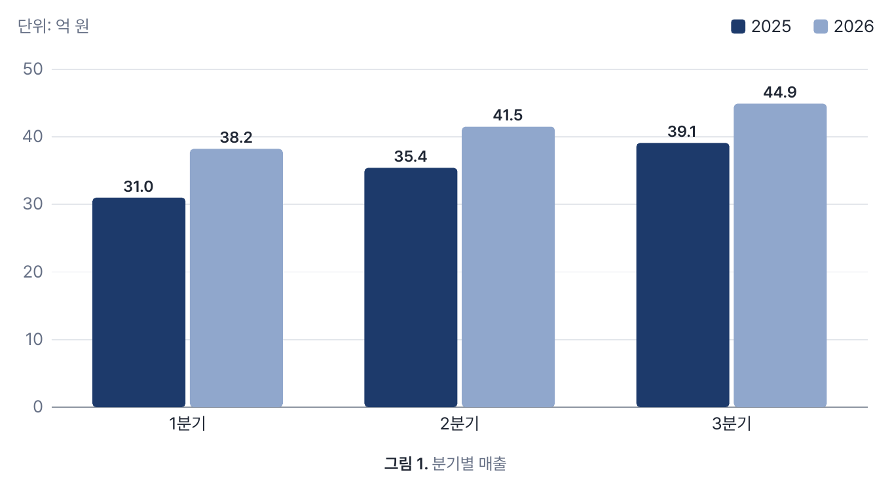

넣기 도구의 **차트** 를 누르면 이와 비슷한 견본 표가 들어간다. 엑셀·시스템의 CSV 는 편집기의 **CSV 표** 넣기 도구로 가져온다(문법이 아니라 편집기 기능 — 차트 안내서 15장).

## 2. 문법

**컨테이너**: `:::chart{속성}` 로 열고 `:::` 로 닫는다. 안에 GFM 표 하나를 둔다. 이름은 `chart` 여야 한다(`{.chart}` 클래스만으로는 차트가 아니다).

<!-- chart-attrs:begin -->
| 속성 | 뜻 | 대표 표기 | 함께 받는 표기 |
|---|---|---|---|
| `type` | 차트 종류(3장). 없으면 `bar` | `type=line` | 대소문자 무시(`type=Line`) |
| `unit` | 값 단위. 위쪽에 "단위: …" 로 적고(원·도넛은 아래 목록의 값 뒤에), 칸의 같은 꼬리를 뗀다(4장). `scatter`·`bubble` 에는 없다(단위는 열 머리글에, 3.11) | `unit="억 원"` | 공백이 없으면 따옴표 없이 `unit=명` |
| `labels` | 값 글자(6장). 기본은 켬 | `labels=off` | 끄기: `false`·`no`·`none`·`0`(대소문자 무시). 그 밖의 값은 모두 켬 |
| `table` | 그림 아래에 표도 보인다(11장). 기본은 표를 숨김 | `table=below` | `table=on`. 그 밖의 값은 숨김(경고 없음) |
| `ref` | 기준선(목표선)의 값(3.8). `pie`·`donut`·`scatter`·`bubble` 에는 없다 | `ref=40` | 4장의 숫자 꼴(`ref="1,000"`·`ref="40억 원"`·`ref="10%"`) |
| `ref-label` | 기준선 라벨. `ref` 와 함께만 | `ref-label="목표"` | |
| `line` | 그 이름의 계열을 선으로, 나머지는 막대로(3.9). `bar` 에만 | `line="계획"` | 공백이 없으면 따옴표 없이 `line=계획`. 이름의 공백은 하나로 줄여 맞춘다 |
| `axis2` | 그 이름의 계열을 오른쪽 축(보조 축)으로(3.10). `bar`·`line` 에만 | `axis2="이익률"` | `line` 과 같은 이름 맞추기 |
| `unit2` | 오른쪽 축의 단위. `axis2` 와 함께만 | `unit2="%"` | `unit` 과 같은 꼴(`unit2=건`) |
| `#id` | 그림(`<figure>`)의 id — 링크·테마 CSS 에서 고른다 | `#q3-sales` | |
| `.class` | 그림의 클래스 — 회사 테마가 모양을 줄 수 있다 | `.wide` | |
<!-- chart-attrs:end -->

속성은 공백으로 띄워 적는다: `:::chart{#q3-sales .wide type=bar unit="억 원" table=below}`. 모양(색·글꼴·크기)을 정하는 속성은 없다 —
색은 테마가 정한다(7장). 그 밖의 키를 쓰면 경고하고 무시한다(10장). `ref`·`ref-label`·`line`·`axis2`·`unit2` 는 0.17.0 판부터다 —
0.16.0 까지의 판은 "쓰지 않음" 경고를 내고 기준선 없이, `line` 의 계열도 막대로, `axis2` 의 계열도 왼쪽 축으로 그린다.

**표 규칙**

- **첫 열은 항목**(가로축 이름, 원의 조각 이름)이다. 첫 열의 머리 칸은 쓰지 않는다(무엇을 적어도 된다).
- **둘째 열부터가 계열**이고, 머리 행의 글자가 계열 이름(범례)이다. 열 하나가 막대 한 벌·선 하나다.
- **캡션**: 표 바로 다음 문단을 `: ` 또는 `Table: ` 로 시작하면 차트 캡션이 되고 그림 번호("그림 1")를 받는다. 없으면 번호 없는 그림이다.
- **빈 줄**: 컨테이너 여는 줄과 표 사이, 캡션과 닫는 `:::` 사이에 빈 줄을 둔다. 문서 창은 빈 줄이 없어도 같게 그리지만,
  빈 줄이 없으면 다른 뷰어에서 캡션과 `:::` 가 한 문단으로 붙고, 표가 문단에 이어 붙으면 표로 읽지 않는 뷰어도 있다(9장).
- 표 말고 컨테이너 안에 든 것(설명 문단 등)은 그림 뒤에 그대로 나온다.
- **산점도·버블은 표 꼴이 다르다**: 첫 열은 점 라벨, 둘째·셋째 열이 x·y 값, 버블은 넷째 열이 크기다(3.11·3.12).

## 3. 종류 9가지

<!-- chart-types:begin -->
| 종류 | 그림 | 알맞은 데이터 | 판 |
|---|---|---|---|
| `bar` | 세로 막대(기본) | 항목 몇 개를 계열 몇 개로 견주기 | 0.11.0 |
| `hbar` | 가로 막대 | 항목 이름이 길 때, 순위 | 0.11.0 |
| `stacked` | 쌓은 막대 | 합계와 그 구성 | 0.11.0 |
| `line` | 꺾은선 | 차례가 있는 항목(월·분기)의 추이 | 0.11.0 |
| `area` | 면 | 추이와 크기를 함께 | 0.11.0 |
| `pie` | 원 | 한 계열의 구성 비율 | 0.11.0 |
| `donut` | 도넛 | 원과 같고 가운데에 합계 | 0.11.0 |
| `scatter` | 산점도 | 두 수치(x·y)의 관계 — 행마다 점 하나 | 0.17.0 |
| `bubble` | 버블 | 산점도 + 셋째 수치(원의 넓이) | 0.17.0 |
<!-- chart-types:end -->

**판**은 그 종류를 처음 그린 itda-hyve 판이다. 문서를 받는 사람의 판이 그보다 옛것이면 그 종류를 모른다.
**모르는 `type` 은 차트를 그리지 않고 표를 그대로 보이며 경고한다**(0.17.0 판부터 — 새 판에 생길 종류의 열을 옛 판이 막대로 잘못 그리지 않게).
0.16.0 까지의 판은 모르는 `type` 을 경고와 함께 `bar` 로 그렸다.

### 3.1 `bar` — 세로 막대

막대는 늘 0 에서 자란다. 음수는 0 기준선 아래로 자라고 값 글자는 막대 아래에 붙는다 — 그 글자 자리가 그림 안에 나지 않으면 눈금을 한 칸 더 내린다(항목 이름과 겹치지 않게).

<!-- chart-example -->
```markdown
:::chart{type=bar unit="억 원"}

| 월 | 순현금흐름 |
|:--|--:|
| 1월 | 3.2 |
| 2월 | -1.4 |
| 3월 | 2.8 |
| 4월 | 4.1 |
| 5월 | -0.6 |
| 6월 | 5.3 |

: 월별 순현금흐름

:::
```

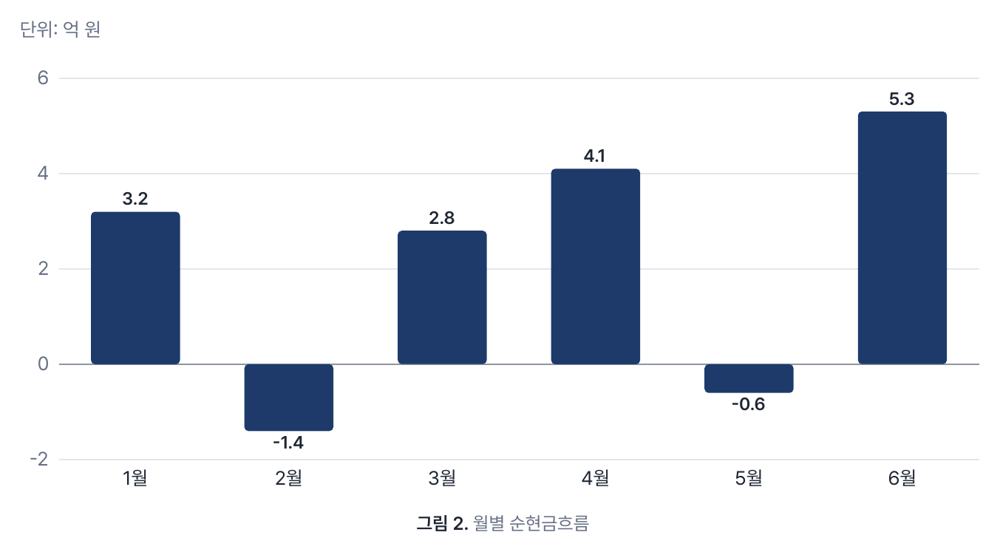

### 3.2 `hbar` — 가로 막대

항목 이름이 길 때 알맞다. 이름은 왼쪽(차트 너비의 3분의 1 안쪽)에 오른쪽 맞춤으로 적고, 넘치면 `…` 로 줄인다(계열이 둘 이상이라 줄이 높으면 두 줄).
이 예는 `table=below` 로 표도 함께 보인다.

<!-- chart-example -->
```markdown
:::chart{type=hbar unit="%" table=below}

| 지역 | 전년 대비 증감 |
|:--|--:|
| 서울·수도권 기업 고객 | 18.4% |
| 부산·울산·경남 | 7.2% |
| 대구·경북 | -3.6% |
| 광주·전남·전북 공공 부문 | -11.0% |
| 대전·세종·충청 | 4.9% |

: 지역별 매출 증감

:::
```

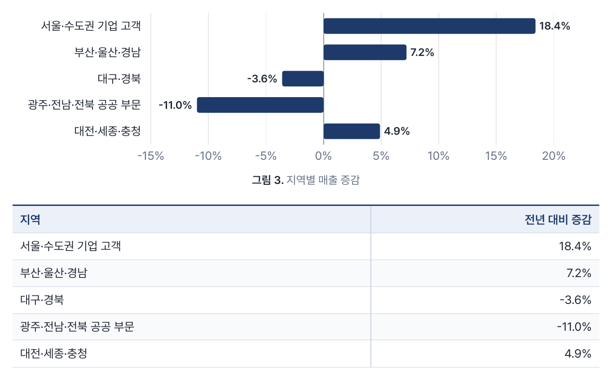

### 3.3 `stacked` — 쌓은 막대

계열을 한 막대에 쌓는다. 양수는 위로, 음수는 아래로 따로 쌓고, 막대 위에 양수 합계를 적는다.

<!-- chart-example -->
```markdown
:::chart{type=stacked unit="억 원"}

| 분기 | 기업 | 공공 | 파트너 |
|:--|--:|--:|--:|
| 1분기 | 24.1 | 10.2 | 3.9 |
| 2분기 | 26.8 | 9.6 | 5.1 |
| 3분기 | 31.5 | 6.9 | 6.5 |

: 고객군별 매출

:::
```

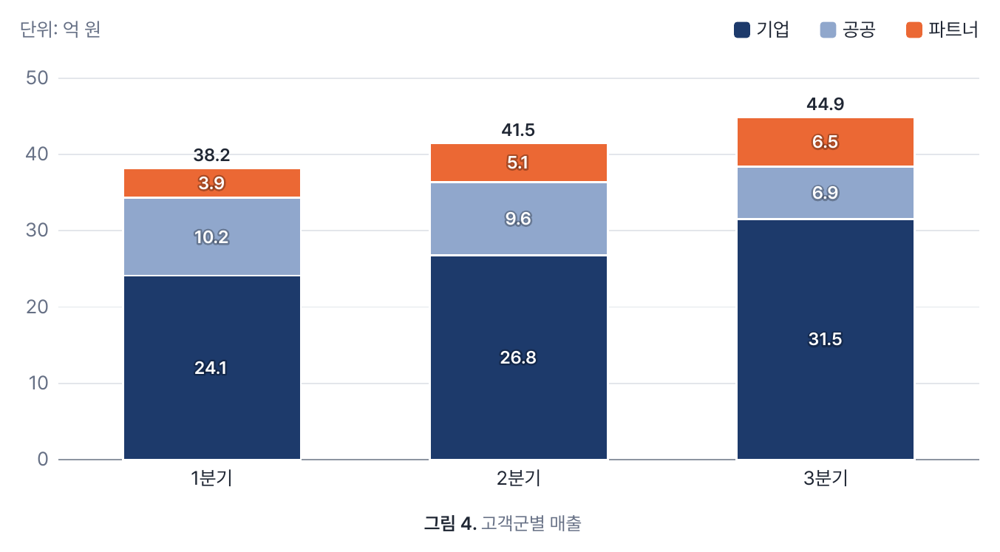

### 3.4 `line` — 꺾은선

빈 값에서 선이 끊긴다. 막대와 달리 값이 모두 0 에서 멀면(가장 작은 값이 가장 큰 값의 절반보다 크면 — 음수 쪽도 마찬가지) 0 부터 그리지 않는다.
다만 읽은 값이 모두 같으면(한 값뿐이거나 `100`·`100` 처럼) 0 부터 그린다.
항목은 **같은 간격**으로 놓인다 — 날짜를 적어도 날짜 간격대로 놓지 않는다(12장).
이 예는 `unit` 이 없지만 값이 모두 `%` 라 단위가 `%` 가 된다(4장).

<!-- chart-example -->
```markdown
:::chart{type=line}

| 월 | 영업이익률 |
|:--|--:|
| 1월 | 8.2% |
| 2월 | 4.1% |
| 3월 | -2.5% |
| 4월 | 6.8% |
| 5월 | 9.4% |
| 6월 | 11.0% |
| 7월 | 10.2% |
| 8월 | 12.6% |
| 9월 | 13.1% |

: 월별 영업이익률

:::
```

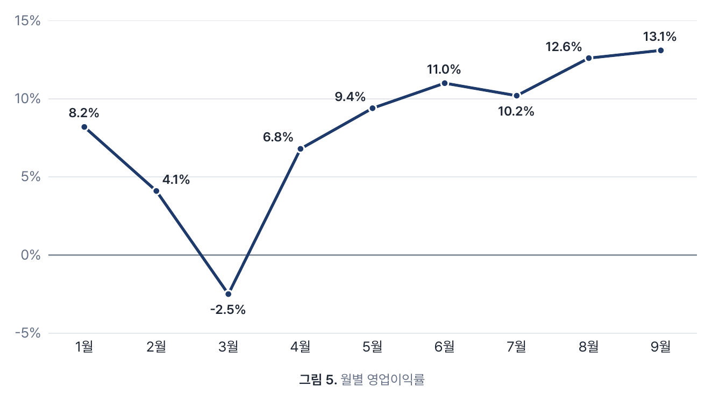

### 3.5 `area` — 면

선 아래를 옅게 칠한다(옅기는 테마 토큰 `--chart-area-opacity`). 면은 0 에서 시작한다.

<!-- chart-example -->
```markdown
:::chart{type=area unit="명"}

| 주 | 방문 고객 | 체험 신청 |
|:--|--:|--:|
| 1주 | 1,240 | 310 |
| 2주 | 1,385 | 352 |
| 3주 | 1,302 | 340 |
| 4주 | 1,630 | 418 |
| 5주 | 1,812 | 470 |
| 6주 | 1,755 | 455 |
| 7주 | 2,034 | 512 |
| 8주 | 2,210 | 566 |

: 주별 방문 고객과 체험 신청

:::
```

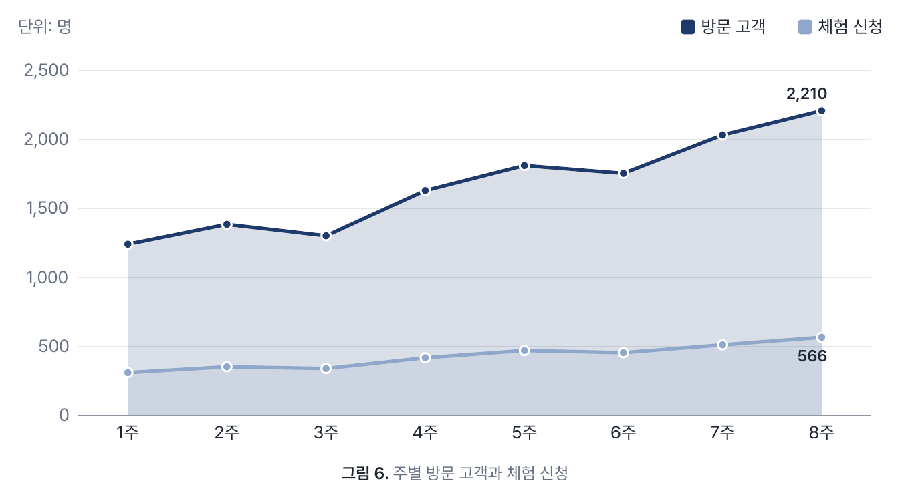

### 3.6 `pie` — 원

**첫 계열만** 쓴다(셋째 열부터는 경고 없이 쓰지 않는다 — 다만 계열 열이 8개를 넘으면 5장의 계열 상한 경고는 난다). 조각은 12시에서 시계 방향으로 표의 차례대로 놓인다. 아래 목록에 항목·값·비율을 적는다.

<!-- chart-example -->
```markdown
:::chart{type=pie}

| 고객군 | 3분기 매출 |
|:--|--:|
| 기업 | 31.5 |
| 공공 | 6.9 |
| 파트너 | 6.5 |

: 3분기 매출 비중

:::
```

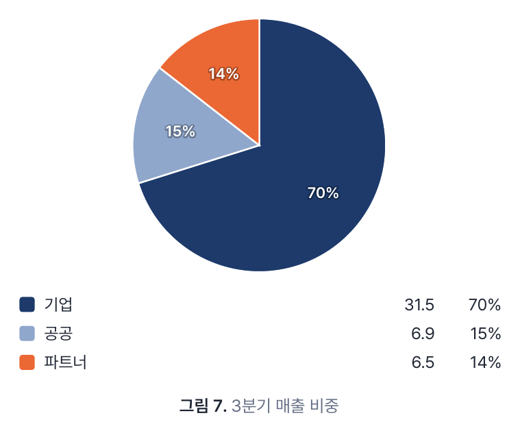

### 3.7 `donut` — 도넛

원과 같고, 가운데에 합계와 단위를 적는다.

<!-- chart-example -->
```markdown
:::chart{type=donut unit="건"}

| 채널 | 신규 계약 |
|:--|--:|
| 직접 영업 | 12 |
| 파트너 | 6 |
| 온라인 문의 | 3 |

: 3분기 신규 계약 경로

:::
```

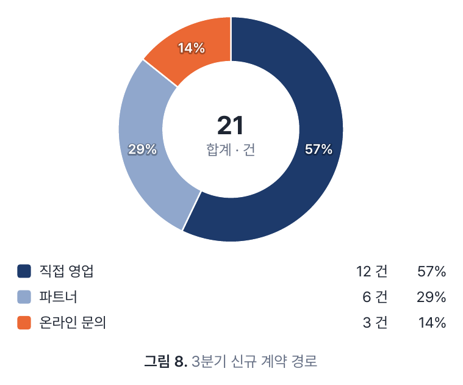

원·도넛은 좁은 그림이라 다단(`::::columns`)의 한 단에 넣어도 글자가 읽힌다. 넓은 자리에서도 92mm 보다 크게 늘지 않는다.

### 3.8 기준선 — `ref`

`bar`·`stacked`·`line`·`area` 에는 가로 점선, `hbar` 에는 세로 점선을 값 `ref` 자리에 하나 긋는다(0.17.0 판부터). `pie`·`donut` 에는 긋지 않는다(경고).

- **축 범위에 든다**: 값보다 크거나 작은 기준선도 보이도록 눈금을 넓힌다. 꺾은선은 기준선을 넣은 범위에 3.4 의 "0 부터" 규칙을 적용한다.
  `stacked` 는 쌓은 합계와 같은 축이다.
- **라벨**: `ref-label` 과 값을 함께 적는다(`목표 40.0` — 라벨이 없으면 값만). 값의 소수 자리는 표의 값 글자와 같고, `ref` 에 더 길게 적었으면 그 자리다.
  세로형은 그림 영역 **오른쪽 밖**(그만큼 그림이 좁아진다), `hbar` 는 막대 영역 **위**에 둔다 — 막대·점·값 글자와 겹치지 않는다
  (`line`·`area` 의 끝 값 글자가 오른쪽으로 삐져나오면 그림 영역 안으로 당긴다). 긴 라벨은 `…` 로 줄인다.
- 점선은 글자색이고 아래에 종이색 테두리를 깔아 같은 색 막대(공문의 검정 막대) 위에서도 보인다. 기준선이 있으면 값 글자를 점선 **위에** 종이색 테두리를 둘러 그린다 —
  점선이 값 글자를 가로지르지 않는다.
- 마우스를 올리면 "목표: 40.0 억 원" 이 보인다(`<title>`, 라벨이 없으면 "기준선"). 점선은 움직이지 않는다.
- 기준선은 **하나**다. 여러 개(`ref="목표=40,상한=1,000"` 꼴)는 받지 않는다 — 쉼표가 천 단위와 겹친다.
- 다른 뷰어에서는 기준선이 보이지 않는다 — 여는 줄의 글자로만 남는다(9장). 값이 중요하면 캡션에도 적는다.

<!-- chart-example -->
```markdown
:::chart{type=bar unit="억 원" ref=40 ref-label="목표"}

| 분기 | 매출 |
|:--|--:|
| 1분기 | 31.0 |
| 2분기 | 35.4 |
| 3분기 | 44.9 |
| 4분기 | 52.0 |

: 분기별 매출과 목표(40억 원)

:::
```

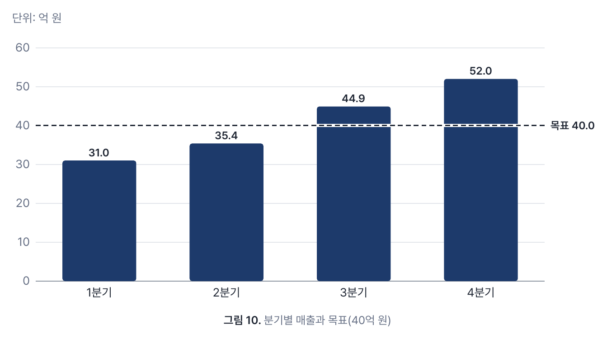

### 3.9 막대 + 선 — `line`

`bar` 에 `line="계열 이름"` 을 주면 그 계열을 **꺾은선**으로, 나머지 계열을 묶은 막대로 그린다(0.17.0 판부터). 실적은 막대, 계획·평균은 선으로 겹쳐 볼 때 쓴다.

- **이름으로 가리킨다**: 머리 행의 계열 이름과 같아야 한다(열 차례가 바뀌어도 같은 계열이다). 앞뒤 공백을 떼고 가운데 공백을 하나로 줄여 맞추고,
  대소문자는 가린다. 숫자 이름(`line=2026`)도 이름이다 — 열 번호로 읽지 않는다.
- **선은 하나**다. `bar` 말고 다른 종류(`stacked`·`hbar`·`line`·`area`·`pie`·`donut`)와 함께 쓰거나, 이름이 비었거나·없거나·같은 이름의 계열이 둘 이상이거나,
  그 계열이 상한(8번째 계열) 밖이거나, 그 계열을 빼면 막대가 남지 않으면 **차트 없이 표를 그대로** 보이고 경고한다(10장) — 엉뚱한 계열을 선으로 그리지 않게.
- **축은 하나**다: 선 계열도 막대와 같은 값 축이고, 막대가 있으므로 축은 늘 0 을 포함한다. 단위가 다른 계열(매출 억 원과 이익률 %)을 함께 그리면
  작은 쪽이 바닥에 깔린다 — 단위가 다르면 선 계열을 오른쪽 축(`axis2`, 3.10)으로 그린다.
- **선과 점**은 막대 위에, 그 항목의 막대 묶음 가운데에 놓인다. 선 아래에 종이색 테두리를 깔아 같은 색 막대(공문의 검정) 위에서도 보인다. 빈 값에서 선이 끊긴다.
- **범례**: 막대 계열은 사각형, 선 계열은 선과 점으로 그려 색 말고 모양으로도 가린다. 색은 다른 차트처럼 열 차례다 — 다만 공문은 선 계열을 글자색으로 그린다(7장).
- **값 글자**: 막대가 먼저다(6장의 `bar` 규칙). 선의 값은 막대의 값 글자와 겹치지도 붙지도(8 안쪽) 않고, 선의 값끼리 겹치지 않으며,
  그림 안(항목 이름 줄 위, 좌우 끝 안)에 들 때만 적는다 — 붙어 있으면 두 값이 한 쌍으로 읽힌다.
  모든 점(항목 12개 이하) → 마지막 점 → 적지 않음 차례로 그런 첫 단계를 쓴다(긴 숫자 12개는 서로 겹치므로 마지막 점이나 없음이 된다). 적지 않은 값도 점에 마우스를 올리면 보인다(`<title>`). 값 글자는 모두 선 위에 종이색 테두리를 둘러 그린다 — 선이 글자를 가로지르지 않는다.
- 기준선(3.8)과 함께 쓸 수 있다. 다른 뷰어에서는 선 계열도 표의 한 열로 보인다.

<!-- chart-example -->
```markdown
:::chart{type=bar unit="억 원" line="2026 계획"}

| 분기 | 2025 | 2026 | 2026 계획 |
|:--|--:|--:|--:|
| 1분기 | 31.0 | 38.2 | 36.0 |
| 2분기 | 35.4 | 41.5 | 40.0 |
| 3분기 | 39.1 | 44.9 | 44.0 |
| 4분기 | 42.0 | 47.3 | 48.0 |

: 분기별 매출과 2026 계획

:::
```

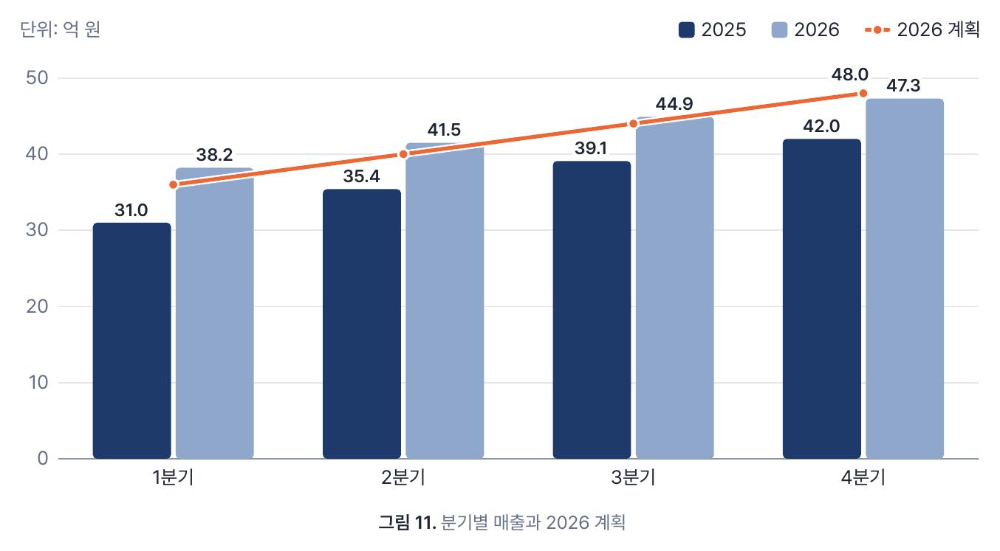

### 3.10 보조 축 — `axis2`·`unit2`

`axis2="계열 이름"` 을 주면 그 계열을 **오른쪽 축**(보조 축)의 눈금으로 그린다(0.17.0 판부터). 매출(억 원)과 이익률(%)처럼 단위나 크기가 다른 두 가지를 한 그림에 둘 때 쓴다.

- **종류**: `bar` 와 `line` 에만. `bar` 에서는 오른쪽 축 계열을 **선**으로 그린다(3.9 의 막대 + 선과 같은 모양 — `line` 을 따로 적지 않아도 된다).
  막대를 두 눈금에 나눠 그리면 다른 눈금의 막대 높이를 견주게 되므로 오른쪽 축에는 막대를 두지 않는다. `line` 을 함께 적으면 같은 계열이어야 한다(선은 하나).
  `line` 에서는 그 계열만 오른쪽 눈금이고 나머지 선은 왼쪽 눈금이다. 그 밖의 종류(`stacked`·`hbar`·`area`·`pie`·`donut`)에는 **차트 없이 표를 그대로** 보이고 경고한다.
- **이름으로 가리킨다**: `line` 과 같다(3.9) — 공백을 하나로 줄여 머리 행의 계열 이름 하나와 같아야 하고, 숫자 이름을 열 번호로 읽지 않는다. 빈 이름·없는 이름·같은 이름 여럿·첫 열·
  8번째 밖, 그 계열을 빼면 왼쪽 축에 계열이 남지 않으면 표 그대로다.
- **단위·소수 자리·`%` 는 축마다**: `unit` 은 왼쪽 축, `unit2` 는 오른쪽 축의 단위다. 칸의 단위 꼬리도 그 축의 단위로 뗀다. `unit2` 가 없고 오른쪽 축 계열의 값이 모두 `%` 면
  오른쪽 축이 `%` 다(4장의 규칙을 축마다). 값 글자의 소수 자리도 축마다 그 축의 계열에 적힌 가장 긴 자리다. 마우스를 올리면 보이는 값(`<title>`)도 그 축의 단위로 적는다.
- **눈금**: 오른쪽 눈금은 그림 영역 오른쪽 밖에 적고(그만큼 그림이 좁아진다), 격자선은 왼쪽 축과 함께 쓴다 — 오른쪽 눈금 글자가 왼쪽 격자선 높이에 놓인다.
  막대가 있는 왼쪽 축은 0 을 포함하고, 오른쪽 축(선)은 3.4 의 선 규칙(0 에 가까우면 0 부터)이다. 두 축이 모두 0 을 지나면 **0 을 같은 격자선**에 맞춘다 —
  다만 그러면 선이 그림의 절반도 못 쓰게 될 때(막대의 0 이 맨 아래인데 선이 음수로 내려가는 때 등)는 맞추지 않는다.
- **표시**: 범례에서 오른쪽 축 계열 이름 뒤에 **"(오른쪽 축)"** 을 붙인다 — 색만으로 어느 축인지 가리지 않게. 위쪽 단위 줄은 "단위: 억 원 · 오른쪽 축 단위: 건" 꼴이다(`%` 는 눈금 글자에 붙으므로 적지 않는다).
  선의 값 글자는 그림 영역 안으로 당겨 오른쪽 눈금과 겹치지 않는다.
- **기준선과 함께 쓰지 않는다**: 기준선 라벨의 자리(그림 오른쪽 밖)를 오른쪽 눈금이 쓰고, 어느 축의 값인지도 헷갈린다 — `ref` 를 적으면 경고하고 기준선 없이 그린다.
- `unit2` 만 있고 `axis2` 가 없으면 경고하고 무시한다. 오른쪽 축 계열에 읽을 수 있는 숫자가 하나도 없으면 경고하고 오른쪽 축 없이 그린다.
- 다른 뷰어에서는 오른쪽 축 계열도 표의 한 열로 보인다. 단위가 열마다 다르면 머리 행에 단위를 적어 두면(`영업이익률(%)`) 표로도 읽힌다.

<!-- chart-example -->
```markdown
:::chart{type=bar unit="억 원" axis2="영업이익률"}

| 분기 | 매출 | 영업이익률 |
|:--|--:|--:|
| 1분기 | 31.0 | 8.2% |
| 2분기 | 35.4 | 9.4% |
| 3분기 | 44.9 | 11.0% |
| 4분기 | 52.0 | 12.6% |

: 분기별 매출과 영업이익률

:::
```

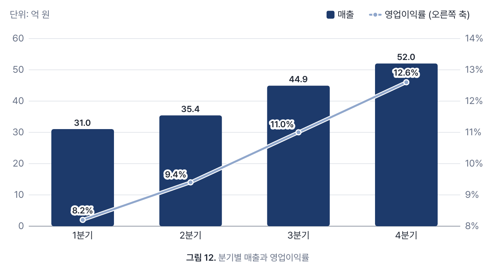

### 3.11 `scatter` — 산점도

두 수치의 관계를 본다(0.17.0 판부터). 표 꼴이 다른 종류와 다르다: **첫 열은 점 라벨**, **둘째 열이 x**(가로), **셋째 열이 y**(세로)다. 행 하나가 점 하나다.

- **축은 둘 다 연속**이다: `line` 의 항목처럼 같은 간격이 아니라 값의 크기대로 놓인다(x 가 10·20·40 이면 간격이 1:2). 눈금은 축마다 5장의 보기 좋은 눈금이고,
  0 포함은 3.4 의 선 규칙이다(0 에 가까우면 0 부터, 0 에서 멀면 값 근처만). 0 을 지나면 0 에 짙은 기준선을 가로·세로로 긋는다.
- **축 제목은 열 머리글**이다: y 는 왼쪽 위, x 는 아래 가운데. 단위는 머리글에 적는다(`매출(억 원)`) — `unit` 은 쓰지 않는다(축이 둘이라 단위 하나로 정해지지 않는다. 적으면 경고하고 무시).
  `%` 는 열마다 4장의 규칙이다(그 열의 값이 모두 `%` 면 그 축 눈금에 `%`). 칸의 단위 꼬리(`38억 원`)는 떼지 않으므로 숫자만 적는다.
- **빈 값**: x·y 중 하나라도 빈 행은 점이 없다(경고 없음). 읽지 못한 칸은 경고하고 빈 값으로 둔다.
- **점 라벨**: 점의 오른쪽 → 왼쪽 → 위 → 아래 중 그림 안이고 다른 라벨·점과 겹치지 않는 첫 자리에 적고, 그런 자리가 없으면 적지 않는다(점이 많으면 일부만 적힌다).
  긴 라벨은 `…` 로 줄인다. `labels=off` 면 적지 않는다. 마우스를 올리면 "본점 · 매출(억 원): 120 · 영업이익률: 14.2%" 가 보인다(`<title>`).
- 같은 좌표의 점은 겹쳐 그린다(라벨은 서로 다른 자리에). 점은 선으로 잇지 않고, 점 집합은 하나(한 색)다.
- 셋째 열 뒤의 열은 쓰지 않는다(경고). `line`·`axis2` 는 받지 않고(표 그대로), `ref` 는 긋지 않는다(경고 — 축이 둘이라 어느 축의 값인지 정해지지 않는다).

<!-- chart-example -->
```markdown
:::chart{type=scatter}

| 지점 | 매출(억 원) | 영업이익률 |
|:--|--:|--:|
| 본점 | 120 | 14.2% |
| 강남 | 98 | 9.1% |
| 판교 | 76 | 12.5% |
| 부산 | 54 | 6.3% |
| 대구 | 41 | 4.8% |
| 광주 | 38 | 7.9% |
| 대전 | 45 | 10.4% |

: 지점별 매출과 영업이익률

:::
```

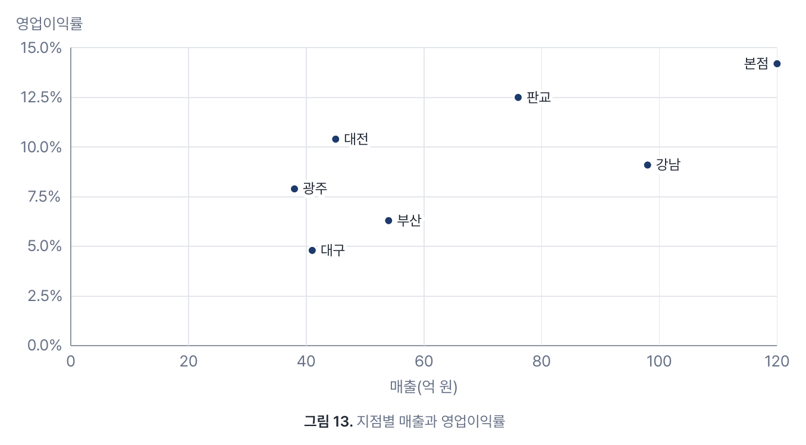

### 3.12 `bubble` — 버블

산점도에 **넷째 열(크기)** 을 더해 원의 **넓이**로 그린다(0.17.0 판부터). x·y·라벨·축·빈 값의 규칙은 3.11 과 같다.

- **넓이 ∝ 크기**: 가장 큰 크기의 원이 반지름 22(그림 너비 600 기준)이고, 나머지는 넓이가 크기에 비례한다 — 크기가 4분의 1 이면 반지름은 절반이다.
  아주 작은 크기(가장 큰 것의 약 0.5% 미만)는 보이도록 최소 반지름 1.5 로 그린다(그 원들만 비례가 깨진다).
- **크기 0·음수·빈 값**: 0 은 넓이가 없어 경고 없이 빠지고(원 조각의 0 과 같다), 음수는 경고하고 뺀다. 빈 크기는 빈 좌표처럼 그 행이 빠진다.
- **크기 범례**: 오른쪽 위에 "넓이: (넷째 열 머리글)" 과 원 둘 — 가장 큰 값과, 그 4분의 1 ~ 2분의 1 사이의 보기 좋은 값(1·2·2.5·5 × 10ⁿ).
- **겹침**: 원은 반투명 면에 테두리라 겹친 원도 저마다 가장자리가 보이고, **큰 원부터** 그려 작은 원이 큰 원에 가리지 않는다.
  원이 그림 영역 밖으로 나가면 그쪽 눈금을 한 칸씩 넓힌다(원이 축 글자를 덮지 않게).
- 원이 많으면 겹쳐 덩어리가 된다 — 버블은 40개까지만 그린다(5장).

<!-- chart-example -->
```markdown
:::chart{type=bubble}

| 제품 | 시장 성장률 | 점유율 | 매출(억 원) |
|:--|--:|--:|--:|
| 클라우드 | 18% | 12% | 85 |
| 보안 | 9% | 31% | 140 |
| 컨설팅 | 3% | 22% | 60 |
| 교육 | -2% | 8% | 15 |
| 유지보수 | 1% | 40% | 110 |

: 제품 포트폴리오(원 넓이 = 매출)

:::
```

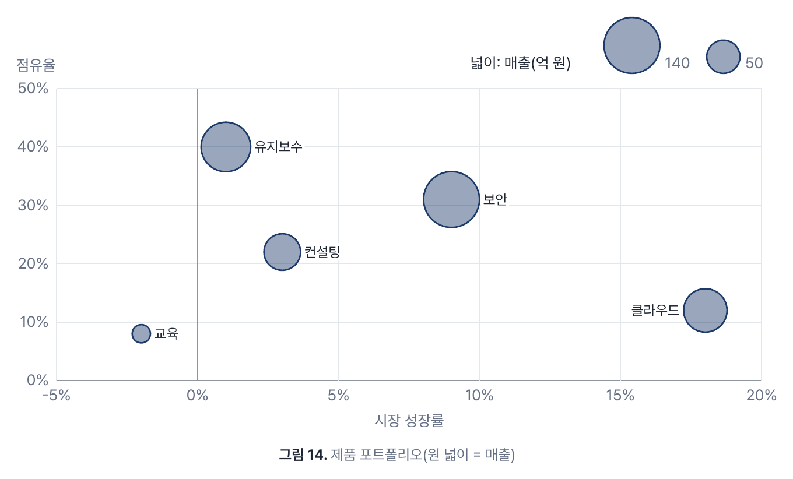

## 4. 숫자 읽기

칸의 글자를 앞뒤 공백을 떼고 아래 꼴로 읽는다.

| 칸 | 읽은 값 | 비고 |
|---|---|---|
| `1,234.5` · `1234.5` · `.5` | 1234.5 · 1234.5 · 0.5 | 천 단위 쉼표는 세 자리마다만(`1,23` 은 못 읽음) |
| `-3` · `−3` · `+4.5` | -3 · -3 · 4.5 | 빼기는 `-` 와 유니코드 빼기 `−` 둘 다 |
| `12%` · `12 %` | 12 | **100 으로 나누지 않는다.** 퍼센트 값은 퍼센트 그대로 그린다 |
| `38.2억 원`(`unit="억 원"`) | 38.2 | `unit` 과 **똑같은** 꼬리만 뗀다 — `unit="억 원"` 에 `38.2억` 은 못 읽음 |
| 빈 칸 · `-` · `—` · `–` · `·` · `N/A` · `NA` | 빈 값 | 경고 없음(대소문자 무시) |
| `1e3` · `₩1,000` · `약 30` · `1 234` | 못 읽음 | 빈 값으로 두고 경고(그 칸의 줄) |

- **지수 표기는 받지 않는다**(`1e3`). 절댓값이 10¹⁵ 를 넘는 수도 못 읽는다.
- **빈 값과 0 은 다르다**: 빈 값은 막대가 없고 값 글자도 없으며, 선은 거기서 끊긴다. 0 은 0 기준선에 붙은 얇은 막대와 값 글자(소수 자리에 따라 `0.0`)를 그린다.
- **단위 `%`**: `unit` 이 없고 읽은 값이 모두 `%` 로 적혀 있으면 단위가 `%` 가 된다(값·눈금 뒤에 `%`, "단위:" 줄은 없음).
  `%` 를 붙인 칸과 붙이지 않은 칸이 섞이면 단위 없이 그리고 **경고한다**(0.17.0 판부터 — 그 전 판은 경고 없이 그렸다). `unit` 이 `%` 아닌 단위(`억 원`)인데 `%` 를 붙인 칸이 있어도
  경고한다(값은 `%` 를 떼고 같은 눈금에 그린다). `unit="%"` 면 `12` 와 `12%` 가 같아 경고하지 않는다. 보조 축(3.10)이 있으면 축마다 따로 본다.
- **표시 소수 자리**: 표에 적힌 소수 자리 중 가장 긴 것(최대 3자리)으로 모든 값을 적는다 — `415` 와 `982.4` 가 함께 있으면 `415.0` 으로 보인다.
  다만 0 이 아닌 값이 그 자리로 0 이 되면(`0.0004` 를 세 자리로 `0.000`) **그 값만** 첫 유효 숫자까지(최대 6자리) 적는다 — `0.0004`. 값 글자·`<title>`·기준선 라벨·도넛 가운데 합계가 같다.
  눈금은 눈금 간격에 맞는 자리로 따로 적는다.

<!-- chart-example warn="12%" -->
```markdown
:::chart{type=bar}

| 지점 | 증감 |
|:--|--:|
| 본점 | 12% |
| 강남 | 8 |

:::
```

이 예는 `"12%"` 와 `"8"` 이 섞였다는 경고 하나를 내고 단위 없이 그린다 — `8` 도 `8%` 로 적거나 `unit="%"` 를 준다.

<!-- chart-example -->
```markdown
:::chart{type=bar unit="억 원"}

| 지점 | 매출 |
|:--|--:|
| 본점 | 1,234.5 |
| 강남 | 982.4억 원 |
| 판교 | +415 |
| 부산 | −312 |
| 대구 | N/A |
| 광주 | 0 |

: 숫자 꼴 견본

:::
```

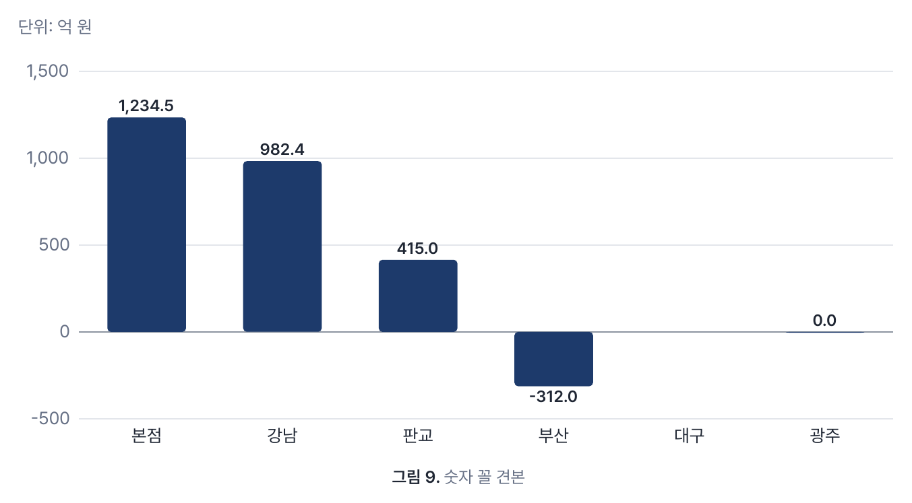

## 5. 상한과 자동 처리

<!-- chart-limits:begin -->
| 무엇 | 상한 | 넘으면 |
|---|---|---|
| 계열(둘째 열부터) | 8 | 앞의 8개만 그리고 경고. 색이 8개뿐이다 |
| 항목(행) | 60 | 앞의 60행만 그리고 경고 |
| 항목(행), `hbar` | 30 | 앞의 30행만 그리고 경고 |
| 원 조각 | 8 | 앞의 7개 + "기타" 로 묶고 경고 |
| 점, `scatter` | 200 | 앞의 200행만 그리고 경고 |
| 점, `bubble` | 40 | 앞의 40행만 그리고 경고 |
<!-- chart-limits:end -->

- **산점도·버블의 상한**은 60행을 따르지 않고 실측으로 정했다: 산점도 200점(점 반지름 2.5)은 분포가 읽히지만, 버블은 몰린 60개가 한 덩어리가 되어
  라벨이 3분의 1 만 자리를 얻었다(고르게 흩어진 40개는 40개 중 36개). 계열 상한(8)은 해당하지 않는다 — 열은 셋(버블 넷)만 쓴다.
- **원·도넛의 "기타"**: 조각은 표의 **입력 차례**로 센다(큰 것부터가 아니다). 0·음수·빈 값은 조각에서 빠진 뒤 센다.
  항목 상한(60행)으로 먼저 자른 뒤 묶으므로, 60행이 넘는 표의 "기타" 는 원본 전체의 나머지가 아니라 60행 안의 나머지다.
- **원의 음수와 0**: 음수는 그리지 못해 빼고 경고한다. **0 은 경고 없이** 조각에서 빠진다(아래 목록에도 없다).
- **눈금**: 간격이 1·2·2.5·5 × 10ⁿ 인 보기 좋은 눈금을 4~6칸으로 고른다. 0 을 지나면 0 에 짙은 기준선(`--chart-axis`)을 긋는다.
- **긴 항목 이름**: 세로형(bar·stacked·line·area)에서 이름이 칸에 들어가지 않으면, 칸이 넉넉하면 두 줄로 나누고(공백이 있으면 가운데에 가까운 공백에서),
  좁으면 몇 개씩 건너 이름을 적는다. 줄인 이름(`…`)에는 전체 이름을 `<title>` 로 달아 마우스를 올리면 보인다. 건너뛴 이름은 그 항목의 막대·점에 마우스를 올리면 보인다.
- **범례와 단위 줄**: `bar`·`hbar`·`stacked`·`line`·`area` 는 계열이 둘 이상이면 오른쪽 위에 범례, `unit` 이 있으면(`%` 말고) 왼쪽 위에 "단위: …".
  범례 표식은 사각형이고, 막대 + 선(3.9)의 선 계열만 선과 점이다. 보조 축(3.10)이 있으면 그 계열 이름 뒤에 "(오른쪽 축)" 을, 단위 줄에 "오른쪽 축 단위: …" 를 더한다.
  첫 범례도 단위 곁에 들지 않으면 첫 줄은 단위만 두고 범례는 다음 줄부터 놓는다(그만큼 그림이 내려간다). 한 줄을 넘는 단위는 `…` 로 줄인다.
  원·도넛에는 이 줄이 없다 — 단위는 아래 목록의 값 뒤(`12 건`)에 붙고, 도넛은 가운데에도 "합계 · 건" 으로 적는다.

## 6. 값 글자

`labels=off` 가 아니면 값을 글자로 적는다. 종류마다 적는 규칙이 다르다. 자리에 들어가는지 재서 빼는 것은 `bar`·`stacked`·원의 조각 안 글자뿐이고,
`line`·`area` 는 재지 않고 적으므로 **값 글자가 겹칠 수 있다**(아래).

| 종류 | 규칙 |
|---|---|
| `bar` | 막대 위(음수는 아래)에. 막대 수(항목 × 계열)가 36 을 넘거나, **하나라도** 자리에 들어가지 않으면 그 차트의 값 글자를 **모두** 뺀다(들쭉날쭉하지 않게) |
| `stacked` | 조각마다 따로 판단 — 조각 높이와 너비에 들어가는 조각만 안에 적는다. 막대 위의 합계도 들어갈 때만. 항목이 24 를 넘으면 모두 뺀다 |
| `line`·`area` | 계열마다 **마지막 값**만 선 끝에. 계열이 하나이고 항목이 12개 이하면 **모든 점**의 값을 선을 피해 적는다(골은 아래 — 다만 아래 자리가 항목 이름 줄에 닿으면 위). 글자끼리의 충돌은 재지 않는다 — 계열 여럿의 마지막 값이 비슷하면 글자가 겹친다 |
| `bar` + `line` | 막대는 `bar` 와 같다(36 은 막대 수로 센다 — 선 계열은 빼고). 선의 값은 막대 값 글자와 겹치지도 붙지도 않고, 서로 겹치지 않으며, 그림 안일 때만 — 모든 점(항목 12개 이하) → 마지막 점 → 없음(3.9). `axis2` 의 `bar` 도 같고, 선의 값은 그 축의 단위로 적는다 |
| `hbar` | 값 글자 자리를 오른쪽에 미리 비워 두므로 늘 적는다 |
| `scatter`·`bubble` | 값 대신 **점 라벨**(첫 열)을 점 곁에. 다른 라벨·점과 겹치지 않는 자리가 있을 때만(3.11) |
| `pie`·`donut` | 조각 안에 비율(조각이 약 7% 이상일 때). 아래 목록의 값·비율은 `labels=off` 여도 늘 있다 |

글자를 뺀 막대·점·조각에도 값은 `<title>` 로 늘 남는다 — 화면에서 마우스를 올리면 "항목 · 계열: 값 단위" 가 보인다.
`line`·`area` 의 값 글자가 겹치면 `labels=off` 로 끄고 `table=below` 로 표를 함께 싣는다(11장).

## 7. 색과 테마

- 계열 색은 테마 토큰 `--chart-1` … `--chart-8` 이다. **1번은 강조색**(`--accent`)이고, 내장 테마마다 이웃한 색끼리 색약에도 구분되는 조합을 골랐다.
  **모노**(`mono`)는 흑백 테마라 회색조다. 막대 + 선(3.9)의 선 계열만은 모노에서 열 차례와 상관없이 **글자색**(검정)으로 그린다 —
  3·5·7번의 옅은 회색은 면으로는 구분되지만 가는 선과 점으로는 인쇄에서 묻힌다. 회사 테마도 같은 일을 하려면 `theme.css` 에서
  표지 클래스 `cl`(선 `path.line.cl`·점 `circle.dot.cl`·범례 `.sw.cl`)을 칠한다.
- 산점도·버블은 점 집합이 하나라 1번 색만 쓴다. 버블은 1번 색의 반투명 면(`fill-opacity` 0.45)에 1번 색 테두리다 — 모노(1번이 검정)에서는 회색 면에 검정 테두리.
- 색은 **열 차례**로 정해진다: 둘째 열이 1번 색, 셋째 열이 2번 색이다. 열 차례를 바꾸면 색도 바뀐다. 원·도넛은 조각 차례(표의 행 차례)로 칠한다.
- 문서에서 색을 정하는 속성은 두지 않는다(설계상 — 색은 테마의 몫이다). 회사 색을 쓰려면 회사 테마의 `tokens` 에 `--chart-*` 를 준다.
  토큰 목록과 기본값은 [문서 테마 안내서 3장](themes.md#3-토큰--전체-표)이 정본이다.
- 글자는 문서 글꼴(테마의 `--font-body`)로 그린다.

## 8. 화면·인쇄·PDF·슬라이드

- **움직임은 화면에서만**: 차트가 화면에 처음 보일 때(30% 이상 보이면) 한 번 막대가 자라고 선이 그려지고 원이 돈다(산점도·버블은 점·원이 표의 차례로 나타나고 라벨이 뒤따른다).
  편집 중 다시 그려도 **바뀌지 않은 차트(같은 SVG)는 다시 움직이지 않는다** — 값을 고친 차트만 다시 움직인다.
- **인쇄·PDF·"동작 줄이기"** 설정에서는 움직임 없이 다 그려진 모습이다. PDF 의 차트 글자(값·항목·범례·눈금·점 라벨·축 제목)는 그림이 아니라 글자라 선택·검색된다.
- **슬라이드**: 제목 말고 차트 **하나만** 있는 슬라이드는 차트를 크게 그린다. `table=below` 면 표가 따로 한 블록이라 "하나만" 이 아니다(표가 필요하면 다음 슬라이드로).
  발표에서는 슬라이드가 나타날 때(앞으로 갈 때) 차트가 움직인다.

## 9. 다른 뷰어에서

GitHub·VS Code 미리보기·Obsidian 은 `:::chart` 를 모른다. 여는 줄·캡션·닫는 줄은 글자로 남고 **데이터는 표로 읽힌다**.
아래는 1장의 예제를 GitHub 의 마크다운 렌더러(`gh api markdown`, GFM)로 렌더한 모습이다.

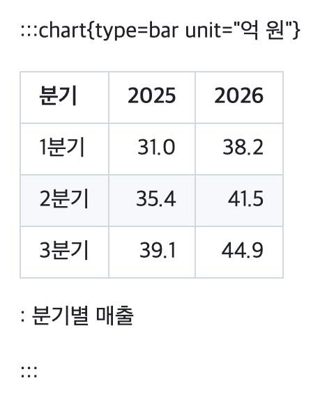

2장의 빈 줄 규칙을 지키면 캡션과 `:::` 가 각자 한 줄로 남아 읽기 쉽다.

## 10. 경고

차트에 문제가 있으면 도구 막대의 경고 단추(삼각형 ⚠ 과 건수)에 코드 `chart` 로 줄 번호와 함께 보인다. 줄을 누르면 편집기가 그 줄로 간다.
`--export-pdf` 는 경고 수를 JSON 의 `warnings` 로 낸다. 아래 문구는 바뀔 수 있다 — 뜻으로 찾는다.

| 원인 | 화면 결과 | 고치는 법 |
|---|---|---|
| 컨테이너 안에 표가 없다 | 차트 없이 안의 내용 그대로 | 표를 넣는다. 표 앞뒤에 빈 줄 |
| 표에 계열 열(둘째 열)이나 데이터 행이 없다 | 차트 없이 표 그대로 | 첫 열 항목 + 숫자 열 하나 이상 |
| 읽을 수 있는 숫자가 하나도 없다 | 차트 없이 표 그대로 | 4장의 숫자 꼴로 적는다 |
| 모르는 `type` | 차트 없이 표 그대로(경고는 이것 하나) | 3장의 아홉 가지 중 하나. 새 판의 종류면 판을 올린다 |
| 모르는 속성(`color` 등) | 무시하고 그림 | `type`·`unit`·`labels`·`table`·`ref`·`ref-label`·`line`·`axis2`·`unit2` 만. 색은 테마로 |
| `ref` 를 숫자로 읽지 못함·비었음 | 기준선 없이 그림 | 4장의 숫자 꼴 |
| `pie`·`donut` 의 `ref` | 기준선 없이 그림 | 막대·선으로 그린다 |
| `ref` 없이 `ref-label` 만 | 라벨 무시 | `ref` 를 함께 적는다 |
| `line` 을 `bar` 아닌 종류에 | 차트 없이 표 그대로 | `type=bar`(또는 `type` 없이). 선만이면 `type=line` |
| `line` 의 이름이 비었거나·없거나·같은 이름이 둘 이상·첫 열(항목)의 이름 | 차트 없이 표 그대로 | 머리 행의 계열 이름 하나를 그대로 적는다. 같은 이름의 열은 이름을 바꾼다 |
| `line` 의 계열이 8번째 밖이거나, 빼면 막대가 남지 않음 | 차트 없이 표 그대로 | 선 계열을 앞쪽 열로 옮긴다. 막대 계열이 하나 이상 있어야 한다 |
| `axis2` 를 `bar`·`line` 아닌 종류에 | 차트 없이 표 그대로 | `type=bar` 나 `type=line` |
| `axis2` 의 이름이 비었거나·없거나·같은 이름이 둘 이상·첫 열·8번째 밖이거나, 빼면 왼쪽 축 계열이 없음 | 차트 없이 표 그대로 | `line` 과 같다. 왼쪽 축 계열이 하나 이상 있어야 한다 |
| `bar` 에서 `line` 과 `axis2` 가 다른 계열 | 차트 없이 표 그대로 | 선은 하나다 — `line` 을 빼거나 같은 이름으로 |
| `axis2` 없이 `unit2` 만 | `unit2` 무시 | `axis2` 를 함께 적는다 |
| `axis2` 와 `ref` 를 함께 | 기준선 없이 그림 | 기준선이 필요하면 보조 축 없이 그린다 |
| `axis2` 계열에 숫자가 하나도 없음 | 오른쪽 축 없이 그림 | 값을 적거나 `axis2` 를 뺀다 |
| `%` 를 붙인 칸과 붙이지 않은 칸이 섞임(`unit` 없이), `unit` 이 다른 단위인데 `%` 칸 | 단위 없이(또는 `unit` 으로) 그림 | `%` 를 모두 붙이거나 `unit="%"`. 축마다 본다 |
| 숫자로 읽지 못한 칸 | 그 칸만 빈 값 | 4장의 꼴로 고치거나, 일부러 비울 칸은 `-` |
| 계열이 8개를 넘는다 | 앞의 8개만 | 표를 나누거나 계열을 줄인다 |
| 항목이 60개(`hbar` 30개)를 넘는다 | 앞의 것만 | 기간을 묶거나 표를 나눈다 |
| 원의 음수 | 그 조각을 뺌 | 막대(`bar`)로 그린다 |
| 원 조각이 8개를 넘는다 | 앞의 7개 + "기타" | 작은 항목을 표에서 미리 묶는다 |
| `scatter` 열이 셋(`bubble` 넷)보다 적다 | 차트 없이 표 그대로 | 라벨 · x · y(· 크기) 열을 둔다 |
| `scatter` 열이 셋(`bubble` 넷)보다 많다 | 앞의 열만 쓰고 그림 | 남는 열은 표를 나눈다 |
| `scatter`·`bubble` 의 `unit` | 무시하고 그림 | 단위는 열 머리글에(`매출(억 원)`) |
| `scatter`·`bubble` 의 `ref` | 기준선 없이 그림 | 지원하지 않는다(12장) |
| `scatter`·`bubble` 의 `line`·`axis2` | 차트 없이 표 그대로 | 빼고 그린다 |
| x·y(버블은 크기도)를 모두 읽을 수 있는 행이 없다 | 차트 없이 표 그대로 | 4장의 숫자 꼴로 적는다 |
| 버블 크기가 음수 | 그 점을 뺌 | 0 보다 큰 크기로 |
| 점이 200개(`bubble` 40개)를 넘는다 | 앞의 것만 | 표를 나누거나 묶는다 |

속성 줄 자체를 읽지 못하면(값 없는 `labels`, 닫히지 않은 따옴표 등) 코드 `bad-attribute` 로 알리고 여는 줄이 글자로 남는다 — 차트가 아니다.

<!-- chart-example warn="환불|약 5" -->
```markdown
:::chart{type=pie}

| 항목 | 금액 |
|:--|--:|
| 매출 | 120 |
| 환불 | -8 |
| 기타 수입 | 약 5 |

:::
```

이 예는 경고 둘을 낸다: `"환불"` 은 음수라 빼고, `"약 5"` 는 숫자로 읽지 못해 빈 값으로 둔다.

<!-- chart-example warn="radar" -->
```markdown
:::chart{type=radar}

| 지점 | 매출 | 이익 |
|:--|--:|--:|
| 본점 | 120 | 14 |
| 강남 | 98 | 9 |

:::
```

이 판이 모르는 종류라 차트 없이 표가 그대로 보이고 경고는 `"radar"` 하나다(같이 적은 다른 속성은 따로 경고하지 않는다 — 그 종류의 속성일 수 있다).

## 11. 접근성과 정확한 값

- `table=below` 가 아니면 **표는 렌더 결과에서 빠진다**. 그림만 남는다.
- SVG 는 `role="img"` 이고 접근 이름은 **캡션**(없으면 "차트")뿐이다. 화면 낭독기는 막대마다의 값(`<title>`)을 읽어 주지 않는다.
- 그래서 **값이 중요한 문서**(보고·공시·결재 문서)는 `table=below` 로 표도 함께 싣기를 권한다(3.2의 예). 캡션은 늘 적는다.
- 그림의 값 글자는 반올림·생략될 수 있다(4장의 소수 자리, 6장). 정확한 값은 표가 정본이다.

## 12. 현재 지원하지 않는 것

영구히 막은 것이 아니라 **지금** 없는 것이다. 색·글꼴 지정만은 설계상 두지 않는다(7장).
차트 밖의 수식(`$…$`)과 mermaid 그림은 된다 — [수식 안내서](math.md)·[그림 안내서](diagrams.md).

- 기준선 여러 개·선 계열 여러 개 — [#114](https://github.com/itda-work/itda-hyve/issues/114)(기준선 하나는 3.8, 막대 + 선 하나는 3.9, 보조 축 하나는 3.10)
- 산점도·버블의 점 집합 여러 개(색으로 가르기)·점 잇기·추세선·로그 축·기준선, 칸의 단위 꼬리 떼기(3.11·3.12)
- 보조 축의 기준선, 보조 축과 기준선을 한 차트에, 오른쪽 축의 막대·면(`area`)·쌓은 막대, 오른쪽 축 계열 여러 개(3.10)
- CSV 파일을 연결해 두고 출처에서 다시 읽기 — [#115](https://github.com/itda-work/itda-hyve/issues/115) 후속. 지금은 편집기의 **CSV 표** 넣기 도구로 표를 문서에 가져온다(차트 안내서 15장)
- **시간 축**: `line`·`area` 의 항목은 같은 간격이다. 날짜가 불규칙해도(1일·2일·10일) 같은 간격으로 놓인다.
- 지수 표기·통화 기호·공백 천 단위(4장).

<!-- syntax:charts:end -->

## 13. 확인하는 법

```sh
itda-hyve md spec/samples/charts-guide.md                                   # 창으로 보기 — 고치면 바로 다시 그린다
itda-hyve md --theme classic --export-pdf /tmp/charts.pdf spec/samples/charts-guide.md   # 창 없이 PDF. stdout JSON 의 warnings
```

저장소에서는 테스트가 이 안내서와 코드를 맞춰 본다(`go test ./mdoc/ -run ChartGuide`): 3장의 종류 표와 5장의 상한 표(표지
`chart-types`·`chart-limits` 안)가 코드의 상수와 같은지, 2장의 속성 표(표지 `chart-attrs`)가 코드가 받는 속성과 같은지, 예제 md 가 경고 없이(경고 예제는 표지 `warn="…"` 에 적은 원인마다 경고 하나씩만) 렌더되고 아홉 종류와 기준선·막대 + 선·보조 축이 모두 나오는지,
예제가 견본에 그대로 들어 있는지, 문서 안의 상대 링크와 그림이 있는지. 15장(CSV)은 Itda Hyve 저장소의 `go test ./internal/docview/ -run CSVGuide` 가
상한 표(표지 `csv-limits`)를 코드의 상수와, 예제 CSV 를 넣었을 때의 표를 실제 변환 결과와 맞춘다. `just docview-check` 는 견본 `charts-guide` 를 테마마다 PDF 로 뽑아 센다.

## 14. 그림 다시 만들기

그림(`spec/images/charts-*.png`)은 실제 앱 렌더다. 예제를 고치면 견본 [`spec/samples/charts-guide.md`](samples/charts-guide.md)를 같이 고치고 다시 만든다.

```sh
just build
scripts/chart-guide-images.sh ./itda-hyve
```

- 견본: `spec/samples/charts-guide.md` — 1쪽은 소개, 2쪽부터 한 쪽에 예제 하나(`<!-- pagebreak -->`). 테마 `classic`, A4.
- 명령: `itda-hyve md --theme classic --export-pdf <임시>.pdf spec/samples/charts-guide.md`. `--export-pdf` 는 PNG 를 만들지 않고,
  `--snapshot` 은 도구 막대가 든 창 사진이라 쓰지 않는다.
- 변환: `pdftoppm -r 200 -png`(poppler) — 200dpi.
- 자르기: ImageMagick 7 로 쪽 위 24mm(머리글)·아래 21mm(바닥글)를 잘라 내고 `-fuzz 1% -trim` 으로 흰 여백을 걷은 뒤 28px 테두리를 둔다.
- 쪽 차례 = 그림 이름: 2 `quick` · 3 `bar` · 4 `hbar` · 5 `stacked` · 6 `line` · 7 `area` · 8 `pie` · 9 `donut` · 10 `numbers` · 11 `ref` · 12 `combo` · 13 `axis2` · 14 `scatter` · 15 `bubble`.
- 만든 판: itda-hyve 0.16.0 뒤의 개발 판(#114 단계 D, darwin/arm64), macOS WKWebView, 2026-10-13. `charts-scatter.png`·`charts-bubble.png` 를 더했고 다른 그림은 단계 C 판의 그림과 같은 모습이다.
- `charts-github.png`(9장)는 1장의 예제를 `gh api markdown`(GFM, 저장소 문맥)으로 렌더한 HTML 에 `github-markdown-css@5.8.1`(light)을 입혀
  헤드리스 Chrome(`--headless=new --force-device-scale-factor=2 --window-size=640,420`)으로 찍고 같은 방법으로 여백을 다듬었다. github.com 화면 자체의 사진은 아니다.

## 15. CSV 를 표로 가져오기

엑셀·시스템에서 뽑은 CSV 를 손으로 옮겨 적지 않아도 된다. 편집 도구 막대의 **CSV 표** 를 누르면 파일을 고르는 창이 뜨고, 인코딩·구분자를
미리 본 뒤 **커서 자리에 GFM 표**(또는 `:::chart` 로 감싼 표)가 들어간다(#115, 0.17.0 판부터). 결과는 보통의 표다 — 다른 뷰어에서도 표로 보이고,
파일 경로는 문서에 남지 않는다(문서가 CSV 를 읽으러 가지 않는다 — 표가 정본이다). 넣은 뒤 CSV 가 바뀌면 다시 가져온다(출처에서 자동으로 다시 읽기는 없다, 12장).

<!-- csv-example -->
```csv
지점,매출,비고
본점,"1,200","대표 매장, 2층"
강남,980,"신규 | 리모델링
(3월)"
부산,,
```

캡션을 "지점별 매출" 로 두고 넣으면:

```markdown
| 지점 | 매출 | 비고 |
|:--|--:|:--|
| 본점 | 1,200 | 대표 매장, 2층 |
| 강남 | 980 | 신규 \| 리모델링<br>(3월) |
| 부산 |  |  |

Table: 지점별 매출
```

- **대화상자**: 파일 이름·크기, 인코딩(자동·UTF-8·CP949·UTF-16), 구분자(자동·쉼표·탭·세미콜론), 넣는 꼴(표, 또는 차트 9가지 중 하나), 캡션(처음에는 파일 이름에서 확장자를 뗀 것 — 지우면 캡션 없음).
  아래에 앞의 8행 미리보기와 고친 것·경고가 보인다. **넣기** 는 되돌리기(⌘Z) 한 번에 빠지고, **취소**·Esc 는 문서를 건드리지 않는다.
- **인코딩 자동 판정**: BOM 이 있으면 그것(UTF-8·UTF-16 — 엑셀 "유니코드 텍스트" 는 UTF-16 탭 구분), 없으면 UTF-8 로 맞는지, 아니면 CP949(엑셀 "CSV" 의 기본 —
  `똠` 같은 확장 글자까지)로 맞는지 본다. 둘 다 아니면 UTF-8 로 읽고 깨진 곳을 센다. **고른 인코딩으로 읽지 못한 곳이 하나라도 있으면 넣지 못한다** — 미리보기에는
  깨진 칸이 붉게 보이고(`�`), 인코딩을 바꾸라고 알린다. 맞는 글자로 읽히지만 엉뚱한 글자가 되는 경우(드물다)는 미리보기로 본다.
- **구분자 자동 판정**: 앞의 50행을 쉼표·탭·세미콜론으로 나눠 보고, 같은 열 수(둘 이상)로 가장 많이 나뉘는 것. 같으면 쉼표, `.tsv` 파일이면 탭이 먼저다.
  첫 줄이 엑셀의 `sep=;` 이면 그것을 쓰고 그 줄은 표에 넣지 않는다.
- **따옴표**: RFC 4180 대로 — 따옴표 안의 구분자·`""`(따옴표 하나)·줄바꿈을 칸 안의 글자로 읽는다. 따옴표가 맞지 않으면 그 줄·글자 자리를 알리고 넣지 않는다.
- **칸 안의 줄바꿈**은 `<br>` 이 된다. 표 칸은 한 줄이어야 하고, `<br>` 은 이 문서 창(설계 1.9 가 남기는 태그)과 GitHub 모두에서 칸 안 줄바꿈으로 보인다.
  거부하지 않는 까닭: 엑셀의 메모 칸에 흔하고, 다른 길(공백으로 붙이기)은 데이터를 바꾼다.
- **머리 행**은 첫 행이다. 빈 머리 칸은 `열 1`·`열 4` 처럼 열 번호로 채운다(차트로 감싸면 머리 칸이 계열 이름이 된다).
  행마다 열 수가 다르면 가장 긴 행에 맞춰 뒤를 빈 칸으로 채운다. 머리 칸까지 모두 빈 **끝** 열(엑셀이 서식만 있는 열을 `,,` 로 내보낸다)과 모두 빈 행은 뺀다. 고친 것은 대화상자에 적는다.
- **숫자 열**(빈 칸·`-` 말고 모두 `1,234.5`·`-3`·`12%` 꼴)은 오른쪽 맞춤(`--:`), 나머지는 왼쪽 맞춤이다. **수식은 계산하지 않는다** — CSV 에 적힌 글자 그대로다(`=SUM(A1:A3)` 은 글자).
- **칸은 글자로 넣는다**: `\` `` ` `` `*` `_` `[` `]` `<` `>` `!` `&` `~` `|` `$` 앞에 `\` 를 붙인다(CommonMark 의 백슬래시 이스케이프 — 어느 뷰어에서나 그 글자 그대로).
  그래서 `|`·백틱·`[링크](…)`·``·raw HTML·`&amp;` 가 든 칸이 이 문서 창과 GitHub 에서 링크·그림·코드·HTML 로 바뀌지 않고 데이터로 남는다(`gh api markdown` 으로 확인, 2026-10-13).
  다만 주소 글자(`https://…`)는 GFM 의 자동 링크가 되고(글자는 그대로), GitHub 은 칸 안의 `$x$` 를 `\$` 로 막아도 수식으로 그린다(GitHub 만의 수식 처리 — 원문과 이 문서 창에서는 글자다).
  앞뒤 공백은 GFM 이 어차피 버리므로 떼고, 탭은 공백으로, 그 밖의 제어 글자는 뺀다.

<!-- csv-limits:begin -->
| 무엇 | 상한 | 넘으면 |
|---|---|---|
| 파일 크기 | 2 MB | 읽지 않는다(크기만 보고 멈춤) |
| 데이터 행(머리 행 빼고) | 1000 | 그 행을 읽은 자리에서 멈춘다 |
| 열 | 30 | 그 행을 읽은 자리에서 멈춘다 |
| 칸 하나의 글자 수 | 1000 | 그 칸을 읽은 자리에서 멈춘다 |
<!-- csv-limits:end -->

- 상한을 넘으면 **자르지 않고 멈춘다** — 까닭(몇 번째 행·칸인지)을 보이고 넣기 단추가 꺼진다. 잘린 표를 모르고 넣지 않게. 표를 나눠 가져온다.
- 이 상한은 **가져올 표**의 상한이다. 차트의 상한(5장 — 막대 60행·`hbar` 30행·산점도 200점·버블 40점·계열 8)과 다르다.
  넣는 꼴을 차트로 고르면 대화상자가 **차트에 나오지 않을 행 수**("뒤의 15 행은 차트에 나오지 않음")와 렌더러의 경고(10장)를 미리 보인다.
  넣은 뒤에도 경고 단추에 같은 경고가 뜬다. 잘린 행도 표 데이터로는 문서에 남는다.
